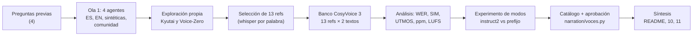

# Método, Alcance y Fuentes

> Investigación del 2026-11-17 (fecha de corte). Cómo se hizo la investigación sobre voces libres para clonar, qué se acordó con el usuario antes de empezar, qué se midió, qué quedó bloqueado y cómo leer las marcas de confianza. Índice en [README.md](README.md).

---

## 1. Parámetros Acordados con el Usuario

| Parámetro | Acuerdo |
| :--- | :--- |
| Pregunta | Cómo consigue y prepara la comunidad voces de calidad profesional para clonar, y dónde hay voces gratuitas y libres para uso comercial |
| Motor de referencia | **CosyVoice 3** (`cosyvoice3` en `narration/tts.py`), el motor estudiado en [voicestudio-narracion/06](../voicestudio-narracion/06-cosyvoice-3.md) |
| Fuentes a cubrir | **Datasets abiertos**, **voces sintéticas libres** y **prácticas de la comunidad**. Los locutores pagos quedaron fuera |
| Licencia aceptada | **Solo CC0 o dominio público**. CC-BY, CC-BY-SA, NC, ND, licencias propias y "solo investigación" se listan como descartadas, con su motivo |
| Idiomas | **Español latino neutro + inglés** |
| Entregable | Carpeta nueva con la estructura de `voicestudio-narracion` **más pruebas en GPU** con voces candidatas |
| Ampliación (mensaje posterior) | Con los resultados, mejorar `narration/tts.py` para elegir desde el CLI una **voz del catálogo aprobada en todos los estilos** ([11](11-catalogo-y-aplicacion.md)) |

---

## 2. Proceso

* La investigación de fuentes se delegó en **4 agentes** de búsqueda web en paralelo, uno por tema: datasets en español ([03](03-librivox-en-espanol.md)), datasets en inglés ([04](04-ingles-librivox-ljspeech-y-otros.md)), voces sintéticas ([06](06-voces-sinteticas-y-diseno-de-voz.md)) y prácticas de la comunidad ([08](08-practicas-de-la-comunidad.md)).
* Después se exploraron a mano las dos colecciones curadas que aparecieron: Kyutai `tts-voices` y Voice-Zero ([05](05-donaciones-cc0-kyutai-y-voice-zero.md)). Ahí estuvo el hallazgo principal: **voces en español donadas con consentimiento explícito y licencia CC0**.
* El banco de pruebas (`tmp/research-voces/`, fuera del repo) eligió el tramo de cada fuente, generó con CosyVoice 3 y midió todo. Detalle en [10](10-pruebas-en-gpu.md).

---

## 3. Marcas de Confianza

Son las mismas de [voicestudio-narracion/01](../voicestudio-narracion/01-metodo-y-fuentes.md#3-marcas-de-confianza).

| Marca | Significado |
| :--- | :--- |
| **(leída)** | La página, el archivo o el código se leyó completo |
| **(snippet)** | Solo se vio el extracto del buscador; puede estar desactualizado o fuera de contexto |
| **no verificado** | Afirmación plausible sin fuente leída ni medición |
| **conflicto** | Fuentes que se contradicen; se dan ambas |
| **medido** | Medido en esta máquina con el banco de pruebas ([10](10-pruebas-en-gpu.md)) |
| A / B / C | En comunidad: estudio con método / dato de proveedor o mantenedor / anécdota |

**Nada de esto es asesoría legal.** El capítulo [02](02-derechos-copyright-y-voz.md) es un insumo para decidir, no un dictamen.

---

## 4. Bloqueos y Limitaciones

| Bloqueo | Efecto | Mitigación |
| :--- | :--- | :--- |
| Reddit no se pudo abrir (`old.reddit.com` también falló) | Sin opiniones de r/LocalLLaMA ni r/TextToSpeech | Issues y discusiones de GitHub leídos con `gh api` ([08](08-practicas-de-la-comunidad.md)) |
| `forum.librivox.org` devolvió 401 y Mozilla Data Collective no cargó | La política de LibriVox sobre IA y las condiciones de Common Voice se vieron solo en extractos | Marcadas **(snippet)** |
| Project Gutenberg rechazó la descarga automática | Las transcripciones de las referencias de LibriVox no se cotejaron con el texto del libro | Se transcribieron con whisper `medium` y se validaron indirectamente: los clones dieron WER 0 ([10](10-pruebas-en-gpu.md)) |
| **Nadie escuchó los audios** | El acento (latino neutro o no) de cada lector no está verificado | El catálogo marca "acento por verificar" y el usuario decide al oído ([11](11-catalogo-y-aplicacion.md)) |
| Whisper `medium` devolvió vacío el clip de Voice-Zero de Cori Samuel | Sin transcripción automática | `large-v3-turbo` lo transcribió: era el aviso de LibriVox ([05](05-donaciones-cc0-kyutai-y-voice-zero.md)) |
| UTMOS está entrenado con inglés | Sus notas en español salen más bajas aunque la voz sea buena | Se compara solo dentro de cada idioma |
| WavLM-base-plus-sv tiene poco rango | La propia voz da 0.95–0.99 y la ajena más parecida hasta 0.95 | El umbral de aprobación se calibró con eso y se complementa con el oído ([10](10-pruebas-en-gpu.md) §4) |

---

## 5. Qué No Cubre

* Locutores pagos (Fiverr, Voices.com, Voice123): el usuario los dejó fuera.
* Fine-tuning de CosyVoice 3 con un dataset de un solo hablante: no hay receta oficial para español ([08](08-practicas-de-la-comunidad.md) §5).
* Verificación de hablante con un segundo modelo (ERes2Net, ECAPA). Solo se usó WavLM-base-plus-sv.
* Asesoría legal: el capítulo [02](02-derechos-copyright-y-voz.md) resume normas y casos, pero no reemplaza a un abogado.
