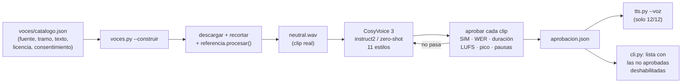

# Catálogo de Voces Libres y Aplicación a `narration/`

> Investigación del 2026-11-17. Cómo se tradujo la investigación en código: el catálogo `narration/voces/catalogo.json`, el constructor y aprobador `narration/voces.py`, el flag `--voz` de `tts.py` y su menú en `cli.py`. Qué voces entraron, con qué criterios y qué queda abierto. Índice en [README.md](README.md). Marcas: **medido**, **no verificado**.

---

## 1. Qué Pidió el Usuario

> "mejorar el script de generación de narración y haz que se pueda seleccionar por el cli la voz que debe ser una lista de voces que pasan la aprobación con todos los tonos (sensaciones o emociones) para que entren en la lista"

Traducido a requisitos:

| Requisito | Implementación |
| :--- | :--- |
| Elegir la voz desde el CLI | `tts.py --voz <nombre>`; `cli.py narration tts` la muestra en una lista con descripción |
| Solo voces **aprobadas** | `choices` = `voces.aprobadas(ESTILOS)`: el parser rechaza cualquier otra |
| Aprobadas en **todos los tonos** | Una voz entra solo si sus 12 estilos (`ESTILOS` de `tts.py`) pasan los criterios de §3 |
| Voces libres | Solo fuentes CC0 o de dominio público ([02](02-derechos-copyright-y-voz.md)–[05](05-donaciones-cc0-kyutai-y-voice-zero.md)) |

---

## 2. Piezas



| Archivo | Rol |
| :--- | :--- |
| [narration/voces/catalogo.json](../../../narration/voces/catalogo.json) | Única pieza versionada del catálogo. Por voz: `url`, `inicio_s`/`dur_s` (si es un tramo), `texto` exacto de la base, `idioma`, `licencia`, `descripcion`, `fuente`, `derechos` y `consentimiento` |
| [narration/voces.py](../../../narration/voces.py) | `--listar` y `--construir <voz…\|todas> [--forzar]`. Su parte de arriba es stdlib (la importan `tts.py` y `cli.py`); la construcción se relanza en el venv de CosyVoice con `tts.usar_venv(…, __file__)` |
| [narration/referencia.py](../../../narration/referencia.py) | `medir`, `loudness`, `procesar` y `verificar`, movidos desde `grabar.py` para que los dos scripts apliquen la misma normalización y los mismos criterios |
| `narration/voces/<voz>/` | `<estilo>.wav` + `.txt` y `aprobacion.json` (gitignoreado; se regenera desde el catálogo) |
| `narration/tts.py` | `--voz` (con `choices` = las voces aprobadas); comprueba que el idioma de la voz coincida con `--idioma`, usa la carpeta como `--ref` y **avisa si la voz no tiene consentimiento de su dueño** (karen-savage, mpinedag: regla 5 de `AGENTS.md`). También avisa de la nota "academic purposes" de CosyVoice 3 |
| `cli.py` | Comando `narration voces` (sin flags lista el catálogo); lista de voces en el asistente de `narration tts`; contador "voces libres N/8" en el menú |
| Robustez | `aprobacion.json` se escribe de forma atómica después de cada ronda; si la base se regenera, se descartan las aprobaciones anteriores; un estilo reprobado con su `.wav` en disco se vuelve a generar |

---

## 3. Criterios de Aprobación

| Criterio | Umbral | Por qué |
| :--- | :--- | :--- |
| Similitud con la base (WavLM-base-plus-sv) | **≥ 0.93** | `instruct2` dio 0.96–0.99 y zero-shot 0.95–0.99; `cross_lingual`, 0.71–0.91 (la voz se pierde). Las voces ajenas del banco llegan a 0.95, así que **detecta pérdidas, pero no prueba identidad** ([10](10-pruebas-en-gpu.md) §4) |
| WER (whisper `large-v3-turbo`, con `normalizar` y `comparar` de `tts.py`) | **≤ 0.15** | En el banco, el peor clon dio 0.10 |
| Duración | **5–15 s** | Los textos de `intima` y `susurro` salen en 5–7 s; CosyVoice rechaza más de 30 s |
| Loudness | −20 a −16 LUFS | Guía de grabación (`referencia.verificar`) |
| Pico real | ≤ −3 dBTP | Ídem |
| Pausas internas | Ninguna de 1 s o más | Ídem |
| Piso de ruido | No se exige en los clips generados | Empiezan en silencio digital; sí se mide en las grabaciones propias |

Si un clip no aprueba, se regenera con la semilla siguiente (1234, 1235, 1236). Tras 3 rondas, la voz queda **reprobada** y `estado()` dice en qué estilos.

**No se mide**: el acento, ni si el estilo suena a lo que dice. El experimento de [10](10-pruebas-en-gpu.md) §5 muestra que `instruct2` sí cambia la entrega en *triste*, *dramática* y *enérgica*, pero casi nada en *íntima* y *susurro*. Eso queda para el oído del usuario.

---

## 4. Cómo se Genera Cada Estilo

| Estilo | Texto | Llamada | Instrucción |
| :--- | :--- | :--- | :--- |
| `neutral` | El de la fuente | — (es el clip real, normalizado) | — |
| `amistosa` | Kit | `instruct2` | `Please speak in a friendly, warm and cheerful tone.` |
| `suave` | Kit | `instruct2` | `Please speak in a soft and gentle voice.` |
| `experta` | Kit | `instruct2` | `Please speak in a confident and professional tone.` |
| `clara` | Kit | `instruct2` | `Please speak slowly and clearly.` |
| `estable` | Kit | `instruct2` | `Please speak in a calm and steady tone.` |
| `energica` | Kit | `instruct2` | `Please speak in a cheerful and energetic tone.` |
| `dramatica` | Kit | `instruct2` | `Please speak in a dramatic, suspenseful storytelling tone.` |
| `triste` | Kit | `instruct2` | `Please speak in a sad and slow tone.` |
| `intima` | Kit | `instruct2` | `Please speak in a very soft voice.` |
| `susurro` | Kit | `instruct2` | `Please say it whispering.` |
| `neutral-en` | `voz/neutral-en.txt` | Zero-shot con la transcripción de la base | — (en una voz inglesa, copia de la base) |

"Kit" es `narration/voz/<estilo>.txt` para las voces en español y `TEXTO_EN` en `voces.py` para las inglesas (traducciones del mismo kit). Las instrucciones van en inglés porque en español CosyVoice las lee en voz alta ([voicestudio-narracion/10](../voicestudio-narracion/10-emociones-y-direccion.md) §2.3).

---

## 5. Voces del Catálogo

| Voz | Idioma | Licencia | Consentimiento para clonar | Por qué entró ([10](10-pruebas-en-gpu.md) §3) | Aprobación ([10](10-pruebas-en-gpu.md) §7) |
| :--- | :--- | :--- | :--- | :--- | :--- |
| `karen-savage` | es | Dominio público (LibriVox) | No | La mejor en español: UTMOS 3.78/3.66, SIM 0.993 | **12/12** |
| `mpinedag` | es | Dominio público (LibriVox) | No | Voz masculina grave; WER 0, SIM 0.985 | **12/12** |
| `yesid` | es | CC0 (Kyutai) | **Sí** | Donación masculina con consentimiento; frases completas | **12/12** |
| `andrea` | es | CC0 (Kyutai) | **Sí** | Donación femenina con consentimiento; UTMOS 3.17/3.38 | **12/12** |
| `cori-samuel` | en | Dominio público (LibriVox; CC0 en Archive.org) | No (pero dio consentimiento escrito a NVIDIA para Hi-Fi TTS) | La mejor del banco: UTMOS 4.47 | 3/12: `instruct2` pierde su voz |
| `john-van-stan` | en | Dominio público (LibriVox) | No (ídem, Hi-Fi TTS) | Masculina grave para storytelling; UTMOS 4.49 en historia | 10/12 |
| `hannah` | en | CC0 (Kyutai) | **Sí** | Femenina con consentimiento; rápida (~240 ppm) | **12/12** |
| `nick` | en | CC0 (Kyutai) | **Sí** | Masculina con consentimiento | 10/12 |

Quedaron fuera Epachuko (traducción con posibles derechos fuera de EE. UU.), John_Triguero (peor UTMOS), Maria Kasper (sin ventaja clara sobre Cori), el clip de Voice-Zero (es el aviso de LibriVox) y Piper `ald` (satura y tiene prosodia plana). **Quedan en `--voz` 5 voces**: las 4 en español y Hannah. Las 3 inglesas reprobadas siguen en el catálogo, deshabilitadas en el menú con el motivo, por si cambia el umbral o el método.

**Agregar una voz**: sumar una entrada a `catalogo.json` con URL, tramo y transcripción exacta (receta en [09](09-preparar-una-referencia.md)) y correr `python cli.py narration voces --construir <voz>`.

---

## 6. Uso

```bash
python cli.py narration voces --listar
python cli.py narration voces --construir todas
python cli.py narration tts --modelo cosyvoice3 --voz yesid --estilo triste --texto "..."
python cli.py narration tts --modelo voxcpm2 --voz hannah --idioma en --texto "..."
python cli.py narration tts                  # asistente: elige la voz en una lista
```

Las referencias del catálogo sirven con cualquier motor de `tts.py`, no solo con CosyVoice: son WAV de 48 kHz con su `.txt`. Pero fueron **generadas con CosyVoice 3**: con otro motor se clona un clon. Solo `neutral` es la grabación original.

---

## 7. Preguntas Abiertas

1. **Acento**: escuchar `narration/voces/<voz>/neutral.wav` de las 4 voces en español y decidir cuáles suenan latino neutro.
2. **Estilos que casi no cambian** (*íntima*, *susurro*): ¿alcanza, o conviene reemplazarlos por una instrucción distinta, por ejemplo "in a very soft voice, almost whispering"?
3. **Consentimiento de los lectores de LibriVox** para uso comercial: ¿escribirles, o limitar el uso comercial a las voces de Kyutai?
4. **Un segundo verificador de hablante** (ERes2Net, el que usa CosyVoice) daría un umbral más discriminante que WavLM-base-plus-sv.
