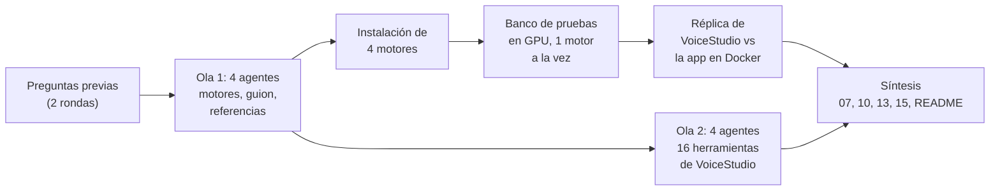

# Método, Alcance y Fuentes

> Investigación del 2026-11-15 (fecha de corte). Cómo se hizo la investigación, qué se acordó con el usuario antes de empezar, qué se midió, qué quedó bloqueado y cómo leer las marcas de confianza. Índice en [README.md](README.md).

---

## 1. Parámetros Acordados con el Usuario

| Parámetro | Acuerdo |
| :--- | :--- |
| Proyecto de referencia | [debpalash/VoiceStudio](https://github.com/debpalash/VoiceStudio) (app Electron, AGPL-3.0) |
| Integración | **Motores directos** como `--modelo` de `narration/tts.py`, cada uno en su venv. No se usa la app ni su API |
| Licencias | **Incluir también los no comerciales** (OmniVoice, IndexTTS 2.5), marcados como tales |
| Motores | OmniVoice, VoxCPM2, IndexTTS 2.5, CosyVoice 3. Solo español e inglés |
| Alcance de guion, prosodia y emoción | Motores elegidos **más** Qwen3-TTS y Chatterbox (ya en uso), para comparar |
| Pruebas | **Fuentes + pruebas en la GPU** (RTX 4060 Laptop, 8 GB, WSL2) |
| Orden | Investigar → preguntar → implementar. La implementación en `tts.py` no es parte de esta entrega |
| Usos | Demos y tutoriales, reels, storytelling dramático, publicidad |
| Ampliación (mensaje posterior) | Documentar **cada herramienta de VoiceStudio** por separado ([herramientas/](herramientas/README.md)) |
| Ampliación (mensaje posterior) | **Replicar VoiceStudio** y probar la réplica contra la app real ([14](14-replicacion-de-voicestudio.md)) |
| GPU | El daemon Laya de Synapse ocupaba ~7 GB: el usuario autorizó detenerlo durante las pruebas y volver a detenerlo si reaparecía (`logs/vigilante-laya.log`) |

---

## 2. Proceso

* Investigación de fuentes delegada en agentes de búsqueda web y lectura de código, en **olas de 4 como máximo** para no disparar límites de tasa.
* Fuente primaria para VoiceStudio: un clon local completo del repo (commit `80b4594`), leído en su código y su documentación.
* Pruebas: un banco propio (`tmp/research-vs/banco.py`, fuera del repo) que genera los mismos casos con cada motor, uno a la vez en la GPU, y un análisis con whisper `medium` (transcripción por palabra), F0 con `librosa.pyin`, palabras por segundo y pausas. Detalle en [13](13-pruebas-en-gpu.md).
* Réplica: script propio que reproduce el flujo de `POST /generate` de VoiceStudio llamando directo a OmniVoice, comparado contra la app real en Docker ([14](14-replicacion-de-voicestudio.md)).

---

## 3. Marcas de Confianza

| Marca | Significado |
| :--- | :--- |
| **(leída)** | La página, el archivo o el código se leyó completo |
| **(snippet)** | Solo se vio el extracto del buscador; puede estar desactualizado o fuera de contexto |
| **no verificado** | Afirmación plausible sin fuente leída ni medición |
| **conflicto** | Fuentes que se contradicen; se dan ambas |
| **medido** | Medido en esta máquina con el banco de pruebas ([13](13-pruebas-en-gpu.md)) o la réplica ([14](14-replicacion-de-voicestudio.md)) |
| A / B / C | En comunidad: estudio con método / dato de proveedor con muestra / anécdota |

Las cifras de benchmarks publicadas por los autores de cada modelo son **B**: cada tabla favorece a quien la publica.

---

## 4. Bloqueos y Limitaciones

| Bloqueo | Efecto | Mitigación |
| :--- | :--- | :--- |
| Reddit respondió 403 y el buscador no indexó hilos | Sin opiniones de r/LocalLLaMA ni r/TextToSpeech | Issues y discusiones de GitHub y Hugging Face ([12](12-recepcion-de-la-comunidad.md)) |
| Límite de la API de búsqueda de GitHub (30/min) | Algunos issues citados solo por título | Marcados **(snippet)** |
| Sin grabaciones del usuario | Todas las pruebas usan `narration/voz/prueba/experta.wav` (11.5 s, 198 ppm, pico −0.2 dBFS, piso −inf) | El acento y la similitud con la voz real quedan por validar ([README](README.md#preguntas-abiertas)) |
| `torch 2.15` da segfault en esta WSL | Los venvs nuevos no arrancaban | Fijar `torch==2.14.1` ([03](03-omnivoice.md) §2) |
| IndexTTS con el Qwen de emoción desborda los 8 GB | 16× más lento | Cargarlo solo cuando se usa `emo_text` ([05](05-indextts-2-5.md)) |
| Whisper normaliza tildes y números | El WER no detecta homógrafos ni distingue "25" de "veinticinco" | Esos casos se marcan para escucha ([13](13-pruebas-en-gpu.md) §6) |
| Juicio de emoción | Las métricas (F0, duración) no dicen si una emoción "suena" bien | Lista de audios para que el usuario escuche |

---

## 5. Qué No Cubre

* La implementación en `narration/tts.py`: va después de las [preguntas abiertas](README.md#preguntas-abiertas).
* Motores de VoiceStudio fuera de los cuatro elegidos (MOSS, dots.tts, Ming, Confucius4, PocketTTS…).
* Asesoría legal sobre licencias: [07](07-comparativa-y-licencias.md) es un insumo, no un dictamen.
* Similitud de hablante con un modelo de verificación (ECAPA, WavLM): no se midió.
