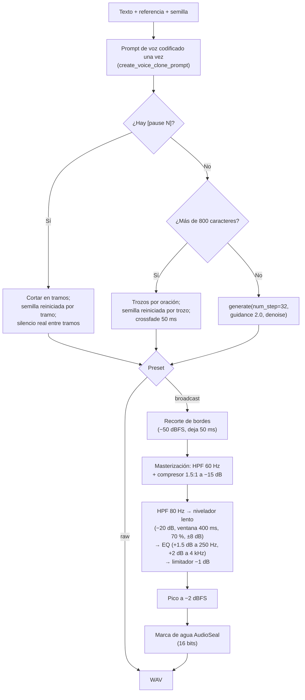

# Replicación de VoiceStudio: Prueba contra la App Real

> Investigación del 2026-11-15. Cómo se replicó el flujo de `POST /generate` de VoiceStudio llamando directo a OmniVoice, y cómo se verificó contra la app real corriendo en Docker con la misma GPU, referencia, textos y semillas. Índice en [README.md](README.md). Marcas: **(leída)**, **medido**, **no verificado**.

---

## 1. Resultado

**La réplica reproduce el flujo de VoiceStudio.** Con los mismos textos, referencia, semilla y parámetros:

| Qué se compara | Resultado **medido** | Veredicto |
| :--- | :--- | :--- |
| Duración de cada toma en `raw` | Idéntica (±0.01 s) en los 14 pares sin pausa | Replicado |
| Recorte de bordes del preset `broadcast` | Misma duración (±0.03 s) en 13 de 14 pares; en `c_drama` s2, 2.73 s vs 2.24 s porque la cola de la toma quedó cerca del umbral de −50 dBFS y el recorte cortó en otro punto | Replicado (sensible al umbral) |
| Pausa `[pause 800ms]` | Silencio idéntico: 1.02 s en `raw`, 0.83 s en `broadcast` | Replicado |
| Pico final | −2.0 dBFS en la réplica; −2.0 ± 0.2 en VoiceStudio (la marca de agua se aplica después de normalizar) | Replicado |
| Loudness integrada | Diferencia ≤ 1 LU en 30 de 32 pares; máx. 2.1 LU | Replicado (salvo variación del modelo) |
| Forma de onda con la misma semilla | Correlación 0.13–0.46, **3–8× mayor** que entre dos semillas distintas del mismo lado (0.03–0.13); distancia log-mel menor | Semilla replicada de forma aproximada, no bit a bit |
| Bugs del modelo | La omisión tras `…` ("La puerta se abrió despacio. ¡Nadie!") aparece **igual en VoiceStudio y en la réplica**, en las 2 semillas | Replicado (el bug es de OmniVoice, no del flujo) |
| Tiempo por toma | Mediana 1.59 s (VoiceStudio) vs 1.65 s (réplica) | Equivalente |

**Por qué no es bit a bit:** VoiceStudio compila el modelo con `torch.compile(mode='reduce-overhead')` y CUDA graphs (log del contenedor: "torch.compile applied (mode='reduce-overhead')"); la réplica corre sin compilar. Los kernels distintos cambian el redondeo en fp16 y, a partir de ahí, el muestreo de posiciones (`position_temperature=5.0`) diverge. La primera petición a VoiceStudio tardó 288 s por esa compilación.

---

## 2. El Flujo de `POST /generate` (OmniVoice)

Leído en `backend/api/routers/generation.py` y `backend/services/audio_dsp.py` del commit `80b4594`; la imagen Docker probada es del commit `c1050c1` (backend 0.5.8) **(leída)**.

| Etapa | Valor | Archivo |
| :--- | :--- | :--- |
| Semilla | `torch.manual_seed(seed)` y de nuevo antes de cada tramo o trozo (#3730) | `generation.py` `_run_inference` |
| `num_step` | 32 si no se envía ("best quality") | `audio-quality.md` |
| Troceo | `max_chunk_chars=800`, `crossfade_ms=50` | `generation.py` (Form) |
| `[pause]` | 350 ms por defecto; tramos recortados solo si el preset no es `raw` | `_render_with_pauses` |
| Preset por defecto | `broadcast` | Form `effect_preset` |
| Normalización | Pico −2 dBFS; no amplifica señales bajo −50 dBFS | `normalize_audio` |
| Marca de agua | AudioSeal activa por defecto | `services/watermark.py` |

---

## 3. Cómo se Probó

1. **VoiceStudio real**: imagen `ghcr.io/debpalash/voicestudio:stable` (17.8 GB) con `--gpus all`, enlazada solo a `127.0.0.1:3900`, con una API key generada en memoria (nunca escrita en disco).
2. **Licencias**: `/generate` respondió **403 `model_licence_required`** hasta aceptar las licencias de `k2-fsa/OmniVoice` (CC-BY-NC; Higgs Audio 2; Meta Llama 3) y `eustlb/higgs-audio-v2-tokenizer` (NOASSERTION) con `POST /models/licenses/accept`. El usuario lo autorizó solo para esta prueba; el contenedor y su volumen se borraron al terminar.
3. **8 textos × 2 semillas × 2 presets** (`raw`, `broadcast`) = 32 tomas por lado: frase base, pregunta, enumeración, drama con `…`, anuncio, tutorial, `[laughter]` y `[pause 800ms]`.
4. **Réplica local** (`tmp/research-vs/replica_vs.py`): el mismo flujo de §2 llamando directo a OmniVoice en `.venv-omnivoice`. La cadena DSP se reimplementó a partir del comportamiento documentado, con `pedalboard` para los filtros y numpy para el nivelador y el limitador. **No se copió código de VoiceStudio** (AGPL).
5. **Comparación** (`comparar_replica.py`, `diagnostico_replica.py`): duración, correlación máxima de onda (±50 ms), LUFS (pyloudnorm), pico, centroide espectral, distancia log-mel con DTW y transcripción con whisper `medium`.

---

## 4. Diferencias y Lo Que Revelan

| Diferencia | Explicación | Consecuencia |
| :--- | :--- | :--- |
| `p_pausa` (s1): VoiceStudio 4.56 s, réplica 3.25 s | El tramo corto antes de la pausa ("Espera un momento.") **se perdió** en la réplica (2 de 2) y en VoiceStudio (1 de 2) | OmniVoice no es fiable con tramos muy cortos: VoiceStudio también falla. En `tts.py` conviene no aislar frases de 3 palabras entre pausas, o regenerar con `--evaluar` |
| Centroide espectral distinto en `c_drama` y `p_pausa` | Mismo motivo: contenido distinto | — |
| Pico −2.0 exacto vs ±0.2 | AudioSeal modifica el audio después de normalizar | Una marca de agua posterior cambia el pico: medir el pico **después** de marcar |
| Correlación de onda < 0.5 | `torch.compile` + fp16 vs ejecución sin compilar | Para repetir una toma exacta hay que usar el mismo modo de ejecución, no solo la semilla |

---

## 5. Conclusiones para social-videos

* **El "trabajo" de VoiceStudio en `/generate` es reproducible con unas 150 líneas propias**: prompt cacheado, semilla por tramo, pausas reales, troceo y una cadena de masterización. `tts.py` ya tiene la mitad (pausas, troceo, recorte); faltan la semilla por bloque y la masterización ([15](15-aplicacion-social-videos.md)).
* **La calidad no sale de la app, sale del motor**: los defectos de OmniVoice (omisiones, tramos cortos perdidos) aparecen igual en VoiceStudio. Elegir el motor importa más que replicar la app.
* **El preset `broadcast` es útil**: deja el pico en −2 dBFS y la loudness en −17 a −21 LUFS sin aplanar las sílabas. Para redes conviene además normalizar a −14/−16 LUFS al mezclar con música.

Archivos de la prueba: `out/narration/research-voicestudio/replica/{vs,local}/{raw,broadcast}/`, tabla completa en `out/narration/research-voicestudio/replica-comparacion.md` (fuera del repo).
