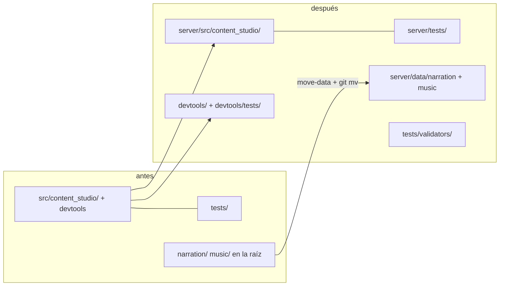

# 001: contexto y decisión

> **Decisiones y pendientes al ejecutar**: quien implemente esta spec puede tomar **todas las decisiones técnicas** que necesite, sin detenerse a pedir confirmación. Cada una queda en [`docs/process/WARNING/`](../../../process/WARNING/README.md); toda revisión pendiente, en [`docs/process/PENDING/`](../../../process/PENDING/README.md).
>
> **Datos del usuario: solo los que crea esta spec**. No borra ni sobrescribe voces grabadas, voces construidas, salidas de `out/` ni modelos que no creó; si algo parece exigirlo, es un `blocked — user-data`. Excepción pedida por el usuario: `move-data` **mueve** `narration/` y `music/` a `server/data/` (§3 D-2).

## 1. Precondición

Ninguna: es la primera spec del lote. Antes del primer commit, `git fetch origin dev` y comprueba que `git ls-files src/content_studio | wc -l` coincida con lo explorado (unos 77 `.py`).

## 2. Contexto

Explorado en `dev` (`dd82e92`):

* Hay código en `src/content_studio/` (incluidos los devtools), tests planos en `tests/` y `cli.py` en la raíz. `pyproject.toml` usa `pythonpath = ["src"]`, `testpaths = ["src", "tests"]` y hatch con `packages = ["src/content_studio"]`.
* `rutas.py` calcula `RAIZ = Path(__file__).parents[2]` y de ahí `NARRATION = RAIZ / 'narration'`, `MUSIC = RAIZ / 'music'`, `OUT` y `LOGS`.
* Los devtools dependen del paquete solo a través de `content_studio.rutas` (`worktree.py`, `turno_gpu.py`) y de `devtools.worktree.principal`.
* 33 archivos versionados nombran `content_studio.devtools` y 31 nombran `src/` o `PYTHONPATH=src`: reglas y skills de `.agents/` y `.claude/`, hooks (`session_start.py`, `graphify_guard.py`, `handoff_text.py`), `.git-hooks/pre-commit`, `AGENTS.md`, los README de `narration/` y `music/`, `docs/process/01-done/` y los tests.
* Los venvs de los motores tienen el Python base fuera del repo (`home =` Miniconda o uv), así que moverlos no los rompe. Las únicas rutas absolutas al repo están en tres instalaciones editables: `music/.venv-acestep` (`_editable_impl_ace_step.pth` y `direct_url.json` de `ace_step` y `nano_vllm`), `music/.venv-heartmula` (`__editable__.heartlib-0.1.0.pth`) y `narration/motores/index-tts/.venv` (`_editable_impl_indextts.pth`).
* `.gitignore` ignora `narration/voz/**/*.wav`, `narration/voces/*` (salvo `catalogo.json`), `narration/motores` y patrones sin `/` final (`.venv-*`, `models`) para los enlaces de `worktree prepare`.
* `worktree prepare` enlaza venvs, motores, modelos y voces desde `RAIZ/narration` y `RAIZ/music` del principal.

## 3. Solución

Cada decisión pasó la escalera de `plan-format.md` §0:

* **D-1: uv workspace en la raíz con un solo miembro (`server`)**. El `pyproject.toml` de la raíz es virtual (`[tool.uv.workspace] members = ["server"]`) y guarda ruff, pytest (`pythonpath = ["server/src", "."]`, con `testpaths` hacia `server/`, `devtools/`, `.agents/hooks/`, `.claude/hooks/` y `tests/`) y el grupo `dev`. `server/pyproject.toml` es el paquete `content-studio` (hatch, `packages = ["src/content_studio"]`, las mismas dependencias). Queda un solo `uv.lock` en la raíz, y `uv run pytest` y `uv run ruff` siguen sin cambios. Se descartaron dos alternativas: los proyectos independientes, porque duplican lock y venv y cambian todos los comandos de reglas, hooks y CI, y que devtools sea miembro, porque es solo stdlib y no tiene dependencias que declarar.
* **D-2: `python -m devtools move-data`**. Mueve `narration/` y `music/` del principal a `server/data/` con `os.replace` (es el mismo disco: un rename atómico que no copia GB). Después reescribe, en los `.pth` y `direct_url.json` de las instalaciones editables, el prefijo `<raíz>/narration|music` por `<raíz>/server/data/narration|music`. Por defecto actúa sobre el checkout principal (`worktree.principal()`), y `--root` permite otra raíz, como `tmp_path` en los tests. Sin `--apply` solo imprime el plan en JSON. Sale con exit 1 si el destino ya existe y no está vacío, y nunca sobrescribe. Es idempotente: si el origen no existe y el destino sí, sale con exit 0 y dice «ya migrado». Lo versionado (README, guiones, `catalogo.json`, los `.txt` de `voz/`) lo mueve git en el commit (`git mv`). `move-data` solo mueve lo que no está en git. Se descartó recrear los venvs porque son GB de descarga sin necesidad: el `home` de cada uno queda fuera del repo.
* **D-3: `devtools/` en la raíz como paquete stdlib** (`devtools/__init__.py`, `__main__.py` con `COMANDOS`, un módulo por comando y `devtools/tests/`). Calcula su propia raíz (`Path(__file__).parents[1]`) y ya no importa `content_studio`. Se invoca con `python -m devtools <comando>` desde la raíz del checkout. Los nombres de módulos y comandos nuevos ya van en inglés (`move_data.py`); los existentes los renombra la 002.
* **D-4: `rutas.py`** pasa a `RAIZ = parents[3]`, con `SERVER = RAIZ / 'server'`, `DATA = SERVER / 'data'`, `NARRATION = DATA / 'narration'` y `MUSIC = DATA / 'music'`. `OUT`, `LOGS` y `TMP` siguen en la raíz. Ningún otro módulo arma rutas por su cuenta (`graphify query "RAIZ"` para comprobarlo).
* **D-5: tests junto a lo que prueban**, como en klinikae: `server/tests/` (todos los del producto y sus fixtures), `devtools/tests/test_devtools.py`, `.agents/hooks/tests/test_handoff.py`, `.claude/hooks/tests/test_hooks.py` y `tests/validators/test_estructura.py`, que valida la estructura de todo el repo. El espejo `unit/src/` llega con la 003.
* **D-6: `cli.py` se queda como shim** en la raíz, pero agrega `server/src` al `sys.path` y su cabecera PEP 723 no cambia. La 004 lo borra.
* **D-7: los patrones de `.gitignore` se mudan con los datos** (`server/data/narration/voz/**/*.wav`, etc.). `.venv-*` y `models` siguen sin `/` final. `worktree prepare` y `close` enlazan y quitan los enlaces de `server/data/...`.
* **D-8: las reglas, skills, hooks, `AGENTS.md`, los README y la CI se actualizan en esta spec** (decisión del lote): ninguna ruta vieja sobrevive. Lo comprueba un test (AC-7). Las copias de `.claude/` se regeneran con `python -m devtools reglas --sincronizar`. graphify pasa a indexar `server/`, `devtools/` y `cli.py`.

## 4. Fuera de alcance

* Renombrar el código o los datos a inglés, y cspell: los hace la 002.
* Los tests espejo (`unit/src/`), el test-runner y el validador de tamaño: los hace la 003.
* Borrar `cli.py`, el menú o el asistente, y FastAPI y SQLite: los hace la 004.
* La carpeta de datos elegible de la app instalada (`%LOCALAPPDATA%`): la hacen la 009 y la 015. `out/`, `logs/` y `tmp/` no se mueven.
* Cambiar cualquier comportamiento de narración, música, voces o grabar.

## 5. Criterios de aceptación

* **AC-1**: WHEN se corre `uv run pytest` en la raíz THEN recolecta los tests de `server/`, `devtools/`, los dos `hooks/tests/` y `tests/validators/`, y pasan todos, con la misma cantidad de tests que en `dd82e92`. Lo verifica: comparar el `-q --co | tail -1` de antes y de después.
* **AC-2**: WHEN `tests/validators/test_estructura.py` recorre lo versionado THEN no hay `src/` en la raíz, todo `.py` del producto está en `server/src/content_studio/`, los de devtools en `devtools/`, el único `.py` de la raíz es `cli.py` y no hay `.py` sueltos en `server/data/`. Lo verifica: ese test.
* **AC-3**: WHEN se corre `python -m devtools --help` desde la raíz THEN lista `worktree`, `turno-gpu`, `contexto-agentes`, `reglas` y `move-data` con exit 0, y `python -m content_studio.devtools` ya no existe. Lo verifica: `devtools/tests/test_devtools.py::test_ac3_help_lista_comandos` y una corrida manual.
* **AC-4**: Given un árbol falso en `tmp_path` con `narration/`, `music/` y un `.pth` que apunta a `<raíz>/music/models/heartlib` When se corre `move-data --apply` Then las carpetas quedan en `server/data/`, el `.pth` apunta a `<raíz>/server/data/music/models/heartlib` y no queda nada en el origen. Una segunda corrida sale con exit 0 («ya migrado»). Si el destino tiene archivos, sale con exit 1 sin mover nada, y sin `--apply` no toca el disco. Lo verifica: `devtools/tests/test_move_data.py`.
* **AC-5**: WHEN, después de la migración real en el principal, se corre `uv run pytest -m local` THEN cada venv importa su librería, editables incluidas. Lo verifica: `server/tests/test_venvs.py` (verificación final).
* **AC-6**: WHEN se corren `python cli.py narration tts --help`, `python cli.py music --help` y una narración y una música cortas THEN funcionan igual que antes y las salidas quedan en `out/<herramienta>/spec-001/`. Lo verifica: la corrida real con `turno-gpu run` y la duración de cada salida (verificación final).
* **AC-7**: WHEN se busca en lo versionado (sin contar `docs/research/`, `docs/specs/` ni el historial) THEN no aparecen `src/content_studio`, `PYTHONPATH=src`, `content_studio.devtools` ni `narration/.venv` o `music/models` fuera de `server/data/`. Lo verifica: `tests/validators/test_estructura.py::test_ac7_sin_rutas_viejas`.
* **AC-8**: Given un worktree nuevo When se corre `python -m devtools worktree prepare <nombre>` Then enlaza `server/data/narration/.venv-*`, `server/data/narration/motores`, `server/data/music/.venv-*` y `server/data/music/models` del principal, y `worktree close` los quita antes del `git worktree remove`. Lo verifica: `devtools/tests/test_devtools.py` (los casos de prepare y close, con las rutas nuevas).
* **AC-9**: WHEN se corren `python -m devtools contexto-agentes` y `python -m devtools reglas` THEN los dos salen con exit 0. Lo verifica: la batería final.

## 6. Diagrama antes y después

