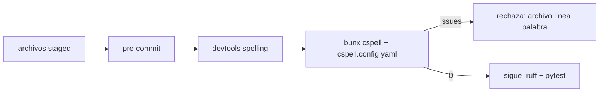

# 002: contexto y decisión

> **Decisiones y pendientes al ejecutar**: quien implemente esta spec puede tomar **todas las decisiones técnicas** que necesite, sin detenerse a pedir confirmación. Cada una queda en [`docs/process/WARNING/`](../../../process/WARNING/README.md); toda revisión pendiente, en [`docs/process/PENDING/`](../../../process/PENDING/README.md).
>
> **Datos del usuario: solo los que crea esta spec**. No borra ni sobrescribe voces grabadas, voces construidas, salidas de `out/` ni modelos que no creó; si algo parece exigirlo, es un `blocked — user-data`. Excepción pedida: `move-data` renombra datos a inglés (D-4).

## 1. Precondición

La 001 está fusionada: `git show origin/dev:devtools/move_data.py` existe y `git show origin/dev:server/src/content_studio/rutas.py | grep "DATA ="` coincide.

## 2. Contexto

* Todo el código está en español: módulos (`comun/`, `proceso.py`, `musica.py`, `estilos.py`, `motores/`, `registro.py`), clases (`EspecMotor`, `MotorTTS`, `EspecMusica`), constantes (`RAIZ`, `ESTILOS`, `EMOCIONES`, `MOTORES`, `MODELOS`), claves de datos (`velocidad`) y tests (`test_ac3_help_lista_comandos`).
* Los estilos de narración (`server/src/content_studio/narration/estilos.py`) son `amistosa`, `suave`, `experta`, `clara`, `estable`, `neutral`, `energica`, `dramatica`, `triste`, `intima`, `susurro` y `neutral-en`, más `neutral-fin` en `voz/`. Las emociones son `alegre`, `triste`, `enojado`, `miedo`, `sorpresa`, `calma`, `urgente` y `susurro`. Las grabaciones del usuario se llaman como el estilo: `voz/<estilo>.wav` y `.txt`.
* Los flags son `--archivo --bpm --carpeta --compas --construir --dispositivo --duracion --estilo --forzar --listar --lote --lufs --modelo --ref --semilla --sin-lm --sobrescribir --texto --todos --tono`, además de `--voz` y `--salida`.
* El guion acepta `[pausa N]` y JSON con `"texto"` (`server/data/narration/docs/formato-guion.md`).
* En klinikae (`cspell.config.yaml`), cspell corre en inglés, sin distinguir mayúsculas y con `minWordLength: 4`. Ignora `docs/**`, `.claude/**`, `.agents/**` y `**/*.md`. Permite español en comentarios y docstrings (`hash-comment`, `python-docstring` y los de C y TS) y en los catálogos (`language: en,es` y `catalog-value`). Los tests pueden tener strings en español (`string-literal`). Tiene un diccionario propio, `devtools/cspell/klinikae-terms.txt`, que dice «NEVER add a Spanish word here».
* Están instalados node 24.19, npm 11.17 y bun 1.4.2.

## 3. Solución

* **D-1: `cspell.config.yaml` en la raíz**, adaptado del de klinikae. Se conservan las mismas `patterns` y `overrides` para `.py`, `.ts/.tsx/.js/.css`, `.yml/.toml/.sh/.git-hooks/*` y los tests (`string-literal`). Se ignoran `docs/**`, `.claude/**`, `.agents/**`, `**/*.md`, los lock, `graphify-out/**`, `tmp/**`, `out/**`, `logs/**`, `server/data/**` salvo lo que el código lee como datos (D-4), y los binarios. Se agrega un override `language: en,es` para `server/data/narration/docs/scripts/**` y `server/data/narration/reference/*.txt`, porque son textos para leer en voz alta, y para `**/messages/*.json` y `server/src/content_studio/messages/*.json`, que llegan con la 004 y la 005. Se quitan los overrides propios de klinikae (Django, Go, emails, lambdas y videos). El diccionario propio va en `devtools/cspell/content-studio-terms.txt`, con nombres de motores, modelos y voces (`qwen`, `chatterbox`, `cosyvoice`, `voxcpm`, `omnivoice`, `indextts`, `acestep`, `heartmula`, `yesid`…) y términos de audio (`lufs`, `ebur`, `cfg`). La misma advertencia: nunca una palabra en español.
* **D-2: bun en la raíz**: `package.json` privado con `workspaces: []`, que se llena en la 005 con `client` y `tests/e2e`. devDependencies: `cspell` y `@cspell/dict-es-es`, con `bun.lock` versionado. `python -m devtools spelling [--staged]` corre `bunx cspell --no-progress --config cspell.config.yaml` sobre lo versionado o lo staged, con el stdout en JSON (`{"issues": n}`) y exit 1 si hay palabras desconocidas. El pre-commit lo llama si hay archivos staged, y la CI suma `oven-sh/setup-bun`, `bun install --frozen-lockfile` y el paso de spelling. Se descartó correr cspell solo con `npx` sin lock porque la versión no quedaría fijada. Se descartó un spell checker en Python porque el diccionario es-es y los patrones de klinikae son de cspell.
* **D-3: exclusiones temporales**: `server/src/content_studio/cli/**`, salvo `cli/commands/`, que se traduce porque arma los parsers, y `server/src/content_studio/narration/grabar/**`. Van en `ignorePaths` con el comentario `# Temporary: removed by spec 004 / 007`. Solo se tocan para que sigan funcionando con los nombres nuevos (imports y flags). La ficha PENDING `002-cspell-excepciones-temporales.md` la cierra la spec que borra cada carpeta.
* **D-4: datos en inglés con `move-data`**. `devtools/move_data.py` pasa a tener una lista ordenada `MIGRATIONS` de pasos `(origen, destino)`, cada uno idempotente, con la reescritura de `.pth` y `direct_url.json` que ya existe. El paso 1 es el de la 001 y el paso 2 hace los renombres:

  | Antes (`server/data/…`) | Después |
  | :--- | :--- |
  | `narration/voz/` | `narration/reference/` |
  | `narration/voz/tomas/` | `narration/reference/takes/` |
  | `narration/voz/<estilo>.{wav,txt}` | `narration/reference/<style>.{wav,txt}`, según la tabla de estilos |
  | `narration/voces/`, `voces/catalogo.json` | `narration/voices/`, `voices/catalog.json` |
  | `narration/motores/` | `narration/engines/` (las editables de index-tts se reescriben) |
  | `narration/docs/guiones/` | `narration/docs/scripts/` |

  Estilos: `amistosa→friendly`, `suave→soft`, `experta→expert`, `clara→clear`, `estable→steady`, `neutral→neutral`, `energica→energetic`, `dramatica→dramatic`, `triste→sad`, `intima→intimate`, `susurro→whisper`, `neutral-en→neutral-en`, `neutral-fin→neutral-end`. Emociones: `alegre→happy`, `triste→sad`, `enojado→angry`, `miedo→fear`, `sorpresa→surprise`, `calma→calm`, `urgente→urgent`, `susurro→whisper`. Las claves de `catalog.json` también pasan a inglés, con sus valores sin cambios. Los **presets de música** (`music/styles.py`) también pasan a inglés en kebab-case (`lofi-lluvia→lofi-rain`, `anuncio-*→ad-*`, `cinematico→cinematic`, `documental→documentary`, `acustico→acoustic`, `suspenso→suspense`, etc.), junto con las claves internas (`tono→key`, `compas→time_signature`). El caption y los tags ya están en inglés y no cambian. La tabla completa va a la ficha WARNING. `music/ESTILOS.md` se actualiza con los nombres nuevos y conserva su nombre de archivo. Los nombres de voces son nombres propios y no cambian. Los `.md` de datos (`README.md`, `ESTILOS.md`, `INVESTIGACION.md`, `formato-guion.md`) conservan su nombre porque son docs en español. Lo versionado lo mueve `git mv` en el commit y lo no versionado lo mueve `move-data --apply`. Las etiquetas visibles en español de estilos y emociones llegan con el catálogo de la 004. Mientras tanto, `--help` muestra la clave en inglés y una descripción en un docstring o comentario si hace falta.
* **D-5: alias del guion**. El parser del guion acepta `[pause N]` y `[pausa N]`, y `"text"` y `"texto"`. Los alias viven en `server/src/content_studio/narration/script_aliases.json` (`{"pause": ["pausa"], "text": ["texto"]}`), que cspell revisa con `language: en,es`, así que no son identificadores. `formato-guion.md` documenta la forma canónica y avisa que los alias existen.
* **D-6: flags en inglés**: `--file --bpm --folder --time-signature --build --device --duration --style --force --list --batch --lufs --model --ref --seed --no-lm --overwrite --text --all --key --voice --output`. No quedan alias de los flags viejos: el CLI es interno y la 004 lo reemplaza. Se actualizan `AGENTS.md`, los README de datos, las reglas (`verify-before-claiming-done.md`, `turno-gpu.md`, `command-output.md`) y `docs/process/01-done/`.
* **D-7: traducción por paquete**, siempre con `git mv` para conservar el historial: `comun→common` (`proceso→process`, `archivos→files`), `rutas→paths` (`RAIZ→ROOT`, `VOZ→REFERENCE`, `VOCES→VOICES`, `TOMAS→TAKES`), `narration/motores→engines` (`EspecMotor→EngineSpec`, `MotorTTS→TTSEngine`, `registro→registry`, `MOTORES→ENGINES`), `music/musica→music_main`, `estilos→styles`, `MODELOS→MODELS`, `EspecMusica→MusicSpec`, `MotorMusica→MusicEngine`, y `devtools` (`turno_gpu→gpu_turn` con el comando `gpu-turn`, `contexto_agentes→agent_context` con `agent-context`, `reglas→rules`). Los nombres finales los decide quien implementa y van a la ficha WARNING con la tabla completa. Los tests se renombran (`test_<area>.py`, `test_ac<N>_<case>`).
* **D-8: la regla `textos-e-idioma.md` se reescribe**: el código va en inglés, el español queda en docstrings, comentarios, docs y catálogos, y lo valida cspell. `codigo-python.md` (nombres), `devtools.md` (comandos nuevos) y `graphify.md` (el vocabulario de las consultas ahora es inglés) se actualizan en la misma spec, y después se corre `python -m devtools rules --sync`.

## 4. Fuera de alcance

* El catálogo de mensajes en español y las etiquetas visibles: los hace la 004. Mientras tanto, los mensajes del CLI y los logs quedan en inglés y la UI todavía no existe.
* Traducir `cli/` (salvo `commands/`) y `grabar/`: los borran la 004 y la 007.
* Traducir docs, reglas, specs, README y docstrings: siguen en español, por decisión del lote.
* El test-runner unificado: lo hace la 003. En esta spec, `spelling` es un comando suelto de devtools.

## 5. Criterios de aceptación

* **AC-1**: WHEN se corre `python -m devtools spelling` sobre todo lo versionado THEN sale con exit 0 y `{"issues": 0}`. Lo verifica: la batería final y un test de devtools con un `.py` de fixture.
* **AC-2**: Given un `.py` temporal con `def calcular_duracion(): """Calcula la duración."""` When se corre `spelling` sobre ese archivo Then informa `calcular` y `duracion`, pero no las palabras del docstring. Con un comentario `# pausa larga` no informa nada. Lo verifica: `devtools/tests/test_spelling.py`.
* **AC-3**: WHEN se hace un commit con un identificador en español staged THEN el pre-commit lo rechaza y nombra el archivo, la línea y la palabra. Lo verifica: un test en `.claude/hooks/tests/` o `devtools/tests/` que corre el gate sobre un repo temporal, y la validación manual.
* **AC-4**: Given datos con los nombres de la 001 When se corre `move-data --apply` Then quedan los nombres de D-4, cada `.wav` y `.txt` de estilo se renombró según la tabla, no se perdió ningún archivo (misma cantidad y mismos bytes) y una segunda corrida no hace nada. Lo verifica: `devtools/tests/test_move_data.py` (paso 2) y el conteo real en la verificación final.
* **AC-5**: WHEN se narra un guion que usa `[pausa 1]` y otro con `[pause 1]` THEN los bloques resultantes son idénticos, y lo mismo pasa con `"texto"` y `"text"` en JSON. Lo verifica: `server/tests/test_script.py::test_ac5_alias_pause_text`.
* **AC-6**: WHEN se corren `python cli.py narration tts --help` y `python cli.py music --help` THEN muestran solo flags en inglés, y `--modelo` falla con exit 2. Lo verifica: `server/tests/test_cli.py` y la corrida manual.
* **AC-7**: WHEN se corre `uv run pytest`, incluidas las fixtures de caracterización THEN todo pasa. Las fixtures que cambian solo por las claves en inglés se regeneran en un commit aparte (`tests/fixtures/generar.py` renombrado), y el diff muestra que solo cambian los nombres, no los valores. Lo verifica: la batería y la revisión del diff.
* **AC-8**: WHEN, después de la migración, se corren una narración con `--style expert --voice yesid` y una música con `--style lofi-chill --duration 15` THEN se generan igual que antes (duración, LUFS en rango), y `uv run pytest -m local` pasa. Lo verifica: la verificación final.
* **AC-9**: WHEN se corren `python -m devtools agent-context` y `python -m devtools rules` THEN los dos salen con exit 0, y `textos-e-idioma.md` describe la regla nueva. Lo verifica: la batería.

## 6. Diagrama

## 7. Debe sonar / no debe sonar

| Salida | Debe | No debe |
| :--- | :--- | :--- |
| `out/narration/spec-002/*.wav` (`--style expert`) | Igual que antes del renombre: misma voz y duración comparable | Fallar al encontrar la referencia (`reference/expert.wav`) |
| `out/music/spec-002/*.wav` (`--duration 15`) | 15 s ± 0,5 s, con LUFS en el rango del README | Voz ni silencios |
