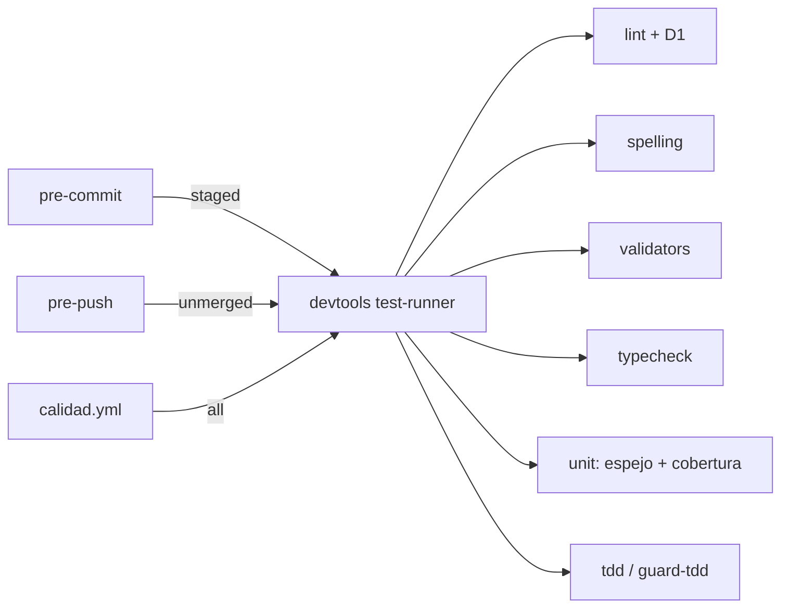

# 003: contexto y decisión

> **Decisiones y pendientes al ejecutar**: quien implemente esta spec puede tomar **todas las decisiones técnicas** que necesite, sin detenerse a pedir confirmación. Cada una queda en [`docs/process/WARNING/`](../../../process/WARNING/README.md); toda revisión pendiente, en [`docs/process/PENDING/`](../../../process/PENDING/README.md).
>
> **Datos del usuario: solo los que crea esta spec**. No borra ni sobrescribe voces grabadas, voces construidas, salidas de `out/` ni modelos que no creó; si algo parece exigirlo, es un `blocked — user-data`.

## 1. Precondición

La 002 está fusionada: `git show origin/dev:cspell.config.yaml` existe y `git show origin/dev:devtools/spelling.py` también.

## 2. Contexto

* Después de la 002: `server/tests/` es plano (CLI, asistente, registro, bugs, caracterización, venvs y script, más las fixtures). También existen `devtools/tests/`, `.agents/hooks/tests/`, `.claude/hooks/tests/` y `tests/validators/test_structure.py`, que hoy valida el límite de 300 líneas en `.py`.
* `.git-hooks/pre-commit` corre ruff, pytest, `spelling`, `agent-context` y `rules` cada uno por su lado. `pre-push` rechaza los tests en `tests/tdd/`. `calidad.yml` corre ruff, pytest y spelling.
* klinikae (`devtools/test-runner/`) tiene los tipos `lint`, `spelling`, `validators`, `typecheck`, `unit` (espejo, huérfanos y cobertura ≥ 80 % por archivo), `tdd`, `guard-tdd`, `e2e`, `budget` y `all`, con los modos `--git-mode=changed|staged|unstaged|unmerged|all` y `--files`. Sus límites de tamaño están en `tests/validators/file-size.json` (por categoría: lines, bytes, lineLength) y lo que ya se pasaba en `file-size.baseline.json`.

## 3. Solución

* **D-1: `devtools/test_runner/`** con `__init__.py`, `main.py` (`main(argv)` y la línea `test-runner` en `COMANDOS`), `flags.py` (`--type`, `--git-mode`, `--files`), `changeset.py` (los archivos según el modo, con `git diff --name-only`) y un módulo por etapa: `lint.py` (ruff check + format --check), `spelling.py` (usa `devtools/spelling.py`), `validators.py`, `typecheck.py`, `unit.py` (pytest con cobertura y la auditoría del espejo), `tdd.py` y `guard_tdd.py`. Las etapas se registran en un dict `STAGES = {'lint': lint.run, ...}` sin autodescubrimiento, y cada una devuelve `{"stage", "status", "detail"}`. La salida es un JSON por línea en stdout y un resumen humano en stderr (`devtools.md` §2). El exit es 1 si alguna etapa falla. `all` = lint, spelling, validators, typecheck, unit y tdd. Se descartó dejar los comandos sueltos en los hooks, porque duplica la lógica en pre-commit, pre-push y CI y no permite el modo `--git-mode`.
* **D-2: validador de tamaño** (`devtools/test_runner/validators.py`, que lee `tests/validators/file-size.json`):

  | Categoría | include | Extensiones | Límites |
  | :--- | :--- | :--- | :--- |
  | `instructions` | `.agents/rules/**`, `.claude/rules/**`, `**/AGENTS.md` | `.md` | 300 líneas · 25 kB · 400 columnas |
  | `tests` | `**/tests/**`, `**/test_*.py`, `**/*.test.ts(x)`, `**/*.e2e.ts` | `.py .ts .tsx .js` | 800 líneas · 60 kB · 300 columnas |
  | `source` | `**` | `.py .ts .tsx .js .mjs .rs .css .sh .sql` | 300 líneas · 40 kB · 300 columnas |

  La primera categoría que coincide es la que gana. Excluye `**/node_modules/**`, `server/data/**`, los lock y los generados (`client/src/shared/api/schema.d.ts`, que llega con la 005). `file-size.baseline.json` guarda los archivos que hoy se pasan, con su medida actual: pueden bajar, pero no crecer, y al bajar del límite salen del baseline. `tests/validators/test_structure.py` conserva lo estructural (no hay `.py` sueltos ni rutas viejas) y deja de medir líneas, porque eso lo hace el validador. `codigo-python.md` remite al validador.
* **D-3: espejo**. Cada test unitario vive en `server/tests/unit/src/content_studio/<ruta>/test_<module>.py`, espejo de `server/src/content_studio/<ruta>/<module>.py`. Los tests que cruzan módulos (caracterización, bugs, CLI de punta a punta y los `local` de venvs) van a `server/tests/integration/`, con sus fixtures en `server/tests/integration/fixtures/`. La auditoría (`unit.py`) falla por tres motivos: un test espejo sin su módulo (huérfano), un módulo nuevo o tocado en el changeset sin su test espejo, o un test fuera de `unit/src`, `integration/` o `tdd/`. Los módulos que ya existen sin test entran en `tests/validators/mirror.baseline.json`. Los `__init__.py` vacíos y los módulos de motor que solo corren en su venv quedan exentos por patrón en la configuración. Lo mismo vale para `devtools/tests/` → `devtools/tests/unit/<ruta>/test_<module>.py`. Los tests de hooks quedan donde los dejó la 001.
* **D-4: cobertura, docstrings y typecheck**. Se suman al grupo `dev` `pytest-cov` y `mypy`. Cobertura: `pytest --cov=server/src/content_studio --cov=devtools --cov-report=json:tmp/test-runner/coverage.json`, y la etapa exige ≥ 80 % en cada archivo del changeset. Sin changeset, en todos salvo los del baseline (`coverage.baseline.json`) y los `omit` (motores, que corren en su venv, y `cli/` y `grabar/`, que se borran). Docstrings: ruff `D1` (D100–D107) en `server/src` y `devtools`, con `pydocstyle.convention = "google"` y los tests fuera. mypy en `server/src` y `devtools` con `ignore_missing_imports = true` (torch y las librerías de los motores no están en el venv de desarrollo) y `check_untyped_defs`. Lo que no pase el primer día va a `[[tool.mypy.overrides]]` con `ignore_errors` por módulo, listado en PENDING.
* **D-5: tdd y guard-tdd**. `server/tests/tdd/` y `devtools/tests/tdd/` para los tests efímeros. La etapa `tdd` los corre y `guard-tdd` falla si queda alguno. El `pre-push` deja de tener su propio chequeo y llama a `test-runner --type=guard-tdd`.
* **D-6: hooks y CI**. El pre-commit corre `python -m devtools test-runner --type=lint,spelling,validators,unit --git-mode=staged`, más `agent-context` y `rules` si hay instrucciones staged. El pre-push corre `--type=guard-tdd,typecheck,unit --git-mode=unmerged`. `calidad.yml` corre `--type=all` en 3.10 y 3.12, y `guard-tdd`. Las reglas `testing.md`, `codigo-python.md`, `devtools.md` y `git-workflow.md` (lo que hace cada hook) y las skills `testing`, `tdd-workflow` y `fix-hooks` se actualizan.

## 4. Fuera de alcance

* Las etapas del client (oxlint, tsc, vitest, budget) y e2e (Playwright): las suma la 005 en `STAGES`.
* Escribir tests nuevos para los módulos del baseline: se cubren a medida que se tocan (PENDING).
* Cambiar el comportamiento de cualquier módulo del producto.

## 5. Criterios de aceptación

* **AC-1**: Given un `.py` de source de 301 líneas When se corre `test-runner --type=validators --files=<archivo>` Then falla con la categoría, el límite y la medida. Con 300 líneas pasa, y con un test de 801 líneas falla. Lo verifica: `devtools/tests/unit/test_runner/test_validators.py`.
* **AC-2**: Given un archivo en el baseline con 320 líneas When crece a 321 Then falla, y cuando baja a 300 pasa y el comando sugiere sacarlo del baseline. Lo verifica: ídem.
* **AC-3**: WHEN se corre la auditoría del espejo THEN falla si hay `test_foo.py` sin `foo.py` (huérfano), si se agrega un módulo `bar.py` sin `test_bar.py` o si hay un test fuera de `unit/src`, `integration/` o `tdd/`, y pasa en el repo real. Lo verifica: `devtools/tests/unit/test_runner/test_unit.py` y la batería.
* **AC-4**: Given un archivo del changeset con 70 % de cobertura When se corre `--type=unit --git-mode=staged` Then falla y nombra el archivo y el porcentaje. Con 80 % pasa. Lo verifica: un test con un módulo de fixture.
* **AC-5**: Given una función pública sin docstring en `server/src` When se corre `--type=lint` Then falla con `D103`. Lo verifica: un test de la etapa lint con un archivo de fixture.
* **AC-6**: WHEN se corre `--type=typecheck` en el repo real THEN sale con exit 0 (con los overrides listados en PENDING), y un error de tipos introducido a propósito en un fixture hace fallar la etapa. Lo verifica: un test de la etapa y la batería.
* **AC-7**: Given un archivo en `server/tests/tdd/` When se corre `--type=guard-tdd` Then sale con exit 1, y sin archivos sale con exit 0. Lo verifica: `test_guard_tdd.py`.
* **AC-8**: WHEN se corre `test-runner --type=all` en el repo real THEN todas las etapas pasan y stdout tiene una línea JSON por etapa. Lo verifica: la batería final.
* **AC-9**: WHEN se corre `uv run pytest -q --co` después de mover los tests THEN el total es el mismo que en `origin/dev` antes de la spec. Lo verifica: comparar las dos cifras (anotadas en el handoff).

## 6. Diagrama

