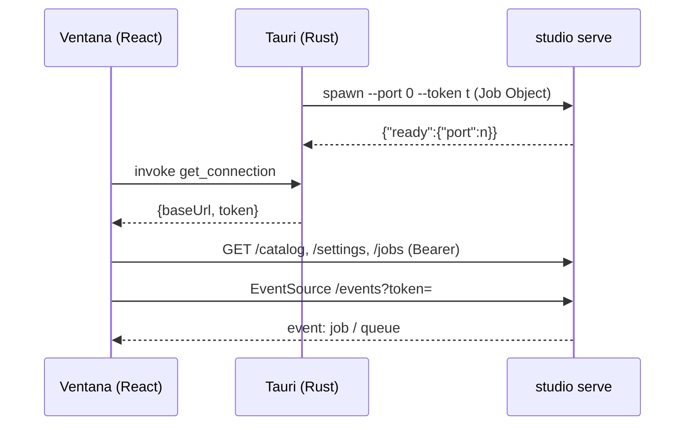

# 005: contexto y decisión

> **Decisiones y pendientes al ejecutar**: quien implemente esta spec puede tomar **todas las decisiones técnicas** que necesite, sin detenerse a pedir confirmación. Cada una queda en [`docs/process/WARNING/`](../../../process/WARNING/README.md); toda revisión pendiente, en [`docs/process/PENDING/`](../../../process/PENDING/README.md).
>
> **Datos del usuario: solo los que crea esta spec**. No borra ni sobrescribe voces grabadas, voces construidas, salidas de `out/` ni modelos que no creó; si algo parece exigirlo, es un `blocked — user-data`.

## 1. Precondición

La 004 está fusionada: `git show origin/dev:server/src/content_studio/api/app.py` existe y `uv run studio serve --port 0 --token x` imprime `{"ready": ...}`.

## 2. Contexto

* La 004 dejó la API en 127.0.0.1 con token: `/catalog`, `/settings`, `/jobs`, `/queue`, `/files` y `/events` (SSE), con OpenAPI en `/openapi.json`. Los errores son `{code, params, message}` y cada opción de catálogo trae `recommended`.
* La referencia de stack y UI es audio-converter (`tmp/estructura_de_archivos_y_carpetas/audio-converter/README.md`): Tauri 2, React 19, TS, Vite, Tailwind v4 con `@tailwindcss/vite` (sin config), `tw-animate-css`, shadcn copiado a mano sobre `radix-ui`, cva, clsx, tailwind-merge, lucide-react, sonner y oxlint. Desactiva el menú contextual y la selección (salvo `data-allow-context`), usa `onDragDropEvent` de Tauri y los diálogos de `plugin-dialog`/`plugin-opener`, y tiene modo demo con `?demo=`. Su `App.tsx` de 545 líneas no pasaría el validador de 300.
* La estructura es la de klinikae (`client/src/{app,features,shared,components/ui}`, `messages/es.json`, `tests/unit/src` espejo, `budget.json`).
* En la raíz hay bun 1.4.2 con un `package.json` de workspaces (002). El test-runner tiene `STAGES` (003).
* Las decisiones del usuario: paleta zinc con acento violeta, Geist y Geist Mono, barra de título nativa, nombre «Content Studio», avisos por toast, notificación de Windows y sonido, Ajustes (tema, avisos, restablecer elecciones y atajos), sidebar con la cola abajo, y la estrella con memoria en todos los selectores.

## 3. Solución

* **D-1: estructura de `client/`** (workspace de bun):

  ```text
  client/
  ├── package.json, vite.config.ts (@ → src), tsconfig*.json, .oxlintrc.json, vitest.config.ts, budget.json, index.html
  ├── messages/es.json                       # todo texto visible (claves en inglés: "queue.cancel")
  ├── src/
  │   ├── main.tsx                           # monta Providers, bloquea el menú contextual
  │   ├── app/{App,Providers,Sidebar,nav}.tsx · app/routes.ts       # nav.ts: una línea por sección
  │   ├── features/queue/{QueuePanel,JobRow,useQueue}.tsx
  │   ├── features/settings/{SettingsPage,ThemeField,NotificationsField,ShortcutsList}.tsx
  │   ├── shared/api/{client,schema.d.ts,events,errors}.ts          # schema.d.ts generado (openapi-typescript)
  │   ├── shared/i18n/t.ts · shared/theme/{theme,useTheme}.ts · shared/notify/{notify,ding}.ts
  │   ├── shared/hooks/{useShortcut,useSetting}.ts · shared/components/{RecommendedSelect,CommandPalette,EmptyState}.tsx
  │   └── components/ui/                     # shadcn copiado: button, badge, card, command, dialog, dropdown-menu, input,
  │                                          #   label, popover, progress, scroll-area, select, separator, slider, sonner,
  │                                          #   switch, table, tabs, textarea, tooltip
  ├── tests/unit/src/…                       # espejo de src/ (vitest + Testing Library)
  └── src-tauri/{Cargo.toml, build.rs, tauri.conf.json, capabilities/default.json, icons/, src/{main,lib,server}.rs}
  ```

  `tests/e2e/` en la raíz (workspace de bun) tiene `playwright.config.ts`, `_api/` (respuestas grabadas), `support/` y una carpeta por flujo (`shell/`, `queue/`, `settings/`) con `happy-*.e2e.ts` y `neg-*.e2e.ts`. Se descartó un solo `App.tsx` como el de audio-converter porque supera las 300 líneas y no escala a 12 secciones.
* **D-2: Tauri** (`src-tauri/src/server.rs`). En el `setup` genera el token, lanza `uv run --project <raíz> studio serve --port 0 --token <t>` (en modo dev la raíz es el checkout; la 015 cambia el ejecutable por el uv incluido) y lee el stdout hasta `{"ready": {"port": n}}`, con un timeout de 30 s y un error visible si falla. Después expone el comando `get_connection() -> {baseUrl, token}`. El proceso hijo se asigna a un Job Object con `JOB_OBJECT_LIMIT_KILL_ON_JOB_CLOSE` (crate `windows`) para que muera con la app aunque esta se cierre mal. En POSIX usa `kill` en `RunEvent::Exit`. Plugins: `dialog`, `opener`, `notification` y `window-state`. La ventana arranca en 1280×800, con un mínimo de 960×640 y la barra nativa. `tauri.conf.json`: `productName: "Content Studio"`, `identifier: "com.bypabloc.contentstudio"`. La CSP solo permite `connect-src http://127.0.0.1:*` y `media-src` para `/files`. Se descartó el sidecar con stdio porque el usuario eligió HTTP.
* **D-3: datos y navegación**. `shared/api/client.ts` es un `fetch` tipado con `schema.d.ts`, que genera `bun run gen:api` (`openapi-typescript` contra un server arrancado con `studio serve`, o contra el `openapi.json` volcado por `studio openapi`, un subcomando nuevo que imprime el schema sin levantar nada; la etapa `typecheck` comprueba que no esté desactualizado). TanStack Query cachea catálogo, settings y jobs. `shared/api/events.ts` abre un único `EventSource('/events?token=')` y, en cada `job` o `queue`, actualiza la caché con `setQueryData` sin volver a pedir. La navegación es por hash (`#/settings`), con `nav.ts` como lista de secciones agrupadas (Generar, Voces, Editar, Biblioteca, Ajustes) donde cada spec agrega su línea. Ctrl+K abre una paleta (shadcn `command`) con las secciones de `nav.ts`. Se descartó un router (TanStack Router o react-router) porque son 12 pantallas planas sin parámetros anidados, y se descartaron los `fetch` a mano con `useEffect` porque la caché compartida entre la cola, el historial y la biblioteca justifica TanStack Query (WARNING).
* **D-4: tema**. `shared/theme/theme.ts` lee `ui.theme` de `settings` (`light`, `dark` o `system`) y pone o quita la clase `dark` en `<html>`. Con `system` sigue a `matchMedia('(prefers-color-scheme: dark)')` y llama a `getCurrentWindow().setTheme()` para que la barra nativa acompañe. El último valor se cachea en `localStorage` y un script inline en `index.html` lo aplica antes de montar React, para que no parpadee. Los tokens oklch de shadcn (zinc) van en `index.css` con `@theme inline`, con un acento violeta (`--primary` en claro ≈ `oklch(0.541 0.281 293)`, ajustado en oscuro). La fuente es `geist` (paquete npm, con la woff2 en el bundle), Geist Sans para la UI y Geist Mono para tiempos y duraciones. El botón rápido de tema está al pie de la sidebar y el campo completo en Ajustes.
* **D-5: `<RecommendedSelect>`** (`shared/components/`). Las props son `settingKey`, `options: {value, label, recommended, disabled?, hint?}[]` y `onChange`. El valor inicial es el de `settings[settingKey]` si existe y sigue siendo válido, y si no, la opción `recommended`. La opción recomendada lleva un ícono ★ (lucide `Star`) con el tooltip `t('select.recommended')`. Cada cambio hace `PUT /settings/<key>`. «Restablecer elecciones» (Ajustes) borra las claves `*.` de los selectores (endpoint nuevo `DELETE /settings?prefix=`, agregado en esta spec con su test) y deja `ui.*` y `notify.*`. Se descartó guardar las elecciones en `localStorage` porque el CLI no las vería (decisión del lote).
* **D-6: cola y avisos**. `QueuePanel` está abajo, colapsable, y muestra el trabajo en curso con su progreso y etapa, los que esperan (reordenables por arrastre con `@dnd-kit/sortable`; se descartó el HTML5 drag nativo porque no tiene accesibilidad de teclado) y los botones de pausar o reanudar la cola, cancelar y reintentar. Cuando un trabajo pasa a `done` o `error`: toast de sonner con «Abrir carpeta» (`plugin-opener`), notificación de Windows si `!document.hasFocus()` y un sonido corto generado con WebAudio (un oscilador de 0,15 s, sin archivo de audio). Los dos últimos se pueden desactivar (`notify.system` y `notify.sound` en `settings`).
* **D-7: atajos**. `useShortcut` es un hook mínimo sobre `keydown` (Ctrl+K paleta, Ctrl+Enter dispara la acción principal de la sección registrada con `useShortcut('mod+enter', …)`, y Espacio reproduce o pausa el reproductor enfocado, que llega con la 006). Ajustes muestra la lista de atajos, que en esta spec no se pueden editar.
* **D-8: sensación nativa**, como audio-converter: menú contextual y selección desactivados salvo `data-allow-context`, diálogos del sistema, y `select-none` en el shell.
* **D-9: gates del frontend**. El test-runner suma en `STAGES` las etapas `client-lint` (oxlint), `client-typecheck` (`tsc --noEmit`), `client-unit` (vitest, cobertura ≥ 80 % por archivo y auditoría del espejo de `client/tests/unit/src`, reusando la lógica de la 003), `budget` (JS inicial en kB gzip de `client/dist` contra `budget.json`, con un tope inicial de 250 kB y el reporte en `tmp/budget/report.json`), `e2e` (Playwright mock: Chromium, desktop, con capturas en claro y oscuro y axe) y `tauri-check` (`cargo check` en `src-tauri`). `all` incluye las cuatro primeras y `e2e`. El validador de tamaño ya cubre `.ts`, `.tsx` y `.rs`, y cspell `.ts` y `.tsx`. El pre-commit corre las etapas del client si hay archivos staged de `client/`. En CI se suma un job `client` (bun, `--type=client-lint,client-typecheck,client-unit,budget,e2e`) en ubuntu y un job `tauri` (`cargo check`) en `windows-latest`, porque en ubuntu faltan las librerías de webkit2gtk.
* **D-10: reglas nuevas y actualizadas**. Nuevas en `.agents/rules/`: `frontend-stack.md` (stack, estructura y comandos de bun) y `ui-components.md` (shadcn copiado, catálogo `es.json` obligatorio, `RecommendedSelect`, tema y el límite de 300 líneas). Se actualizan `testing.md` (vitest, espejo del client y e2e), `worktrees.md` y `worktree prepare` (`bun install` en el worktree y `CARGO_TARGET_DIR` compartido en `<principal>/tmp/cargo-target`), `AGENTS.md` (cómo abrir la app: `bun run --cwd client tauri dev`), `command-output.md` (`tmp/budget/` y `tmp/e2e/`) y `graphify.md` (indexar `client/src`). Después, `python -m devtools rules --sync`.

## 4. Fuera de alcance

* Las secciones (Narración, Música, etc.): las agregan de la 006 a la 014, cada una con su línea en `nav.ts`.
* Editar atajos y configurar la carpeta de datos: lo hacen la 015 y la 009.
* Instalador y firma: lo hace la 015. Aquí solo hay `tauri dev` y un `tauri build --debug` de prueba.
* Otro idioma de la UI: hay un solo catálogo (`es.json`).

## 5. Criterios de aceptación

* **AC-1**: WHEN se corre `bun run --cwd client tauri dev` THEN se abre «Content Studio», arranca el server sin abrir ninguna consola, la sidebar y la cola se ven, y al cerrar la ventana no queda ningún proceso `studio` ni `uvicorn` (`tasklist`). Lo verifica: la verificación final.
* **AC-2**: Given `ui.theme = system` When el sistema cambia a oscuro Then la app y la barra nativa cambian sin recargar. Con `light` o `dark` fijo, no siguen al sistema, y al reabrir la app no hay parpadeo del tema contrario. Lo verifica: `theme.test.ts` (matchMedia simulado) y capturas e2e en los dos temas.
* **AC-3**: Given opciones con una `recommended` y sin setting guardado When se monta `<RecommendedSelect>` Then preselecciona la recomendada y muestra ★ solo en ella. Al elegir otra hace `PUT`, y al remontarse preselecciona esa. Si la guardada ya no existe, vuelve a la recomendada. Lo verifica: `RecommendedSelect.test.tsx`.
* **AC-4**: WHEN se pulsa «Restablecer elecciones» y se confirma THEN se borran las preferencias de los selectores, pero `ui.theme` y `notify.*` se mantienen. Lo verifica: un test del endpoint en el server y `SettingsPage.test.tsx`.
* **AC-5**: Given un evento SSE `job` con `progress 0.4` When llega Then la fila del trabajo muestra 40 % y la etapa sin otro request. Con `status done` aparece el toast, y la notificación de Windows y el sonido solo salen si la ventana no tiene el foco y están activados. Lo verifica: `useQueue.test.ts` y `notify.test.ts`.
* **AC-6**: WHEN en la cola se arrastra un trabajo en espera a la primera posición, se pausa, se cancela uno o se reintenta uno THEN se llama al endpoint correspondiente y la lista refleja el estado que llega por SSE. Lo verifica: e2e `queue/happy-reorder-pause-cancel-retry.e2e.ts` (mock) y `QueuePanel.test.tsx`.
* **AC-7**: WHEN se pulsa Ctrl+K y se escribe «ajus» THEN la paleta muestra Ajustes y Enter navega a `#/settings`. Lo verifica: e2e `shell/happy-command-palette.e2e.ts`.
* **AC-8**: WHEN cualquier texto visible se renderiza THEN sale de `messages/es.json` (ningún literal en español en `.tsx`), y `python -m devtools spelling` pasa. Lo verifica: cspell y un test que compara las claves usadas con las del catálogo.
* **AC-9**: WHEN se corre `test-runner --type=client-lint,client-typecheck,client-unit,budget,e2e,tauri-check` THEN todas las etapas pasan, el JS inicial es ≤ 250 kB gzip y axe no encuentra violaciones serias en el shell, la cola ni Ajustes. Lo verifica: la batería final.
* **AC-10**: WHEN el server no arranca (por ejemplo, falta `uv`) THEN la ventana muestra una pantalla de error con el motivo (del catálogo) y un botón Reintentar, en lugar de quedarse en blanco. Lo verifica: un e2e `shell/neg-server-down.e2e.ts` (con `get_connection` simulado) y una prueba manual renombrando `uv`.

## 6. Diagrama


