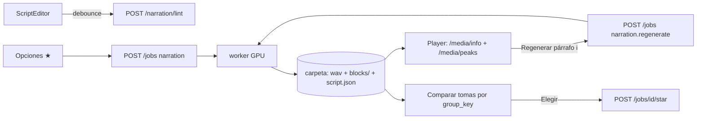

# 006: contexto y decisión

> **Decisiones y pendientes al ejecutar**: quien implemente esta spec puede tomar **todas las decisiones técnicas** que necesite, sin detenerse a pedir confirmación. Cada una queda en [`docs/process/WARNING/`](../../../process/WARNING/README.md); toda revisión pendiente, en [`docs/process/PENDING/`](../../../process/PENDING/README.md).
>
> **Datos del usuario: solo los que crea esta spec**. No borra ni sobrescribe voces grabadas, voces construidas, salidas de `out/` ni modelos que no creó; si algo parece exigirlo, es un `blocked — user-data`.

## 1. Precondición

La 005 está fusionada: `git show origin/dev:client/src/shared/components/RecommendedSelect.tsx` existe y `client/src/app/nav.ts` también.

## 2. Contexto

* Parser de narración (nombres de la 002): `--model` (por defecto `voxcpm2`, el recomendado del README), `--ref`, `--voice` (voces aprobadas del catálogo), `--style`, `--text` o `--file` (uno o varios `.txt` o `.json`), `--output`, `--batch`, `--seed`, `--master voice|no`, `--lufs` (-16), `--language es|en`, `--evaluate` y `--retries`.
* `narration/pipeline.py` (nombres de la 002): `narrate()` arma el estado `g` (segmentos, bloques preparados, semillas, audios por bloque) y llama a `regenerate(engine, g, indices, batch, seed)`, que rehace los bloques indicados y reescribe el `.wav`. `evaluate()` transcribe con whisper y deja `g['evaluation']` con las observaciones por párrafo. El estado vive **solo en memoria**: al terminar el proceso no se puede regenerar un párrafo.
* `texto/segmentos.etiquetas()` detecta las etiquetas que el modelo leería en voz alta. Las reglas de `formato-guion.md` §«Reglas obligatorias» (1–24) se revisan a mano hoy.
* La 004 dejó la API de trabajos y archivos y el catálogo con `recommended`. La 005 dejó el shell, `RecommendedSelect`, el catálogo `es.json`, `Ctrl+Enter` y Espacio.

## 3. Solución

* **D-1: linter del guion en el server**. `narration/script_lint.py` tiene `lint(text) -> list[Issue]` (`{line, col, length, rule, code, params}`) y aplica las reglas que se pueden comprobar sin modelo: 1 (etiquetas y marcas, reusando `etiquetas()`), 2 (mayúsculas de énfasis: palabras de 3 o más letras en mayúsculas que no sean siglas del diccionario), 3 (oración sin cierre), 6 (`;`, y `:` que no precede una enumeración), 10 (`?` o `!` sin el signo de apertura), 11 (más de 25 palabras), 13 (cifras) y 19 («registras»). El endpoint es `POST /narration/lint {text}`, y el client lo llama con un debounce de 300 ms. Los textos de cada regla van en `messages/es.json` del server (`lint.rule_11`, …), con un enlace al ancla de `formato-guion.md`. Se descartó duplicar las reglas en TS porque habría dos fuentes de verdad. `estimate_seconds(text, style)` (palabras ÷ 2,6 × velocidad del estilo, más las pausas `[pause N]` y las líneas en blanco) va en la misma respuesta.
* **D-2: bloques en disco y regenerar**. `narrate()` y `regenerate()` escriben, además del `.wav` final, `blocks/<i>.wav` y `script.json` (segmentos, referencia por bloque, estilo, idioma, semillas por bloque, master y LUFS) en la carpeta del trabajo. Un trabajo nuevo `narration.regenerate {source_job, index, seed?}` (servicio `services/narration_regenerate.py`, recurso `gpu`) carga `script.json` y los bloques, rehace solo `index` con una semilla nueva (o la indicada) usando `regenerate()`, reensambla y escribe una **toma nueva** en su propia carpeta. La original no se toca. Necesita un flag interno `--from-script <dir> --only <i>` en `tts.py`, que no se expone en `studio` más allá de `studio narration regenerate <job> <index>`. Se descartó mantener el motor cargado entre trabajos porque bloquea la GPU para la música y la 004 libera la VRAM al terminar.
* **D-3: audio en la UI**. Hay dos endpoints nuevos en `api/routes/media.py`: `GET /media/info?path=`, que devuelve duración (`ffprobe`), LUFS integrado y pico verdadero (`ebur128`). Esos números se cachean en una tabla `media_cache (path, mtime, size, duration, lufs, true_peak)` (migración 2), que guarda solo la ruta y los números, nunca el audio. Además está `GET /media/peaks?path=&n=2000`, que decodifica con `ffmpeg -f s16le -ac 1 -ar 8000` a un pipe y saca los máximos por ventana con `array` de la stdlib, sin numpy, en la capa liviana. Las dos usan la misma validación de rutas que `/files`. En el client, `shared/media/Waveform.tsx` y `Player.tsx` se apoyan en **wavesurfer.js** (con los picos del server para no decodificar archivos largos en el WebView) y Espacio reproduce o pausa. Lo reusan el limpiador y los subtítulos (con los plugins Regions y Timeline). Se descartó un canvas propio porque la 010 y la 011 necesitan regiones arrastrables con zoom, y eso es justo lo que resuelve la librería (WARNING).
* **D-4: tomas**. La migración 2 agrega `jobs.starred INTEGER NOT NULL DEFAULT 0` y `jobs.group_key TEXT` (indexada). Una narración guarda `group_key = 'narration:' + sha1(texto normalizado)[:12]`, y sus regeneraciones heredan la misma clave. `GET /jobs?group_key=` lista las tomas y `POST /jobs/{id}/star` marca una (y desmarca las demás del grupo). La UI de **Comparar** muestra las tomas del texto actual en columnas, cada una con motor, voz, estilo, semilla, duración, LUFS y si la evaluación salió OK, más su reproductor (al reproducir una se pausan las demás), y «Elegir» la marca con ★. La biblioteca (014) reutiliza `starred`.
* **D-5: pantalla** (`client/src/features/narration/`):
  * `NarrationPage.tsx`: editor a la izquierda y opciones a la derecha. Debajo, el resultado y la comparación.
  * `ScriptEditor.tsx`: un textarea con una capa de resaltado detrás (la técnica del `<pre>` espejo; se descartó CodeMirror por peso y porque no hace falta sintaxis) para `[pause N]`, los párrafos y los avisos subrayados, con tooltip del texto de la regla y enlace. Lleva contador de palabras y duración estimada. «Importar» abre `dialog.open` para `.txt` y `.json`, o se puede arrastrar el archivo (`onDragDropEvent`). Con varios archivos se encolan como un lote (un trabajo por archivo, como `--file` múltiple).
  * `NarrationOptions.tsx`: siempre visibles motor ★, voz o referencia ★ (voces del catálogo aprobadas y «Mis grabaciones» si existen, la 007 agrega más), estilo ★ e idioma ★. En el popover «Avanzado»: master y LUFS, semilla (vacía = aleatoria), lote (solo con motores que lo soportan) y Evaluar con reintentos. Todas las claves de setting van bajo `narration.*`.
  * Los motores con licencia no comercial o «revisar» llevan un badge en el selector. La primera vez que se eligen, un `Dialog` explica el uso permitido (texto del catálogo, desde la licencia de `registry.py`) y, al aceptar, se guarda `license.accepted.<engine>`. Si se cancela, vuelve a la opción anterior.
  * «Generar» (también con `Ctrl+Enter`) hace `POST /jobs` y el resultado se sigue por SSE. Los avisos del linter no bloquean: se muestra un resumen («3 avisos: generar igual») y el usuario decide.
  * `NarrationResult.tsx`: `Player` con la onda, la duración, los LUFS y el pico, y los botones «Abrir carpeta» y «Mandar a Mezclar» (deshabilitado hasta la 013). Con evaluación, una lista por párrafo con el texto pedido, lo que oyó whisper, las palabras distintas resaltadas y el estado OK o REVISAR. Cada párrafo tiene «Regenerar», que encola `narration.regenerate` y la toma nueva aparece en Comparar.
  * La sección se registra en `nav.ts` (grupo Generar) con su línea.
* **D-6: reglas y docs**. `narration/README.md` y `formato-guion.md` (la UI y el linter: qué reglas comprueba y cuáles no), y `docs/process/01-done/narration.md`.

## 4. Fuera de alcance

* Grabar o construir voces: lo hace la 007. Aquí solo se usan las voces aprobadas que ya existen y las grabaciones que ya están.
* Instalar motores: lo hace la 009. Un motor que no está instalado se muestra deshabilitado, con el hint «Instálalo en Motores» que la 009 convierte en botón.
* Mezclar con música: lo hace la 013 (el botón existe, deshabilitado).
* Las reglas 4, 5, 7–9, 12, 14–18 y 20–24, que necesitan criterio o un modelo: el linter no las comprueba y la doc lo dice.
* Editar el texto de un párrafo y regenerar solo ese párrafo con el texto nuevo: se regenera el mismo texto con otra semilla (PENDING si el usuario lo pide).

## 5. Criterios de aceptación

* **AC-1**: WHEN se manda al linter «Hola; esto es DEMO con 24 horas» THEN devuelve las reglas 6, 2 y 13, con línea, columna y largo correctos, y para un texto que cumple todo no devuelve nada. Lo verifica: `test_script_lint.py`, con un caso por regla.
* **AC-2**: WHEN termina un trabajo de narración THEN su carpeta tiene el `.wav`, `blocks/0..n-1.wav` y un `script.json` con una semilla por bloque. Lo verifica: un test de `pipeline` con un motor falso que devuelve ruido.
* **AC-3**: Given un trabajo de narración `done` de 3 párrafos When se encola `narration.regenerate {index: 1}` Then la toma nueva tiene los bloques 0 y 2 idénticos a la original (mismo hash), el 1 distinto, la misma `group_key`, y la original queda sin cambios. Lo verifica: `test_narration_regenerate.py` (motor falso) y la corrida real.
* **AC-4**: WHEN se llaman `GET /media/info` y `/media/peaks?n=100` sobre un `.wav` de fixture de 2 s THEN responden la duración 2.0 ± 0.01, LUFS y pico numéricos, y exactamente 100 picos entre 0 y 1. Con una ruta fuera de las permitidas responden 403. Lo verifica: `test_media.py` (ffmpeg real, que está en CI; se marca `skipif` sin ffmpeg).
* **AC-5**: WHEN se marca una toma con `POST /jobs/{id}/star` THEN es la única `starred` de su `group_key`. Lo verifica: `test_jobs_api.py::test_ac5_star_unique`.
* **AC-6**: Given el editor con «Hola; mundo» When pasan 300 ms Then `;` queda subrayado y su tooltip muestra el texto de la regla 6. Lo verifica: `ScriptEditor.test.tsx` (API simulada).
* **AC-7**: Given que se elige OmniVoice por primera vez When se cancela el diálogo de licencia Then el selector vuelve a la opción anterior, y si se acepta queda `license.accepted.omnivoice` y no vuelve a preguntar. Lo verifica: `NarrationOptions.test.tsx`.
* **AC-8**: WHEN se escribe un texto, se eligen las opciones y se pulsa `Ctrl+Enter` THEN se encola el trabajo con esos `params`, al terminar el `Player` muestra la onda y los LUFS, y al recargar la página las opciones siguen elegidas. Lo verifica: e2e `narration/happy-generate.e2e.ts` (mock) y la corrida real.
* **AC-9**: WHEN se importan dos `.json` arrastrándolos THEN se encolan dos trabajos, uno por archivo. Un archivo que no es `.txt` ni `.json` muestra un error del catálogo y no encola nada. Lo verifica: e2e `narration/happy-import-batch.e2e.ts` y `neg-import-invalid.e2e.ts`.
* **AC-10**: Given dos tomas del mismo texto When se abre Comparar y se elige una Then queda con ★, y al reproducir una se pausa la otra. Lo verifica: `CompareTakes.test.tsx` y un e2e.

## 6. Diagrama

## 7. Debe sonar / no debe sonar

| Salida | Debe | No debe |
| :--- | :--- | :--- |
| Narración desde la UI (`voxcpm2`, `yesid`, `expert`) | Igual que `studio narration tts` con los mismos parámetros. LUFS de -16 ± 1 con master `voice` | Cortes entre bloques ni silencios distintos a las pausas pedidas |
| Toma regenerada (párrafo 2 de 3) | Párrafos 1 y 3 idénticos a la original y el 2 con otra lectura. Empalmes sin clic | Saltos de volumen en el empalme |
