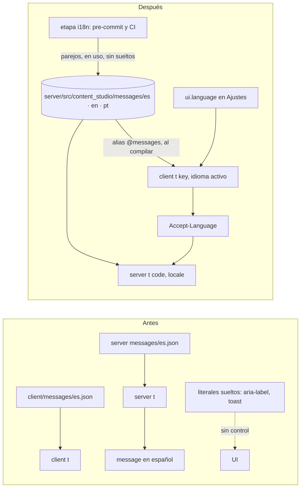

# 007: contexto y decisión

> **Decisiones y pendientes al ejecutar**: quien implemente esta spec puede tomar **todas las decisiones técnicas** que necesite, sin detenerse a pedir confirmación. Cada una queda en [`docs/process/WARNING/`](../../../process/WARNING/README.md); toda revisión pendiente, en [`docs/process/PENDING/`](../../../process/PENDING/README.md).
>
> **Datos del usuario: solo los que crea esta spec**. No borra ni sobrescribe voces grabadas, voces construidas, salidas de `out/` ni modelos que no creó; si algo parece exigirlo, es un `blocked — user-data`.

## 1. Precondición

La 006 está fusionada: `git show origin/dev:client/src/features/narration/NarrationPage.tsx` existe. Antes del primer commit se rehace el inventario de §2 contra `origin/dev`, porque la 006 suma claves al catálogo del client y al del server (`lint.*`, estilos, motores).

## 2. Contexto

Hoy hay **dos catálogos separados, solo en español**, y textos que no están en ninguno:

| Superficie | Dónde está hoy | Cómo se usa |
| :--- | :--- | :--- |
| UI del client | [client/messages/es.json](../../../../client/messages/es.json): 61 claves (`nav.*`, `queue.*`, `settings.*`, `server.*`, `theme.*`…) | [shared/i18n/t.ts](../../../../client/src/shared/i18n/t.ts) importa el JSON, y `MessageKey = keyof typeof catalog` |
| Errores de la API | [server/src/content_studio/messages/es.json](../../../../server/src/content_studio/messages/es.json): 15 códigos sin prefijo (`unauthorized`, `job_not_found`…) | [messages.py](../../../../server/src/content_studio/messages.py) `t(code, **params)`; [api/app.py](../../../../server/src/content_studio/api/app.py) `_http_error` arma `{code, params, message}` |
| Error genérico de Starlette (404 de ruta, 405) | `code = str(exc.detail)` → `"Not Found"` | `t()` no lo encuentra y devuelve la frase en inglés |
| Errores de validación de los servicios | `services/*.validate` devuelve `{'code', 'params'}` | Ya es por código: falta asegurar que cada código tenga su texto |
| Estilos, motores y presets | Ids en inglés (`expert`, `lofi-chill`, `qwen-0.6b`); `note` y `desc` en inglés en los `engines/registry.py` | El CLI los muestra en inglés, y la UI, según lo que deje la 006 |
| Región de avisos de sonner | En inglés (lo pone la librería) | [PENDING/005-avisos-sonner-ingles](../../../process/PENDING/005-avisos-sonner-ingles.md) |
| CLI `studio`, devtools, hooks y logs | Escritos en el código, en inglés | Así lo fija [textos-e-idioma.md](../../../../.agents/rules/textos-e-idioma.md); siguen así (§4) |

Lo que ya protege y se conserva:

* `react/jsx-no-literals` como error en `client/.oxlintrc.json` ([WARNING/005-jsx-literales](../../../process/WARNING/005-jsx-literales.md)). Solo mira el texto entre etiquetas JSX: deja pasar `aria-label="Cerrar"`, `toast('Listo')` o `const label = 'Abrir carpeta'`.
* [catalog-keys.test.ts](../../../../client/tests/unit/src/shared/i18n/catalog-keys.test.ts) comprueba que las claves usadas en `t('…')` existan y que no sobre ninguna. Solo cubre el client, y con una regex que no ve las claves dinámicas.
* La regla de textos descarta el i18n *«sin segundo uso»*. Ahora el usuario pide dos idiomas más, así que el segundo uso existe y la regla se reescribe (D-10).

El `pre-commit` ([.git-hooks/pre-commit](../../../../.git-hooks/pre-commit)) corre `test-runner --type=lint,spelling,validators --git-mode=staged`. Las etapas de [devtools/test_runner/main.py](../../../../devtools/test_runner/main.py) son una línea en `STAGES`, `GROUPS['all']` y `FILE_STAGES`.

## 3. Solución

Cada decisión pasó la escalera de `plan-format.md` §0:

* **D-1: un catálogo, en el paquete del server.** `server/src/content_studio/messages/{es,en,pt}.json` es la única fuente de texto visible.
  * El server lo lee en tiempo de ejecución, como hoy. Al ser package data, viaja con el server en el instalador (022) sin pasos extra.
  * El client lo importa al compilar con el alias `@messages`, que apunta a esa carpeta en `vite.config.ts` y `tsconfig`, con `server.fs.allow` para el modo dev de Vite. El bundle trae los textos, así que el client muestra «Arrancando el motor…» y el error de arranque antes de que el server exista.
  * `client/messages/` se borra.
  * Descartadas:
    * Una carpeta `messages/` en la raíz: no viaja en el paquete del server ni en el instalador sin copiarla.
    * Servirlo por API con `GET /messages/{lang}`: el client lo necesita antes de que arranque el server.
    * Dos catálogos con un script que los sincroniza: dos fuentes de lo mismo, justo lo que se quiere evitar.
* **D-2: formato.**
  * JSON plano, una clave por texto. Las claves van en inglés, en minúsculas, separadas por puntos y en orden alfabético (menos conflictos entre specs en paralelo). Los parámetros van entre llaves: `{job_id}`.
  * Sin anidación, para que un grep de la clave completa la encuentre.
  * `es.json` es la base: de ahí salen las claves y el tipo `MessageKey`.
  * Prefijos:
    * `error.<code>`: los 15 códigos de la API migran con su código intacto (`error.job_not_found`).
    * `error.http.<status>`: errores genéricos sin código propio (404, 405, 422, 500).
    * `app.`, `nav.`, `queue.`, `settings.`, `server.`, `theme.`, `notify.`, `palette.`, `select.`, `shell.` y los de la 006: se conservan.
    * `label.narration.style.<id>`, `label.music.style.<id>`, `label.narration.engine.<id>` y `label.music.model.<id>`: nombres y descripciones visibles.
    * `language.<code>`: nombres de idiomas, para el selector de Ajustes y el idioma de las voces.
  * Descartados: ICU MessageFormat y librerías como i18next o react-intl (dependencia nueva para lo que hoy son plantillas con `{x}`); JSON anidado.
* **D-3: idiomas.**
  * `es` es la base, en español neutro latinoamericano con tuteo.
  * `en` es inglés de EE. UU.
  * `pt` es portugués de Brasil, la variante de la mayor parte del público latinoamericano (`WARNING/007-pt-br`).
  * Las etiquetas de idioma son `es`, `en` y `pt`, sin región.
  * El agente traduce las claves que existan al ejecutar; la revisión humana queda en `PENDING/007-revision-humana-en-pt`.
  * El nombre de cada idioma se muestra en su propio idioma («Español», «English», «Português») y es igual en los tres catálogos.
* **D-4: server.**
  * `messages.t(code, locale='es', **params)` carga los tres catálogos una vez, al importar el módulo.
  * `messages.negotiate(header)` parsea `Accept-Language` con stdlib: pesos `q` y coincidencia por prefijo (`pt-BR` → `pt`). Si el idioma no es uno de los tres, devuelve `es`.
  * `_http_error` traduce `error.<code>` con el idioma de la petición. Un `HTTPException` sin código propio pasa a `error.http.<status>`.
  * El cuerpo de la respuesta sigue siendo `{code, params, message}`, sin cambiar el contrato de la 004.
  * Descartado: guardar el idioma en `settings` y leerlo en cada petición. La cabecera es estándar, cuesta cero y sirve igual para curl.
* **D-5: client.**
  * `shared/i18n/` trae los tres catálogos (`catalogs.ts`) y el idioma activo (`locale.ts`): `resolveLocale(pref, navigator.languages)`, `getLocale`, `setLocale`, `subscribe` y el hook `useLocale` con `useSyncExternalStore`.
  * `t(key, params)` busca primero en el idioma activo, después en `es` y por último devuelve la clave. Con D-3 estricto, los dos respaldos solo se ven en desarrollo.
  * Al cambiar el idioma, `<html lang>` se actualiza y el árbol se vuelve a renderizar, sin recargar la ventana.
  * El cliente HTTP (`shared/api/client.ts`) manda `Accept-Language: <locale>`.
  * `ApiError` muestra `t('error.<code>', params)` si la clave existe; si no, el `message` del server.
  * Las notificaciones de Windows y los avisos de sonner salen de `t()`, así que siguen el idioma activo. sonner recibe `containerAriaLabel={t('notify.region')}` y con eso cierra la parte de etiqueta de `PENDING/005-avisos-sonner-ingles`.
* **D-6: selector.**
  * La preferencia `ui.language` vale `system`, `es`, `en` o `pt`, y `system` es la opción ★.
  * Queda en caché en `localStorage` con el mismo patrón que [theme.ts](../../../../client/src/shared/theme/theme.ts), para que el primer cuadro ya salga en su idioma.
  * Ajustes › Apariencia suma «Idioma» con `RecommendedSelect`.
  * «Restablecer elecciones» no lo toca: el prefijo `ui.` no es de un selector, igual que `ui.theme`.
  * `system` sigue a `navigator.languages`; WebView2 refleja el idioma de Windows.
* **D-7: etiquetas de estilos, motores y presets.**
  * Lo visible en la UI sale de `label.*`. Un test de server comprueba que cada id de `narration.parser.STYLES`, `music.styles.STYLES`, `ENGINES` y `MODELS` tenga su clave en `es`.
  * Los `desc` y `note` de los `engines/registry.py` se quedan en inglés para el CLI, que está fuera de alcance (§4). Es la misma frase en dos superficies con públicos distintos, y queda anotado en `WARNING/007-descripciones-cli`.
  * Descartado: que el CLI lea el catálogo `en`, porque el usuario dejó el CLI fuera.
* **D-8: etapa `i18n` en `test-runner`.** Va en `devtools/test_runner/i18n.py` (stdlib), con una línea en `STAGES`, `GROUPS['all']` y `FILE_STAGES`, y se suma al `pre-commit`: `--type=lint,spelling,validators,i18n --git-mode=staged`. La configuración está en `tests/validators/i18n.json`. Hace cuatro revisiones:
  1. **Catálogos**:
     * JSON válido y sin claves repetidas (`object_pairs_hook`).
     * El mismo conjunto de claves en `es`, `en` y `pt`.
     * Los mismos `{parámetros}` en cada clave.
     * Claves en orden alfabético.
     * Ningún valor vacío ni con espacios al borde.
     * Corre siempre que cambie un catálogo o cualquier archivo de `client/src/` o del server incluido.
  2. **Claves en uso**:
     * Toda clave literal de `t('…')` en `client/src/` existe.
     * Todo código de `ApiError(…, '<code>')` y de `{'code': '<code>'}` en el server (con `ast`) tiene su `error.<code>`.
     * Ninguna clave sobra, salvo las de un prefijo dinámico declarado en `dynamicPrefixes` (`queue.status.`, `label.narration.style.`…). Cada prefijo declarado debe tener al menos una clave.
     * Reemplaza a `catalog-keys.test.ts`, que se borra: una sola revisión para el client y el server.
  3. **Textos sueltos en Python** (`ast`): en `server/src/content_studio/api/`, `services/`, `jobs/` y `messages.py` (lista `python.include`). Ignora:
     * docstrings;
     * llamadas a `logging` y a `log.*` / `logger.*`;
     * claves de diccionario y valores de `code`;
     * mensajes de excepciones internas (todo lo que no sea `ApiError` ni `HTTPException`, que es texto para el desarrollador y va en inglés);
     * los strings de `subprocess` y de las rutas.
  4. **Textos sueltos en TS**: un script `client/scripts/loose-texts.ts` usa el compilador de TypeScript, que ya es dependencia, y la etapa lo corre con `bun` sobre `client/src/**/*.{ts,tsx}` (sin tests). Ignora:
     * los especificadores de `import` y `export`;
     * los literales en posición de tipo (`'light' | 'dark'`);
     * el primer argumento de `t()`;
     * `console.*`;
     * nombres de propiedad;
     * los atributos `className`, `class`, `style`, `key`, `id`, `role`, `type`, `href`, `src`, `name`, `htmlFor`, `data-*` y `aria-controls`, `aria-describedby` y `aria-labelledby`;
     * los argumentos de `cn()`, `clsx()` y `cva()`;
     * las URL, las expresiones regulares y los selectores CSS.

  **Qué cuenta como texto** (la misma regla en los dos lenguajes, `WARNING/007-detector-heuristica`): un literal, sin los espacios del borde, que tiene al menos una letra y cumple una de estas condiciones:
  * dos palabras con letras separadas por espacio;
  * una letra fuera de ASCII (á, ñ, ç, ã) o `¿`/`¡`;
  * una sola palabra con mayúscula inicial y el resto en minúsculas (`'Cancelar'`).

  Los ids (`lofi-chill`), las claves (`queue.title`), las constantes (`GET`), los nombres en PascalCase (`ApiError`) y los atajos (`Ctrl+K`) no cuentan.

  **Excepciones**:
  * La lista `allowed` de `i18n.json`, con strings exactos como `'Bearer '`.
  * Un marcador en la línea: `// i18n-ignore: <motivo>` o `# i18n-ignore: <motivo>`. Un marcador sin motivo también es un error.

  **Salida**: el `stdout` del stage es JSON, como las demás etapas. El detalle es una línea por hallazgo, en inglés: `client/src/app/Foo.tsx:12: loose text "Abrir carpeta". Move it to messages/*.json and use t('…'), or mark the line with // i18n-ignore: <reason>.`

  Descartadas:
  * `react/jsx-no-literals` con `noStrings` y `noAttributeStrings`: marca `className` y no ve los literales fuera del JSX.
  * Un grep de palabras en español: frágil, no ve el inglés ni el portugués y falla con los acentos (`WARNING/005-jsx-literales`).
  * Un baseline de textos sueltos: el repo queda en cero al cerrar esta spec, así que no hay nada que congelar.
* **D-9: cspell.**
  * `en.json` se revisa en inglés, sin el override `en,es`.
  * `es.json` se revisa con `en,es`, como hoy.
  * `pt.json` se revisa con `en,pt`: se suma `@cspell/dict-pt-br` como dependencia de desarrollo de la raíz, igual que `@cspell/dict-es-es`, y su `import` en `cspell.config.yaml` (`WARNING/007-cspell-pt`).
  * Se borra el override de `client/messages/es.json` (ya no existe).
* **D-10: reglas.**
  * `textos-e-idioma.md`: la introducción pasa a «un catálogo único con tres idiomas». Las filas de API y UI apuntan a `messages/{es,en,pt}.json`. Suma una sección «Agregar un texto»: la clave en los tres catálogos, `t()` en el client y `ApiError(…, '<code>')` en el server, y la etapa `i18n` lo comprueba. Las etiquetas de estilos llegan por `label.*`.
  * `frontend-stack.md` y `ui-components.md` cambian la ruta del catálogo y la mención de `catalog-keys.test.ts`.
  * `AGENTS.md`: la línea de `messages.py`.
  * Después, `python -m devtools rules --sync` y `agent-context`.

## 4. Fuera de alcance

* El CLI `studio`, devtools, hooks, logs y mensajes de excepciones internas: siguen en inglés en el código (decisión del usuario y `textos-e-idioma.md`). La etapa `i18n` no los revisa.
* `grabar/` (legacy, en español): lo retira la 010.
* Plurales (`_one`/`_other` con `Intl.PluralRules`): ningún texto actual los necesita. Se redactan sin depender del número («Archivos: 3»), y la primera spec que necesite plurales los agrega (`PENDING/007-plurales`).
* Formato de fechas y números por idioma con `Intl`: lo agrega la primera spec que muestre fechas (020, Biblioteca), con `getLocale()`.
* Carga diferida de cada catálogo: los tres se importan juntos mientras el budget lo permita (AC-9).
* Textos de Rust en `client/src-tauri` (solo `expect` de arranque, que el usuario no ve) y metadatos de la ventana y del instalador (`productName`, `<title>`): son la marca y no se traducen.
* Traducir el contenido (guiones, subtítulos): lo hacen la 014 y la 021.
* Idiomas de narración: el idioma del guion no cambia con el de la UI.

## 5. Criterios de aceptación

* **AC-1** (catálogos parejos): WHEN un catálogo tiene una clave que otro no tiene, una clave con `{parámetros}` distintos, claves fuera de orden, una clave repetida o un valor vacío THEN `python -m devtools test-runner --type=i18n` sale con código 1 y una línea por problema, con archivo y clave; con los catálogos reales, sale con código 0. Lo verifica: `devtools/tests/unit/test_runner/test_i18n.py::test_ac1_*`, con fixtures en `devtools/tests/fixtures/i18n/`.
* **AC-2** (idioma de la API): Given un server con los tres catálogos, When `GET /jobs/nope` llega con `Accept-Language: pt-BR,pt;q=0.9,en;q=0.8` Then el cuerpo es `{code: 'job_not_found', params: {job_id: 'nope'}, message: <texto de pt>}`. Con `fr-FR` o sin cabecera, `message` sale en español. Una ruta inexistente responde `code: 'http.404'` con el texto de `error.http.404`. Lo verifica: `server/tests/unit/src/content_studio/test_messages.py` y `api/test_errors_locale.py`.
* **AC-3** (todo mapeado): WHEN se corre la etapa `i18n` THEN cada `t('…')` literal del client, cada código de `ApiError` y de `validate` del server tiene su clave, y no sobra ninguna fuera de los `dynamicPrefixes`. Además, cada id de estilo, motor y modelo de los registros tiene su `label.*`. Lo verifican: `test_i18n.py::test_ac3_*` (fixtures con una clave huérfana, una faltante y un código de `ApiError` sin texto) y `server/tests/unit/src/content_studio/test_messages.py::test_ac3_every_registry_id_has_a_label`.
* **AC-4** (textos sueltos en Python): WHEN un archivo incluido trae `HTTPException(400, detail='Falta el texto')`, `return {'message': 'Listo'}` o un `# i18n-ignore:` sin motivo THEN la etapa falla y nombra archivo y línea. Una docstring, un `log.info('job started')`, un `ApiError(404, 'not_found')`, una clave de diccionario y un `raise ValueError('bad seed')` no fallan. Lo verifica: `test_i18n.py::test_ac4_*`.
* **AC-5** (textos sueltos en TS): WHEN un `.tsx` de `client/src/` trae `aria-label="Cerrar"`, `toast('Listo')`, `const label = 'Abrir carpeta'` o `` `Hola ${name}` `` THEN la etapa falla con archivo, línea y el texto. `className="flex gap-2"`, `import x from 'react'`, `type T = 'light' | 'dark'`, `t('nav.settings')`, `console.debug('state', s)`, `data-testid="job-row"` y una línea con `// i18n-ignore: marca` no fallan. Lo verifica: `test_i18n.py::test_ac5_*`, que corre `client/scripts/loose-texts.ts` sobre `devtools/tests/fixtures/i18n/client/*.tsx`.
* **AC-6** (bloquea en el pre-commit): Given un `.tsx` con `aria-label="Cerrar"` en el staging, When se hace `git commit` Then el `pre-commit` lo rechaza con el mensaje de AC-5. Al quitar el literal o pasarlo a `t()`, el commit pasa. Con el repo completo, `test-runner --type=i18n --git-mode=all` sale con código 0 y cada `i18n-ignore` tiene motivo. Lo verifican: el caso de `.git-hooks` en `devtools/tests/unit/test_runner/test_i18n.py::test_ac6_precommit_runs_i18n` (que el hook invoque la etapa) y la prueba manual de `03` §2.
* **AC-7** (idioma del client): WHEN `setLocale('en')` THEN `t('nav.settings')` devuelve «Settings», `document.documentElement.lang` es `en`, el cliente HTTP manda `Accept-Language: en` y un `ApiError` con código `job_not_found` muestra el texto de `en`. `resolveLocale('system', ['pt-BR', 'en'])` devuelve `pt`; con `['fr-FR']`, `es`; `resolveLocale('en', ['pt-BR'])` devuelve `en`. Lo verifican: `client/tests/unit/src/shared/i18n/{t,locale}.test.ts` y `shared/api/client.test.ts`.
* **AC-8** (selector): Given Ajustes, When se elige «English» en «Idioma» Then toda la UI visible (sidebar, cola, Ajustes y Narración) cambia sin recargar, `ui.language` queda en `en` y, al reiniciar la app, el primer cuadro ya sale en inglés. «Sistema» lleva la ★. «Restablecer elecciones» no cambia el idioma. axe no reporta fallos serios en `en` ni en `pt`. Lo verifican: `client/tests/unit/src/features/settings/SettingsPage.test.tsx` y `tests/e2e/settings/happy-language.e2e.ts`.
* **AC-9** (budget): WHEN se construye el client THEN el bundle no crece más de 12 KB gzip respecto del baseline de la 006. Lo verifica: `python -m devtools test-runner --type=budget`.
* **AC-10** (ortografía y reglas): WHEN se corre `test-runner --type=spelling` THEN `en.json` pasa en inglés y `pt.json` con el diccionario `pt-br`. `python -m devtools rules` y `agent-context` salen con 0 con las reglas reescritas. Lo verifica: `--type=spelling` sobre una fixture `en.json` con una palabra mal escrita (falla) y los catálogos reales (pasan).

## 6. Diagrama antes y después

