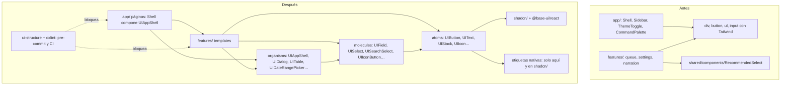

# 008: contexto y decisión

> **Decisiones y pendientes al ejecutar**: quien implemente esta spec puede tomar **todas las decisiones técnicas** que necesite, sin detenerse a pedir confirmación. Cada una queda en [`docs/process/WARNING/`](../../../process/WARNING/README.md); toda revisión pendiente, en [`docs/process/PENDING/`](../../../process/PENDING/README.md).
>
> **Datos del usuario: solo los que crea esta spec**. No borra ni sobrescribe voces grabadas, voces construidas, salidas de `out/` ni modelos que no creó; si algo parece exigirlo, es un `blocked — user-data`.

## 1. Precondición

La 007 está fusionada: `git show origin/dev:server/src/content_studio/messages/en.json` existe y `test-runner --type=i18n` está en `GROUPS['all']`. klinikae se lee en `\\wsl.localhost\Ubuntu-24.04\home\bypabloc\projects\bypabloc\klinikae\packages\`. Si la ruta no responde, es un `blocked — user-data`: hay que abrir la distro de WSL, no instalar nada en ella.

## 2. Contexto

**content-studio hoy** (`client/src/`, 12 `.tsx`):

* No hay componentes de shadcn copiados ([PENDING/005-desvios-d1-d8](../../../process/PENDING/005-desvios-d1-d8.md), punto 1). Los controles son HTML con Tailwind.
* El único componente compartido es [RecommendedSelect.tsx](../../../../client/src/shared/components/RecommendedSelect.tsx).
* Hay etiquetas nativas en `app/` y `features/`: 11 `div`, 4 `section`, 4 `p`, 4 `button`, 3 `ul` y `li`, 3 `option`, `h1` a `h3`, `label`, `input`, `progress`, `nav`, `header`, `main` y `aside`. A eso se suma lo que deje la 006 en `features/narration/`.
* El tema vive en [index.css](../../../../client/src/index.css) con variables oklch (`--background`, `--primary`, `--muted`…) en claro y oscuro.
* El router es por hash ([routes.ts](../../../../client/src/app/routes.ts), `useSectionId`).
* La única defensa es `react/jsx-no-literals` (texto en JSX) y, desde la 007, la etapa `i18n` (textos sueltos). Nada impide escribir `<button className=…>` en una pantalla.

**klinikae** (`packages/`, revisado el 2026-11-19):

* `ui/src/ui/<Nombre>/index.tsx`: 80 componentes con prefijo `UI` y JSDoc. Son controlados por props, y **todos los textos llegan por props** (`label`, `labels.previous`): no tienen literales visibles.
* `ui/src/shadcn/*.tsx`: 27 primitivas de shadcn v4 sobre `@base-ui/react` 1.9.0, que son alert-dialog, alert, avatar, badge, button, card, chart, collapsible, combobox, dialog, dropdown-menu, empty, field, input, label, popover, radio-group, separator, sheet, sidebar, skeleton, sonner, spinner, table, tabs, textarea y tooltip.
* `ui/src/hooks/`: `use-mobile`, `use-reduced-motion` y `use-hydrated` (este último solo para SSR).
* `ui/tests/unit/src/ui/<Nombre>/`: 108 tests con Testing Library.
* Dependencias: `@base-ui/react` 1.9.0, `class-variance-authority` 0.7.1, `cn` 0.5.0, `lucide-react` 1.58.0, `recharts` 3.10.1, `sonner` 2.0.8 (la misma de content-studio), `tw-animate-css` 1.4.0 y `shadcn` 4.22.0 (por `shadcn/tailwind.css`).
* Dependencias de Next: `Link` (`next/link`), `AppShell` (`next/navigation`), `Turnstile` (`next-themes`) y los `'use client'`.
* `tokens/`: `theme.css`, `tokens.css` y `utilities.css`, con `ui-typography-{display,title-*,subtitle-*,body,caption,overline}`, `ui-focus` y `ui-press`. Los componentes usan colores que content-studio no define: `foreground-secondary`, `primary-hover`, `destructive-soft`, `success`, `success-soft`, `accent-foreground` y `shadow-ui`/`-sm`/`-lg`.
* `app-kit/src/forms/useForm.ts` (102 líneas, solo React): estado por ruta con punto (`documents.1.number`), validación al enviar y en vivo después del primer envío, `touched`, `dirty`, `setServerErrors` y `reset`.
* `app-kit/src/testing/setup.ts`: `asyncUtilTimeout` de 5 s (Base UI anima al abrir) y shims de `matchMedia` y `ResizeObserver` para jsdom.
* `app-kit/src/build/` (CSP, gzip y postbuild): es para nginx y Next.

## 3. Solución

Cada decisión pasó la escalera de `plan-format.md` §0. La respuesta a «¿ya existe?» es sí, en klinikae: se copia y se adapta, no se diseña de cero.

* **D-1: base.** `@base-ui/react`, `class-variance-authority`, `lucide-react`, `recharts` y `tw-animate-css`, con las versiones exactas de klinikae (sin `^`), con `bun add --exact` en la raíz del workspace, como la 006.
  * Las 27 primitivas se copian a `client/src/shared/components/shadcn/` tal cual: es código de proveedor, y oxlint y el detector de la etapa `ui-structure` lo excluyen.
  * `cn`: se usa el mismo paquete `cn` 0.5.0. Antes de fijarlo se revisan su licencia y su código (`npm view cn` y su fuente). Si no pasa, `client/src/shared/lib/cn.ts` (clsx + tailwind-merge) ocupa su lugar con un alias `cn` en `vite.config.ts` y `tsconfig`, así los imports copiados no cambian (`WARNING/008-paquete-cn`).
  * `shadcn/tailwind.css` se importa del paquete `shadcn` como dependencia de desarrollo, o se copia a `client/src/styles/` si solo hace falta ese archivo.
  * `components.json` apunta a `shared/components/shadcn/` para que un `bunx shadcn add` futuro caiga en su lugar.
  * Descartados: Radix (otra base, y no se podría copiar de klinikae) y HTML con Tailwind propio (reescribir la accesibilidad de Dialog, Popover y Combobox).
* **D-2: carpetas y nombres.** `client/src/shared/components/{shadcn,atoms,molecules,organisms}/`.
  * Hay una carpeta por componente, con `index.tsx` y sus archivos internos (`DateRangePicker/calendar.ts`, `SearchSelect/Picker.tsx`).
  * Los nombres llevan el prefijo `UI` (`UIButton`), como en klinikae, para no chocar con las primitivas (`Button` de `shadcn/button`).
  * Los hooks van a `client/src/shared/hooks/` (`use-mobile`, `use-reduced-motion`), y `use-hydrated` no se trae porque no hay SSR.
  * Los tests van en espejo: `client/tests/unit/src/shared/components/<nivel>/<Nombre>/index.test.tsx`, adaptados de los de klinikae.
  * Se quita `'use client'`. `@author` y `@since` se conservan como en klinikae, y se suma `@since` con la fecha de la copia cuando el archivo cambia.
* **D-3: qué entra.** Los 64 genéricos, en tres niveles. El criterio es este: un átomo envuelve un solo elemento nativo o primitiva; una molécula combina átomos en un control con una tarea; un organismo es una sección completa con estado propio.

  | Nivel | Componentes |
  | :--- | :--- |
  | Átomos (22 + 2) | `UIStack`, `UIGrid`, `UIPage`, `UIText`, `UIDetailText`, `UIIcon`, `UIButton`, `UILink`, `UIBadge`, `UIStatus`, `UIStatusBadge`, `UIAvatar`, `UISkeleton`, `UICard`, `UICheckbox`, `UISwitch`, `UIFixedValue`, `UIFieldError`, `UIHiddenInput`, `UIForm`, `UIQrImage`, `UIRouteTransition`. Nuevos: `UIBox` (D-4) y `UITooltip` (sobre `shadcn/tooltip`, con su atajo opcional). Reales además (inventario de T8): `UIFieldFrame`, `UIQrCode` (pasa de molécula a átomo), `UIChartMarker`, `UIChartPlaceholder`, `UIDiffText`, `UIMarkedText`, `UIProgress`, `UIImage` y `UITime` |
  | Moléculas (29 + 2) | `UIField`, `UITextarea`, `UIPasswordField`, `UISearchField`, `UIFileField`, `UISelect`, `UISearchSelect`, `UICombobox`, `UICheckboxGroup`, `UIRadioGroup`, `UIDateParts`, `UIDateRangeFilter`, `UICollapsible`, `UITabs`, `UIPopover`, `UIAlert`, `UIEmpty`, `UIErrorSummary`, `UIStepProgress`, `UIPagination`, `UIRowActions`, `UIDescriptionList`, `UITimeline`, `UIToast`, `UIThemeToggle`, `UIStatCard`, `UIRemoteImage`, `UIMonthGrid`. Nuevos: `UIIconButton` (`UIButton` de solo icono con `aria-label`, `aria-pressed` opcional y `UITooltip`) y `UIRecommendedSelect` (el `RecommendedSelect` de hoy, sobre `UISelect`, con la ★) |
  | Organismos (13 + 1) | `UIDialog`, `UIConfirmDialog`, `UIFormDialog`, `UIBottomSheet`, `UITable`, `UIRowTable`, `UIFileDrop`, `UIDateRangePicker`, `UIFloatingToolbar`, `UIChart`, `UIChartCard`, `UIRepeatGroup`, `UIAppShell`. Nuevo: `UICommandPalette` (el de `app/`, con los ítems por props) |

  * Quedan fuera, con motivo, en `WARNING/008-excluidos-de-klinikae`:
    * de la clínica: `UIOdontogram`, `UIBodyMap`, `UIStockBadge` y `UIScheduleGrid`;
    * de auth y la web pública: `UITurnstile`, `UIProviderButton`, `UIAuthLayout`, `UIPortalShell`, `UIPublicPageFallback`, `UIBrand` y `UIBrandLink`;
    * de encuestas: `UINps`, `UIScale` y `UIMatrix`;
    * sin usuarios ni modo móvil: `UIUserMenu` y `UIBottomNav`.
  * Si al copiar un componente su lugar real es otro nivel (por ejemplo, porque importa un organismo), se mueve y se anota. La tabla es el punto de partida, no un contrato.
  * Un archivo que pase de 300 líneas se divide por responsabilidad (`UIFloatingToolbar`, 432). El validador de tamaño no da excepciones.
  * **Adaptaciones obligatorias**:
    * `UILink` usa `href="#/<sección>"` sin `next/link`.
    * `UIAppShell` usa `useSectionId` en lugar de `next/navigation`.
    * `UIThemeToggle` usa el `useTheme` de content-studio (claro, oscuro y sistema) en lugar de `next-themes` y `use-hydrated`.
    * `UIChart` y `UIChartCard` cargan `recharts` con `lazy()`, como `SearchSelect` carga su `Picker`.
  * **`UIIcon`**: se trae con el mapa de nombres de klinikae, sin los iconos de la clínica (`stethoscope`, `tooth`…), y suma los que pide el shell (tema, sidebar, cola). El resto de los iconos de content-studio los agrega la 009.
* **D-4: jerarquía estricta.**

  | Carpeta | Etiquetas nativas | Puede importar |
  | :--- | :--- | :--- |
  | `shared/components/shadcn/` | Sí | npm, `shared/lib/` |
  | `atoms/` | Sí | `shadcn/`, npm, `shared/lib/`, `shared/hooks/`, `shared/i18n/`, otros átomos |
  | `molecules/` | No | Lo anterior y otras moléculas |
  | `organisms/` | No | Lo anterior y otros organismos |
  | `features/` (templates) | No | `atoms/`, `molecules/` y `organisms/` (salvo `UIBox`), y el resto de `shared/`: `api`, `hooks`, `i18n`, `theme`, `notify`, `forms` |
  | `app/` (páginas) | No | Lo de `features/` y los `features/` |

  * Nadie fuera de `shared/components/` importa `shadcn/`, `@base-ui/react`, `lucide-react`, `recharts` ni `sonner`. `shared/components/` no importa `features/` ni `app/`, y `features/` no importa `app/`.
  * `UIBox` es el contenedor genérico (`as`: `div`, `span`, `section`, `header`, `nav`, `aside`, `main` o `footer`, más `className`). Existe para que las moléculas y los organismos de klinikae sustituyan sus `div` internos sin etiquetas nativas. Solo lo importa `shared/components/`. En `features/` y `app/` el layout se arma con `UIStack` (que suma `direction="row"`, `align` y `justify`), `UIGrid`, `UICard`, `UIPage` y `UIText`, así una pantalla no recrea un `div` con otro nombre (`WARNING/008-ui-box`).
  * Un caso que ningún componente cubre se resuelve creando o ampliando un componente, nunca con una etiqueta nativa en la pantalla.
* **D-5: cómo se hace cumplir.**
  * **Etiquetas nativas**: `client/scripts/ui-structure.ts`, con la misma técnica que `client/scripts/loose-texts.ts` de la 007 (compilador de TypeScript, que ya es dependencia). Marca:
    * todo `JsxOpeningElement` o `JsxSelfClosingElement` cuyo nombre empiece en minúscula (`div`, `svg`, `button`…);
    * todo `createElement('<tag>')`, `React.createElement('<tag>')` y `<Tag>` con `const Tag = 'h1'`, cuando el valor es una cadena literal;
    * en `client/src/**/*.tsx` fuera de `shadcn/` y `atoms/`.
    * La salida es `client/src/features/queue/JobRow.tsx:14: native <button> outside atoms. Use a component from shared/components (UIButton, UIIconButton) or add one.`
    * Sin excepciones ni marcadores de ignorar: lo que haga falta va a un átomo.
    * Corre como etapa `ui-structure` de `test-runner` (`devtools/test_runner/ui_structure.py`, que lanza el script con `bun`, como las etapas `client-*`), en `GROUPS['all']` y en el `pre-commit` junto a `client-lint` cuando hay archivos de `client/` en el staging.
  * **Jerarquía de imports**: `no-restricted-imports` de oxlint con un `override` por carpeta en `client/.oxlintrc.json`, con patrones de rutas relativas y del alias `@/`. Es declarativo y ya se usa (la 009 restringía `lucide-react`), así que corre en `client-lint` sin código propio.
  * Descartados: `react/forbid-elements` (exige listar cada etiqueta, no distingue carpetas y no ve `createElement`) y un grep de `<[a-z]` (falsos positivos con genéricos de TS y comparaciones).
* **D-6: tokens y utilidades.**
  * `client/src/styles/tokens.css` suma, en claro y oscuro, los colores que usan los componentes y no existen hoy: `foreground-secondary`, `primary-hover`, `destructive-soft`, `success`, `success-soft`, `accent-foreground` y `shadow-ui`/`-sm`/`-lg`. Salen de la paleta oklch actual de `index.css` (mismo tono, otra luminosidad), no de la de klinikae.
  * `client/src/styles/utilities.css` copia `ui-typography-*`, `ui-focus` y `ui-press` de `tokens/utilities.css`.
  * `index.css` importa los dos, más `tw-animate-css` y `shadcn/tailwind.css`.
  * Un test (`client/tests/unit/src/styles/tokens.test.ts`) comprueba que cada token de la lista exista en `:root` y en `.dark`, y que el contraste de `foreground-secondary` sobre `background` sea AA (4,5:1) en los dos temas.
  * Descartado: reemplazar el tema por la paleta de klinikae. El usuario eligió adaptarlos.
* **D-7: AppShell.**
  * `UIAppShell` recibe `nav` (grupos e ítems con `id`, `label` e `icon`), `active`, `footer` (tema y versión) y `aside` (el panel de la cola).
  * Usa la sidebar de shadcn: colapsable a iconos con tooltips, `Ctrl+B` y el estado en el setting `ui.sidebar.collapsed`.
  * `app/Shell.tsx` pasa a ser la página que lo compone con `NAV`. `app/Sidebar.tsx` y `app/ThemeToggle.tsx` se borran, porque los reemplazan `UIAppShell` y `UIThemeToggle`.
  * El modo móvil de la sidebar queda deshabilitado: la ventana de Tauri tiene un mínimo de ancho de escritorio.
* **D-8: app-kit.**
  * `useForm` va a `client/src/shared/forms/useForm.ts`, con su test.
  * `testing/setup.ts` se fusiona en el setup de vitest del client (`client/tests/setup.ts` o el que declare `vitest.config.ts`).
  * `build/` no se trae: Tauri sirve archivos locales y su CSP vive en `tauri.conf.json`.
  * Los formularios que existan al ejecutar (Ajustes y Narración) pasan a `useForm` solo si hoy validan a mano. Si no validan, no se tocan.
* **D-9: budget.** Base UI y los componentes suman peso.
  * El bundle inicial puede crecer hasta 90 KB gzip respecto del baseline de la 007.
  * `recharts`, el `Picker` de `SearchSelect`, `UIDateRangePicker` y `UIFloatingToolbar` van en chunks diferidos y no cuentan en el inicial.
  * El delta real queda en `WARNING/008-budget`, y el baseline de `budget` se actualiza en el mismo commit.
* **D-10: reglas.**
  * `ui-components.md` se reescribe: Atomic Design, la tabla de D-4, el criterio de nivel de D-3, cómo agregar un componente (carpeta, prefijo `UI`, test espejo y textos por props desde `t()`) y que se copia de klinikae antes de crear uno.
  * `frontend-stack.md` suma Base UI, `cn`, los tokens y la etapa `ui-structure`.
  * `devtools.md` suma la etapa.
  * Después, `python -m devtools rules --sync` y `agent-context`.

## 4. Fuera de alcance

* Los 16 componentes excluidos en D-3.
* Un paquete compartido entre klinikae y content-studio (`packages/`): se copia, no se enlaza. Cómo traer mejoras futuras queda en `PENDING/008-sincronizar-con-klinikae`.
* `app-kit/build/` (CSP, gzip y postbuild).
* Iconos de cada pantalla y el criterio de solo icono: los hace la 009 con `UIIcon`, `UIIconButton` y `UITooltip`.
* Rediseñar las pantallas. Se migran 1:1 a componentes: mismo contenido y orden, con el aspecto de los componentes de klinikae.
* Storybook o un catálogo visual de componentes.
* El modo móvil de la sidebar y la navegación inferior.

## 5. Criterios de aceptación

* **AC-1** (inventario completo): WHEN se lista `client/src/shared/components/{atoms,molecules,organisms}/` THEN están los 64 componentes de D-3 más los 5 nuevos, cada uno con `index.tsx`, un export `UI<Nombre>` y su test espejo, y `client-unit` pasa con cobertura ≥ 80 % por archivo. Lo verifica: `client/tests/unit/src/shared/components/inventory.test.ts` (compara las carpetas con la tabla de D-3) y `python -m devtools test-runner --type=client-unit`.
* **AC-2** (bloqueo de nativas): WHEN un `.tsx` de `client/src/features/`, `client/src/app/`, `molecules/` u `organisms/` contiene `
`, `<button>`, `<svg>` o `createElement('span')` THEN `test-runner --type=ui-structure` sale con código 1 y una línea con archivo, línea, etiqueta y el componente sugerido. El mismo código en `atoms/` o `shadcn/` pasa, igual que un componente `<UIStack>` o un genérico `<T,>` en una función. Lo verifica: `devtools/tests/unit/test_runner/test_ui_structure.py`, con fixtures en `devtools/tests/fixtures/ui-structure/`.
* **AC-3** (jerarquía de imports): WHEN un átomo importa una molécula, una molécula importa un organismo, un archivo de `features/` importa `shadcn/button`, `@base-ui/react`, `lucide-react` o `UIBox`, `shared/components/` importa `features/`, o `features/` importa `app/` THEN `client-lint` falla con `no-restricted-imports`. Los imports permitidos de la tabla de D-4 pasan. Lo verifica: `devtools/tests/unit/test_runner/test_client_lint_hierarchy.py`, que corre oxlint sobre fixtures por caso.
* **AC-4** (pre-commit): Given un `.tsx` de `features/` con `
` en el staging, When se hace `git commit` Then el `pre-commit` lo rechaza con la línea de AC-2; con `<UIStack>`, pasa. Con el repo completo, `test-runner --type=ui-structure --git-mode=all` sale con 0 hallazgos. Lo verifican: `test_ui_structure.py::test_ac4_precommit_runs_ui_structure` (el hook invoca la etapa) y la prueba manual de `03` §2.
* **AC-5** (comportamiento de klinikae): WHEN `UISelect` recibe 1, 5 o 12 opciones THEN muestra `UIFixedValue`, un combobox sin filtro o un combobox con filtro. `UISearchSelect` carga su `Picker` solo con más de una opción. `UIDateRangePicker` aplica sus presets y respeta `min` y `max`. `useForm` muestra errores solo después del primer envío y borra el error del server al cambiar su campo. Lo verifican: los tests portados de klinikae en sus rutas espejo.
* **AC-6** (textos e i18n): WHEN se corre `test-runner --type=i18n` THEN ningún componente trae textos sueltos: los textos llegan por props, y los que un componente necesita por defecto (cerrar un diálogo, paginar, mostrar contraseña) salen de `t('ui.<componente>.<texto>')` en los tres catálogos. Lo verifica: `--type=i18n --git-mode=all` con 0 hallazgos.
* **AC-7** (AppShell y migración): Given la app, When se abre Then el shell es `UIAppShell`, con las secciones de `NAV`, la cola a la derecha y el tema y la versión al pie. La sidebar se colapsa a iconos con tooltips (botón y `Ctrl+B`) y sigue colapsada al reiniciar (`ui.sidebar.collapsed`). Ajustes, la cola y Narración se ven y funcionan como antes: los e2e existentes pasan con sus selectores por rol. Lo verifican: `client/tests/unit/src/shared/components/organisms/UIAppShell/index.test.tsx`, `tests/e2e/shell/happy-sidebar-collapse.e2e.ts` y `python -m devtools test-runner --type=e2e`.
* **AC-8** (tokens y accesibilidad): WHEN se abren el shell, Ajustes, la cola y Narración, en claro y en oscuro THEN axe no reporta fallos serios ni críticos, cada token de D-6 existe en los dos temas y `foreground-secondary` tiene contraste AA. Lo verifican: `tokens.test.ts` y `tests/e2e/shell/happy-apariencia-axe.e2e.ts` ampliado.
* **AC-9** (budget): WHEN se construye el client THEN el bundle inicial no crece más de 90 KB gzip respecto del baseline de la 007, y `recharts`, el `Picker`, `UIDateRangePicker` y `UIFloatingToolbar` van en chunks aparte. Lo verifica: `python -m devtools test-runner --type=budget` y la lista de chunks de `vite build`.
* **AC-10** (reglas): WHEN se corren `python -m devtools rules` y `agent-context` THEN salen con 0, con `ui-components.md` reescrito (Atomic Design y D-4) y `frontend-stack.md` y `devtools.md` actualizados. Lo verifica: esos dos comandos y la validación headless de `agent-config-testing.md`.

## 6. Diagrama antes y después

