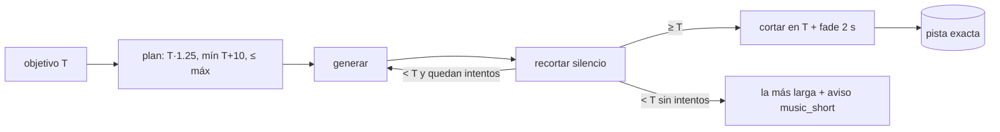

# 008: contexto y decisión

> **Decisiones y pendientes al ejecutar**: quien implemente esta spec puede tomar **todas las decisiones técnicas** que necesite, sin detenerse a pedir confirmación. Cada una queda en [`docs/process/WARNING/`](../../../process/WARNING/README.md); toda revisión pendiente, en [`docs/process/PENDING/`](../../../process/PENDING/README.md).
>
> **Datos del usuario: solo los que crea esta spec**. No borra ni sobrescribe voces grabadas, voces construidas, salidas de `out/` ni modelos que no creó; si algo parece exigirlo, es un `blocked — user-data`.

## 1. Precondición

La 006 está fusionada: `git show origin/dev:client/src/features/narration/CompareTakes.tsx` existe, igual que `jobs.group_key` y `/media/info`.

## 2. Contexto

* Parser de música (nombres de la 002): `--model acestep|heartmula` (ACE-Step es el recomendado), `--style` (uno o más presets o texto libre), `--duration` (60 por defecto; ACE hasta 600 y HeartMuLa hasta 240), `--key` y `--bpm` (obligatorios con texto libre), `--time-signature 2|3|4|6`, `--no-lm` (ACE ~3× más rápido), `--folder`, `--variants`, `--evaluate` (demucs mide la voz) y `--retries`.
* `music/README.md` §174: ACE-Step genera exactamente los segundos pedidos, pero suele **terminar antes** y rellenar con silencio. El script recorta la cola (`areverse,silenceremove,areverse`, `SILENCE_DB = -50`), y por eso la pista final dura menos que lo pedido (30 s pedidos dieron 22,5 s, y las de 20 s perdieron de 10 a 11 s). El README recomienda pedir la narración + 10 s, con un mínimo de 30.
* `music/styles.py`: 126 presets con `caption`, `tags` (solo en los 9 base), `key`, `bpm` y `time_signature`. Los prefijos (nombres de la 002) dan familias (lofi, ad, demo, corporate, ambient, cinematic…), pero no hay un campo de categoría.
* La 006 dejó `Player`, `Waveform`, `CompareTakes` (en `features/narration/`), `group_key`, `starred` y `/media/info`.

## 3. Solución

* **D-1: duración exacta** (`music/duration.py`, funciones puras más el armado de ffmpeg):
  * `plan_duration(target, engine_max) -> request`. Calcula `min(engine_max, max(target * 1.25, target + 10))`. Si `target > engine_max`, `validate` lo rechaza (`duration_over_max`).
  * Después de generar y recortar el silencio: si `trimmed >= target`, `fit(path, target)` corta en `target` con `afade=t=out:st={target-2}:d=2` (si `target < 6`, el fade es de `target/3`), y la pista final dura `target` ± 10 ms. Si `trimmed < target`, regenera con otra semilla (hasta 2 veces, contando cada intento como `@@progress stage "retry n/2"`). Si sigue corta, deja la más larga y marca `result.warning = 'music_short'` con la duración real, que la UI muestra.
  * Se aplica por variante y por estilo. `--evaluate` (demucs) corre sobre la pista ya ajustada.
  * Se descartó el loop con crossfade (la opción que el usuario no eligió) y el «aproximado» de hoy.
* **D-2: categorías**. Cada preset de `styles.py` suma `category` (`lofi`, `ads`, `demo`, `corporate`, `ambient`, `cinematic`, `tutorial`, `documentary`, `acoustic`, `electronic`, `jazz`, `wellness`, `genres`; la asignación final la decide quien implementa y va a WARNING), además de `mood` (lista corta: `calm`, `upbeat`, `dark`, `epic`, `warm`…) si el caption lo deja claro, y si no, vacío. `styles_catalog()` devuelve `[{key, category, mood, musical_key, bpm, time_signature, caption, has_sample}]`. Las etiquetas visibles de categorías y moods van al catálogo del client (`music.category.*`). El test de estructura comprueba que todo preset tenga `category`.
* **D-3: muestras de 10 s**. El trabajo `music.samples {styles?: [...], force}` (`services/music_samples.py`, recurso `gpu`) genera con ACE-Step `--no-lm --duration 10` y semilla fija un clip por preset en `server/data/music/samples/<style>.wav` (gitignoreado, enlazado por `worktree prepare`). Saltea los que ya existen salvo con `force`, así que se puede cancelar y retomar. El progreso va por preset. `GET /music/styles` dice `has_sample`, y `/files` permite servir `samples/`. En el buscador, cada tarjeta tiene ▶ si hay muestra, y un banner ofrece «Generar muestras (~126 clips, unos 40 min de GPU)» con el tiempo estimado medido. Se descartó generar muestras con HeartMuLa porque tarda ~5 min por pista.
* **D-4: igualar duración**. `DurationField.tsx` tiene un campo mm:ss validado contra el máximo del motor elegido, botones de 15 s, 30 s, 60 s, 90 s y 3 min, y un menú «Igualar a…» con dos opciones: una narración del historial (selector de trabajos `narration` `done`, con ★ primero) más una cola de N s (por defecto 2, en `music.match_tail`), o cualquier audio o video (`dialog.open`). La duración se lee de `/media/info`. El valor elegido queda en `music.duration`.
* **D-5: estilos y texto libre**. `StyleBrowser.tsx` es una grilla con buscador de texto, chips de categoría y mood, rango de BPM y modo (mayor o menor), y ★ favorito (`music.favorites`, primero en la lista). La selección es múltiple, con una pista por estilo, igual que `--style` múltiple. El modo «Texto libre» (`FreeTextStyle.tsx`) tiene una descripción en inglés (la del caption; la ayuda explica por qué va en inglés y cita las recomendaciones de ACE-Step de `styles.py`), un selector de tonalidad con las tonalidades estables del catálogo, BPM con tap tempo (`useTapTempo`, el promedio de los últimos 4 golpes) y compás. Los tres son obligatorios, y «Generar» queda deshabilitado hasta completarlos.
* **D-6: pantalla** (`features/music/MusicPage.tsx`). Siempre visibles: motor ★, duración y estilos. En «Avanzado»: variantes (1–6), sin LM, evaluar voz (activado por defecto) con reintentos (1 por defecto) y semilla. Con `Ctrl+Enter` se genera. El resultado usa `CompareTakes`, que se mueve a `shared/components/` y se generaliza con columnas configurables (para música: estilo, variante, duración real, aviso `music_short`, voz detectada por demucs, LUFS, tonalidad y BPM), «Elegir» con ★ y «Mandar a Mezclar» (deshabilitado hasta la 013). Las variantes de un mismo pedido comparten `group_key = 'music:' + sha1(params sin semilla)[:12]`. La sección se registra en `nav.ts` (grupo Generar).
* **D-7: docs**. Se actualizan `music/README.md` (duración exacta, que reemplaza a §174 y §182, muestras y la UI), `ESTILOS.md` (categorías) y `docs/process/01-done/music.md`.

## 4. Fuera de alcance

* Mezclar con la narración: lo hace la 013.
* Muestras de HeartMuLa: se descartan por el tiempo.
* Editar los presets desde la UI: siguen en `styles.py`.
* Loops o extensión de una pista existente.

## 5. Criterios de aceptación

* **AC-1**: WHEN se llama a `plan_duration(30, 600)`, `(60, 600)`, `(590, 600)` y `(700, 600)` THEN devuelven 40, 75 y 600, y el último lo rechaza `validate`. Lo verifica: doctests en `music/duration.py`.
* **AC-2**: Given una pista recortada de 34 s y un objetivo de 30 When se aplica `fit` Then el archivo dura 30.00 ± 0.01 s y los últimos 2 s tienen un fade (el RMS del último medio segundo es al menos 20 dB menor que el del segundo 25). Lo verifica: `test_duration.py`, con un tono sintético y ffmpeg real.
* **AC-3**: Given un motor falso que siempre termina a los 20 s When se piden 30 s Then hace 3 intentos y el resultado tiene `warning = 'music_short'` con la duración real. Con un motor que da 40 s hace un solo intento y no hay aviso. Lo verifica: `test_music_main.py`, con el motor simulado.
* **AC-4**: WHEN se llama a `GET /music/styles` THEN devuelve 126 presets, todos con `category`, y `has_sample` refleja lo que hay en `samples/`. Lo verifica: `test_music_api.py` y `test_structure.py`.
* **AC-5**: Given 3 muestras ya generadas When se encola `music.samples` para esos 3 más otros 2 Then solo se generan los 2 nuevos, y con `force` se generan los 5. Lo verifica: `test_music_samples.py` (motor simulado).
* **AC-6**: Given una narración `done` de 47,3 s When se elige «Igualar a narración» con una cola de 2 s Then el campo muestra 00:49.3. Con HeartMuLa y una narración de 5 min, muestra el error `duration_over_max`. Lo verifica: `DurationField.test.tsx`.
* **AC-7**: WHEN en «Texto libre» falta el BPM THEN Generar está deshabilitado. Con 4 toques de tap tempo cada 500 ms, el BPM queda en 120. Lo verifica: `FreeTextStyle.test.tsx` y `useTapTempo.test.ts`.
* **AC-8**: WHEN se eligen 2 estilos y 2 variantes y se genera THEN se encolan los trabajos que hacen falta, al terminar Comparar muestra 4 columnas con la duración real y la voz detectada, y «Elegir» deja una sola ★ por grupo. Lo verifica: e2e `music/happy-generate-compare.e2e.ts` (mock) y la corrida real.
* **AC-9**: WHEN se corre una música real de ACE-Step con `--duration 30` y el preset `lofi-jazz` (el que en el README dio 22,5 s) THEN la pista dura 30,00 ± 0,01 s y termina con un fade, sin silencio final. Lo verifica: la verificación final (ffprobe y espectrograma).

## 6. Diagrama

## 7. Debe sonar / no debe sonar

| Salida | Debe | No debe |
| :--- | :--- | :--- |
| `lofi-jazz`, 30 s (ACE) | 30,00 s exactos, con un fade-out natural de 2 s y LUFS en el rango del README | Silencio final, corte seco, voz ni letra |
| Muestras de 10 s | El carácter de cada preset reconocible en 10 s | Voz ni silencio largo |
| Variantes de un pedido | La misma tonalidad y BPM, con otra melodía | Una variante con voz sin la marca de demucs |
