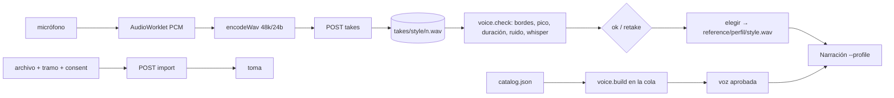

# 008: contexto y decisión

> **Decisiones y pendientes al ejecutar**: quien implemente esta spec puede tomar **todas las decisiones técnicas** que necesite, sin detenerse a pedir confirmación. Cada una queda en [`docs/process/WARNING/`](../../../process/WARNING/README.md); toda revisión pendiente, en [`docs/process/PENDING/`](../../../process/PENDING/README.md).
>
> **Datos del usuario: solo los que crea esta spec**. No borra ni sobrescribe voces grabadas, voces construidas, salidas de `out/` ni modelos que no creó; si algo parece exigirlo, es un `blocked — user-data`. Excepción pedida: `move-data` mueve las referencias actuales al perfil `default`.

## 1. Precondición

La 006 está fusionada: `git show origin/dev:client/src/shared/media/Player.tsx` existe y `/media/peaks` también.

## 2. Contexto

* Después de la 002, las referencias propias están en `server/data/narration/reference/<style>.{wav,txt}` (más `takes/`, `emotions/` y `test/`) y los guiones de grabación en `docs/scripts/` (12 más el de emociones). La guía exige 12 clips de 8 a 12 s, en un orden fijo (neutral al inicio y al final), con picos de -12 a -6 dB, en WAV mono de 48 kHz y 24 bits, sin procesado, con 0,3 a 0,5 s de silencio en los bordes y sin pausas internas de más de 1 s. Se guarda la misma ganancia en todos.
* `narration/grabar/` (questionary, rich y ffmpeg dshow) quedó excluido de cspell en la 002, y la 004 dejó `rich` y `questionary` en el grupo `legacy` solo para él.
* `narration/voces/` (nombres de la 002: `voices/`) tiene `catalog.py` (voces libres con licencia y fuentes), `build.py` (descarga la fuente, corta por estilo, transcribe con `whisper` y aprueba) y `main.py` (`--list`, `--build <voz|all>` y `--force`). El catálogo está en `server/data/narration/voices/catalog.json`. Las aprobadas son las que tienen los 12 estilos.
* La narración (006) ya lista las voces aprobadas y «Mis grabaciones».
* El whisper actual es `openai-whisper` (comando `whisper`). La 011 trae faster-whisper.

## 3. Solución

* **D-1: perfiles**. `narration/profiles.py` tiene `list_profiles()`, `create(name)`, `rename`, `delete` (solo si está vacío, o con confirmación explícita y moviendo los archivos a `reference/.trash/<fecha>/`, nunca un borrado duro), `styles_status(profile)` (cada estilo con referencia elegida, tomas y estado del chequeo) y `reference_for(profile, style)`. La estructura es `reference/<slug>/profile.json` (`{name, created_at, consent?}`), `reference/<slug>/<style>.{wav,txt}` (la elegida) y `reference/<slug>/takes/<style>/<n>.wav` con su `check.json`. El paso 3 de `move-data` mueve `reference/*.{wav,txt}`, `takes/`, `emotions/` y `test/` a `reference/default/` (con nombre visible «Mi voz»), y es idempotente y sin sobrescribir. El parser de narración cambia `--ref` por `--profile <slug>`, que se suma a `--voice`. El catálogo de la API lista los perfiles completos y los parciales (un perfil parcial solo ofrece los estilos que tiene).
* **D-2: captura en el client**. `features/recording/capture/recorder-worklet.ts` es un AudioWorklet que acumula Float32. `encodeWav(samples, 48000, 24)` es una función pura con su test. `getUserMedia({audio: {deviceId, channelCount: 1, sampleRate: 48000, echoCancellation: false, noiseSuppression: false, autoGainControl: false}})`. Si el dispositivo no da 48 kHz, se remuestrea en el server con ffmpeg (`aresample=resampler=soxr`) y se anota en `check.json`. El selector de dispositivo usa `enumerateDevices()` con ★ (el último usado queda en `recording.device`). Hay un vúmetro en vivo (pico y RMS en dBFS con un `AnalyserNode`), con la zona verde de -12 a -6 dB y un aviso rojo desde -1 dB. La «prueba de sala» graba 5 s de silencio y mide el piso de ruido: si está por encima de -50 dBFS, avisa que la sala es ruidosa. Se descartó `MediaRecorder` porque en WebView2 entrega webm/opus con pérdida, que la guía prohíbe. Permiso del micrófono: WebView2 lo pide la primera vez. Si Tauri no lo muestra, se habilita el permiso con el handler de `PermissionRequested` en `src-tauri` (WARNING).
* **D-3: tomas y chequeo**. `POST /voices/profiles/{slug}/takes` (multipart: `style` y el `wav`) guarda `takes/<style>/<n>.wav` y encola `voice.check` (`services/voice_check.py`, recurso `gpu`). El chequeo recorta los bordes a 0,4 s (con `silenceremove` de ffmpeg solo en los extremos), mide la duración (rango del estilo, de `docs/scripts/README.md` o de la tabla `DURATION` que ya tenía `grabar/`, que pasa a `narration/recording_kit.py`), el pico (-12 a -6 dB con tolerancia de ±1 dB), el piso de ruido, las pausas internas de más de 1 s y el texto (transcribe con el whisper actual y compara con el `.txt` del guion usando `evaluation/compare.py`). El veredicto es `ok` o `retake`, con las razones como códigos del catálogo. `POST .../takes/{style}/{n}/choose` copia esa toma a `<style>.wav` y `<style>.txt`, y la anterior queda en `takes/`. `GET .../takes` lista las tomas con su `check.json`.
* **D-4: importar**. `POST /voices/profiles/{slug}/import {path, start, end, style, consent: true}` valida `consent` (sin él responde 422), extrae el tramo con ffmpeg a WAV de 48 kHz, mono y 24 bits (de audio o de video), lo guarda como una toma y encola el chequeo. La primera importación de un perfil guarda en `profile.json` `consent: {accepted_at, text}` con el texto del catálogo. En la UI se elige el archivo, se marca el tramo de 8 a 12 s sobre la onda (`Waveform` con una región, plugin Regions de wavesurfer) y la casilla obligatoria.
* **D-5: catálogo de voces libres**. `GET /voices/catalog` lista cada voz con su ficha (origen, licencia, consentimiento, género, acento y las muestras por estilo construidas) y su estado (no construida, parcial o aprobada). El trabajo `voice.build {voices: [...], force}` (`services/voice_build.py`, recurso `gpu`) llama a `voices/build.py` y reporta el progreso por voz y estilo con `@@progress`. Las favoritas se guardan en `settings` como `voices.favorites` (una lista) y el selector de voz de Narración las ordena primero.
* **D-6: pantallas** (`client/src/features/voices/` y `features/recording/`):
  * **Mis voces**: la lista de perfiles con su progreso (por ejemplo, 9 de 12 estilos) y las acciones crear, renombrar y borrar (con confirmación y papelera). En el detalle del perfil, una grilla de estilos con la referencia elegida (reproducible), la cantidad de tomas y su estado, más «Grabar» e «Importar».
  * **Grabar** (por perfil): asistente en el orden del kit. Por estilo muestra el teleprompter con el guion (de `docs/scripts/<n>-<style>.md`, servido por `GET /voices/kit`), la duración objetivo, los ppm y la notación explicada. Tiene grabar y parar (Espacio), el vúmetro, el temporizador con la zona objetivo, «Siguiente» y «Repetir». Al parar, la toma se sube sola, el chequeo corre en la cola y su resultado aparece en la lista de tomas del estilo, que se pueden reproducir, comparar y elegir. Los estilos opcionales (susurro y emociones) quedan al final, marcados.
  * **Catálogo**: tarjetas con la ficha y la licencia, un reproductor por estilo, ★ favorita, «Construir», «Construir todas» y «Forzar», con el progreso en la cola.
  * Las entradas de `nav.ts` van en el grupo Voces: «Mis voces» (con Grabar dentro) y «Catálogo».
* **D-7: borrar `grabar/`**. Se hace `git rm` de `narration/grabar/` y de sus tests, se borra el grupo `legacy` (sale `rich` y `questionary`), se saca `grabar/` de `ignorePaths` de cspell y se cierra la ficha PENDING `002-cspell-excepciones-temporales.md`. `studio narration record` no existe: grabar es solo desde la UI. `studio narration voices` sigue para listar y construir.
* **D-8: docs**. Se actualizan `docs/scripts/README.md` (cómo grabar desde el estudio), `narration/README.md` (perfiles y `--profile`), `AGENTS.md` y `docs/process/01-done/narration.md` (o una ficha nueva `voices.md`).

## 4. Fuera de alcance

* Pasar el chequeo y la evaluación a faster-whisper: lo hace la 011 (PENDING `008-whisper-a-faster-whisper.md`).
* Agregar voces nuevas al catálogo de voces libres desde la UI: se siguen editando en `catalog.json`.
* Limpiar ruido de una toma: la guía lo prohíbe, porque el denoise baja la similitud.
* Instalar whisper si falta: lo hace la 010 (Motores). Aquí el chequeo informa `whisper_missing` y la toma igual se puede elegir a mano.

## 5. Criterios de aceptación

* **AC-1**: Given referencias en `reference/*.wav` When se corre `move-data --apply` Then quedan en `reference/default/` con los mismos bytes, `profile.json` dice «Mi voz» y una segunda corrida no hace nada. Lo verifica: `test_move_data.py` (paso 3) y el conteo real.
* **AC-2**: WHEN se crea el perfil «Spec 008», se renombra y se borra estando vacío THEN la API responde 201, 200 y 204. Borrar uno con tomas sin `confirm` responde 409, y con `confirm` lo mueve a `.trash/` sin borrar los bytes. Lo verifica: `test_profiles.py` y `test_voices_api.py`.
* **AC-3**: WHEN `encodeWav` recibe 48.000 muestras de una senoidal THEN produce un WAV válido de 1,0 s, mono, 48 kHz y 24 bits (cabecera `RIFF`/`fmt `/`data` correcta) que `ffprobe` lee. Lo verifica: `encodeWav.test.ts` y un test del server que hace `ffprobe` del archivo generado en el client (fixture).
* **AC-4**: Given una toma con un pico de -3 dB, 14 s y el texto correcto When corre `voice.check` Then el veredicto es `retake`, con las razones `peak_high` y `too_long`. Una toma que cumple todo da `ok`. Lo verifica: `test_voice_check.py`, con WAVs sintéticos y un whisper simulado.
* **AC-5**: WHEN se elige la toma 2 de `expert` THEN `reference/<perfil>/expert.wav` es igual a `takes/expert/2.wav` y la elegida antes sigue en `takes/`. Lo verifica: `test_takes.py`.
* **AC-6**: WHEN se importa un tramo de un video sin `consent` THEN responde 422 `consent_required`. Con `consent`, el tramo de 10 s queda como toma de 10 s ± 0,05 a 48 kHz mono, y `profile.json` registra el consentimiento. Lo verifica: `test_voices_import.py` (ffmpeg real, con fixture de video generado).
* **AC-7**: WHEN se encola `voice.build` para una voz del catálogo THEN el progreso llega por SSE por estilo y, al terminar, `GET /voices/catalog` la muestra aprobada. Lo verifica: un test con `build` simulado y la corrida real con una voz.
* **AC-8**: Given la pantalla Grabar con un micrófono simulado (Playwright `--use-fake-device-for-media-stream`) When se graba un estilo y se para Then se sube un WAV, se encola el chequeo y la toma aparece con su veredicto. Lo verifica: e2e `recording/happy-record-take.e2e.ts`.
* **AC-9**: WHEN se marca una voz como favorita THEN aparece primero en el selector de voz de Narración. Lo verifica: `VoiceSelect.test.tsx` y un e2e.
* **AC-10**: WHEN se buscan `grabar`, `questionary` y `rich` en lo versionado (sin docs) THEN no aparecen, y cspell no tiene exclusiones temporales. Lo verifica: `test_structure.py` y `spelling`.
* **AC-11**: WHEN se narra con `--profile default` (desde `studio` y desde la UI) THEN usa las referencias migradas y suena igual que antes de la migración. Lo verifica: la corrida real.

## 6. Diagrama

## 7. Debe sonar / no debe sonar

| Salida | Debe | No debe |
| :--- | :--- | :--- |
| Toma grabada desde la UI | WAV de 48 kHz, mono y 24 bits, con bordes de ~0,4 s y la voz sin procesar (igual que el micrófono) | Compresión (artefactos de opus), cancelación de eco ni ganancia automática |
| Tramo importado | El tramo pedido ± 50 ms, sin clics en los bordes | Cambios de tono ni de velocidad |
| Narración con `--profile default` | Igual que la de antes de la migración | Usar otra referencia |
