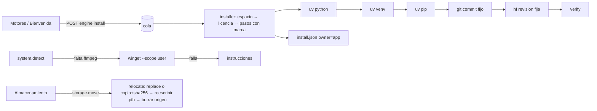

# 010: contexto y decisión

> **Decisiones y pendientes al ejecutar**: quien implemente esta spec puede tomar **todas las decisiones técnicas** que necesite, sin detenerse a pedir confirmación. Cada una queda en [`docs/process/WARNING/`](../../../process/WARNING/README.md); toda revisión pendiente, en [`docs/process/PENDING/`](../../../process/PENDING/README.md).
>
> **Datos del usuario: solo los que crea esta spec**. No borra ni sobrescribe voces grabadas, voces construidas, salidas de `out/` ni modelos que no creó; si algo parece exigirlo, es un `blocked — user-data`. Los motores instalados a mano son `external`: no se desinstalan ni se mueven sin confirmación explícita.

## 1. Precondición

La 009 está fusionada: `git show origin/dev:server/src/content_studio/music/duration.py` existe.

## 2. Contexto

* Las instalaciones están documentadas a mano en `narration/README.md` §2 y `music/README.md` §«Instalación»:
  * Qwen, OmniVoice y VoxCPM2: `uv venv -p 3.12` + `uv pip install <paquete> soundfile torch==2.14.1 torchaudio==2.11.1`.
  * Chatterbox: torch 2.6 cu126 + `git+https://github.com/resemble-ai/chatterbox`.
  * IndexTTS: `git clone` + su venv + `hf download IndexTeam/IndexTTS-2.5`.
  * CosyVoice: `git clone --recursive` + venv 3.10 + `requirements` + `pip uninstall wetext` + `snapshot_download` con `ignore_patterns`.
  * ACE-Step: `git clone` + venv + demucs sin dependencias.
  * HeartMuLa: `git clone` + venv 3.10 + torch 2.10 cu128 + `-e heartlib`.
  * Los pesos de Qwen, Chatterbox, OmniVoice y VoxCPM2 van a `~/.cache/huggingface`, y los de IndexTTS y CosyVoice quedan dentro de su repo.
* Las rutas son constantes en `paths.py` (`DATA`, `NARRATION`, `MUSIC`, `OUT` y `DB`), con datos en `server/data/` y la base en `var/`.
* `devtools/move_data.py` mueve carpetas y reescribe las rutas absolutas de `.pth` y `direct_url.json`, pero vive en devtools, que no viaja en la app instalada.
* El catálogo de la API (004) ya dice si un motor está instalado (si existe su venv), y la licencia está en `registry.py`.
* Las decisiones del usuario: instalar, verificar, reparar y desinstalar; carpeta elegible en esta spec; sin GPU, avisar y permitir CPU donde se pueda; asistente de bienvenida; ffmpeg del PATH o instalado con winget, con aviso.

## 3. Solución

* **D-1: rutas dinámicas**. `paths.py` mantiene `ROOT` y suma funciones: `data_dir()`, `engines_dir()` (venvs, repos y pesos), `models_cache()` (= `engines_dir()/hf`), `outputs_dir()` y `db_path()`. Las tres primeras se leen de `settings` (`storage.engines`, `storage.outputs`) con caché en el proceso. Por defecto, fuera del checkout y en todos los modos: `%LOCALAPPDATA%\Content Studio\` en Windows y `~/.local/share/content-studio/` en POSIX. `CONTENT_STUDIO_HOME` la cambia (la usan las pruebas de la 020) y la UI la cambia en Ajustes > Almacenamiento. En modo instalado (la 020 lo activa con `CONTENT_STUDIO_MODE=installed`), las salidas van a `Documentos\Content Studio\`; en dev, `out/` sigue en el checkout. La base no se mueve con `storage.*`: vive en `var/` en dev y en `%LOCALAPPDATA%` instalado, porque es la que guarda dónde está todo lo demás. Se reemplazan todos los usos de las constantes (`graphify affected "paths" --depth 2` para encontrarlos). Los voices, references y samples siguen en `data_dir()`. Solo lo pesado (venvs y pesos) se mueve con `storage.engines`.
* **D-2: recetas** (`server/src/content_studio/engines/recipes/<engine>.json`, validadas por `recipes.py` con un esquema chico escrito a mano, sin `jsonschema`):

  ```json
  {"engine": "voxcpm2", "size_gb": 4.8, "vram_gb": 5.5, "cpu": false, "license": "apache-2.0",
   "steps": [
     {"kind": "python", "version": "3.12"},
     {"kind": "venv", "path": "narration/.venv-voxcpm"},
     {"kind": "pip", "packages": ["voxcpm==<ver>", "soundfile", "torch==2.14.1", "torchaudio==2.11.1"], "index": null},
     {"kind": "hf", "repo": "openbmb/VoxCPM2", "revision": "<sha>", "into": "hf"},
     {"kind": "verify", "import": "voxcpm"}]}
  ```

  `kind` puede ser `python` (`uv python install`), `venv` (`uv venv -p`), `pip` (`uv pip install` con `VIRTUAL_ENV`, `--index-url` o `--torch-backend`, `--no-deps` y `uninstall`), `git` (clone `--depth 1` de un **commit fijo**, recursivo si hace falta), `hf` (`huggingface_hub.snapshot_download` corrido con el python del venv: `revision` fija, `allow_patterns` e `ignore_patterns`, reanudable porque hf retoma los parciales) y `verify` (import, más la prueba de humo de D-4). Hay una receta por motor (VoxCPM2, Qwen 0.6B y 1.7B, Chatterbox, OmniVoice, IndexTTS, CosyVoice, ACE-Step con demucs y HeartMuLa), sacada de los README con versiones y commits fijados (WARNING `010-recetas.md`). La 011 agrega `faster-whisper`. Se descartó un script de instalación por motor porque serían 9 scripts casi iguales, mientras que una receta es una línea de datos por paso.
* **D-3: ejecutor** (`engines/installer.py` y `services/engine_install.py`). El trabajo `engine.install {engine, repair?}` (recurso `cpu`) hace lo siguiente:
  1. Chequea el espacio libre (`shutil.disk_usage(engines_dir())`, `size_gb × 1.2`) y aborta con `disk_full` si no alcanza.
  2. Exige `license.accepted.<engine>` para las licencias no comerciales (el mismo diálogo de la 006).
  3. Corre cada paso con un marcador `steps/<n>.done` en `engines_dir()/<engine>/`, para que un reintento siga desde el primer paso sin marca.
  4. Emite `@@progress` por paso y, en `hf`, por bytes (calculado desde el tamaño de la carpeta destino contra el total de la API de hf).
  5. Escribe `install.json` (`{owner: "app", recipe_version, installed_at, paths: [...]}`).

  Con `repair`, borra solo el venv (no los pesos) y rehace los pasos `python`, `venv` y `pip`. El trabajo `engine.uninstall {engine}` borra las `paths` de `install.json` si `owner == app`. Con `owner == external` (motores detectados en modo dev sin `install.json`) responde 409 `engine_external`, salvo con `force` y la confirmación de la UI (D-7). `GET /engines` lista cada motor con su estado (`missing`, `installing`, `installed`, `broken` o `external`), el tamaño en disco, el requisito de VRAM, la licencia, si sirve en CPU y el resultado de la última verificación.
* **D-4: verificar**. El trabajo `engine.verify {engine}` (recurso `gpu`) importa la librería en su venv y genera 1 s: para TTS, `tts.py --text "Prueba." --model <e>` con la voz de prueba incluida (`reference/test/`). Para música, `music_main.py --duration 5` (el mínimo que acepta el motor), recortado a 1 s. El resultado (`ok` o el error con `stderr` resumido) queda en `settings` como `engine.verify.<engine>`. `server/tests/integration/test_venvs.py` (`-m local`) llama a la misma función.
* **D-5: herramientas del sistema** (`system/tools.py`). `detect()` devuelve `{ffmpeg: {path, version} | null, git: …, gpu: {name, vram_gb, driver, cuda} | null}` (con `shutil.which` y `nvidia-smi --query-gpu=name,memory.total,driver_version --format=csv,noheader`). `install_tool('ffmpeg'|'git')` corre `winget install --id Gyan.FFmpeg -e --scope user --accept-package-agreements --accept-source-agreements` (y `Git.Git` para git), y después vuelve a leer el PATH del registro (`HKCU\Environment` y `HKLM\...\Environment`) para encontrar el binario sin reiniciar la app. Si winget no existe o falla, responde `{installed: false, code: "tool_install_failed", instructions}`, con el texto del catálogo y los enlaces oficiales. Expone `GET /system` y `POST /system/tools/{name}/install` (un trabajo `system.install_tool`, recurso `cpu`). El server llama a `detect()` al arrancar, y si falta ffmpeg, las secciones que lo usan muestran un banner con «Instalar ffmpeg». En POSIX, sin winget, solo muestra las instrucciones (`apt` o `brew`). Se descartó incluir ffmpeg en la app por decisión del usuario.
* **D-6: almacenamiento** (`storage/relocate.py`, movido desde `devtools/move_data.py`, que ahora lo importa). `relocate(src, dst)`: si están en el mismo volumen usa `os.replace`. Si no, copia con verificación (tamaño y `sha256` por archivo, con progreso), reescribe los `.pth` y `direct_url.json` con el prefijo nuevo, actualiza `settings`, y recién entonces borra el origen. Si algo falla antes del borrado, el origen queda intacto y el destino parcial se borra (WARNING `010-mover-entre-discos.md`). El trabajo `storage.move {target: "engines"|"outputs", to}` (recurso `cpu`) espera a que no haya trabajos corriendo y pausa la cola mientras mueve. Mover `outputs` no reescribe las rutas viejas de `jobs.output_dir`: guarda la raíz anterior y la nueva en `storage.outputs_moves`, y `/files` resuelve las rutas antiguas con ese mapa (decisión de mínimo cambio en la base).
* **D-7: pantallas**:
  * **Motores** (`features/engines/EnginesPage.tsx`, grupo Ajustes en `nav.ts`): una tarjeta por motor agrupada por TTS, Música y Transcripción. Cada tarjeta muestra el estado, la licencia con badge, el tamaño, la VRAM requerida contra la detectada (`entra`, `justo` o `no entra`), si sirve en CPU, la última verificación, y los botones Instalar, Verificar, Reparar y Desinstalar (con confirmación y el espacio que se libera). Los `external` tienen un badge, y Desinstalar exige escribir el nombre del motor para confirmar. Sin GPU, los motores que no sirven en CPU quedan deshabilitados con el motivo.
  * **Ajustes > Almacenamiento**: carpeta de motores y carpeta de salidas, cada una con su ruta, tamaño usado y espacio libre del disco, y «Cambiar…» (diálogo de carpeta y confirmación con lo que se moverá y el tiempo estimado).
  * **Bienvenida** (`features/welcome/WelcomeWizard.tsx`): sale al abrir la app si `welcome.done` no existe y no hay motores instalados ni externos. Paso 1: herramientas (ffmpeg y git, con Instalar si faltan) y GPU detectada. Paso 2: carpetas (por defecto, o cambiar). Paso 3: paquete recomendado (VoxCPM2, ACE-Step y faster-whisper large-v3-turbo cuando exista la 011; hasta entonces, los dos primeros) con el tamaño total y casillas para sumar otros. Paso 4: instalar (los trabajos en la cola) y «Ir a Narración».
  * En Narración y Música, el hint «Instálalo en Motores» de los motores faltantes pasa a ser un botón que abre la tarjeta del motor.
* **D-8: docs**. Los README de datos reemplazan la instalación manual por «desde la UI o con `studio engines install <e>`», y dejan las recetas como referencia. Se actualizan `AGENTS.md` (Requisitos), `stack.md` (recetas y winget), `codigo-python.md` (cómo agregar un motor: archivo, línea en el registro y **receta**), `worktrees.md` (los enlaces siguen a `engines_dir()`) y `docs/process/01-done/` (ficha nueva `engines.md`).

## 4. Fuera de alcance

* La receta de faster-whisper: la agrega la 011.
* El instalador NSIS y el modo `installed` empaquetado: los hace la 020. Aquí el modo instalado se prueba con la variable de entorno.
* Actualizar un motor a una versión nueva: hoy es desinstalar e instalar (PENDING si se pide).
* Bajar los pesos desde mirrors o con tokens de hf: los modelos actuales son públicos.

## 5. Criterios de aceptación

* **AC-1**: Given `storage.engines = X` When se llaman `engines_dir()` y `models_cache()` Then devuelven `X` y `X/hf`. Sin setting ni `CONTENT_STUDIO_HOME`, devuelven la carpeta por defecto fuera del checkout (`%LOCALAPPDATA%\Content Studio\engines` en Windows), también en dev. Con `CONTENT_STUDIO_HOME=X`, devuelven `X/engines` y `X/engines/hf`. Lo verifica: `test_paths.py`.
* **AC-2**: WHEN se cargan las 9 recetas THEN todas validan, todo `git` tiene commit, todo `hf` tiene `revision` y todo `pip` de torch tiene versión. Una receta con un paso desconocido se rechaza con el nombre del paso. Lo verifica: `test_recipes.py`.
* **AC-3**: Given una receta falsa de 3 pasos (comandos `python -c`) en la que falla el 2 When se reintenta Then el paso 1 no se vuelve a correr (tiene marca), el 2 y el 3 sí, y queda `install.json` con `owner: app`. Lo verifica: `test_installer.py`.
* **AC-4**: Given `disk_usage` simulado con 1 GB libre y una receta de 4,8 GB When se instala Then falla con `disk_full` antes de cualquier paso. Lo verifica: `test_installer.py`.
* **AC-5**: WHEN se desinstala un motor `external` sin `force` THEN responde 409 `engine_external` y no borra nada. Uno `app` borra solo sus `paths`. Lo verifica: `test_engine_uninstall.py`.
* **AC-6**: Given `which('ffmpeg')` simulado como ausente y `winget` presente When se instala ffmpeg Then se corre el comando exacto de D-5 y, con el PATH del registro simulado, `detect()` lo encuentra. Sin winget, responde `tool_install_failed` con instrucciones. Lo verifica: `test_tools.py`.
* **AC-7**: Given dos carpetas en volúmenes distintos (simulado: forzar el camino de copia) con un venv falso y un `.pth` When se corre `storage.move` Then los archivos llegan con el mismo sha256, el `.pth` se reescribe, `settings` cambia, el origen se borra al final, y si se interrumpe en la copia el origen queda intacto. Lo verifica: `test_relocate.py`, y `devtools/tests` siguen verdes.
* **AC-8**: WHEN se abre la app sin motores ni `welcome.done` THEN aparece la bienvenida. Al terminar, `welcome.done` queda y no vuelve a salir, y con motores `external` no aparece. Lo verifica: `WelcomeWizard.test.tsx` y un e2e.
* **AC-9**: WHEN la GPU detectada tiene 6 GB THEN la tarjeta de un motor de 7 GB dice «no entra» (y se puede instalar igual con un aviso). Sin GPU, los motores con `cpu: false` quedan deshabilitados con el motivo. Lo verifica: `EngineCard.test.tsx`.
* **AC-10**: WHEN, en una carpeta temporal de datos (`storage.engines = tmp/spec-010/data`), se instala de verdad un motor chico (Qwen 0.6B, ~2 GB) desde la UI, después se verifica, se repara y se desinstala THEN cada paso termina bien, la verificación genera 1 s de audio y al desinstalar no queda nada en esa carpeta. Lo verifica: la verificación final (descarga real).

## 6. Diagrama


