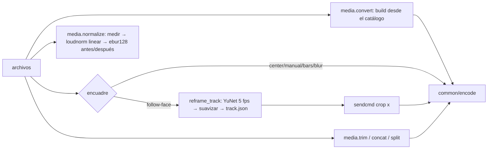

# 012: contexto y decisión

> **Decisiones y pendientes al ejecutar**: quien implemente esta spec puede tomar **todas las decisiones técnicas** que necesite, sin detenerse a pedir confirmación. Cada una queda en [`docs/process/WARNING/`](../../../process/WARNING/README.md); toda revisión pendiente, en [`docs/process/PENDING/`](../../../process/PENDING/README.md).
>
> **Datos del usuario: solo los que crea esta spec**. No borra ni sobrescribe voces grabadas, voces construidas, salidas de `out/` ni modelos que no creó; si algo parece exigirlo, es un `blocked — user-data`. Ninguna herramienta modifica sus archivos de entrada.

## 1. Precondición

La 011 está fusionada: `git show origin/dev:server/src/content_studio/common/encode.py` existe, igual que `media/formats.py` (010).

## 2. Contexto

* audio-converter (la referencia de la UI) convierte a MP3, OGG (Opus/Vorbis), M4A, WAV y FLAC, con calidad, canales y frecuencia, tiene una cola con estados por archivo y un `Dialog` de error con un mensaje amigable y el detalle técnico.
* Ya existen `common/ffmpeg.py` (probe, loudness, picos y silencedetect), `common/encode.py` (NVENC o x264), `media/formats.py` (extensiones de entrada), `/media/info` y `/media/peaks`, `Waveform` con Regions, `useSyncedMedia` y la cola con trabajos `cpu` en paralelo.
* La narración ya masteriza a -16 LUFS (`--master voice`) y la música mide LUFS. El README de música da su rango.
* Las decisiones del usuario: secciones Convertir, Normalizar y Recortar y unir; los cuatro encuadres; normalizar con presets, antes y después, lote y mejorar voz; recortar, unir, fades y dividir.

## 3. Solución

* **D-1: catálogo y armador**. `media/formats.py` define las salidas como datos:
  * **Audio**: `mp3` (libmp3lame, VBR V0–V9 o CBR), `wav` (pcm_s16le, s24le o f32le), `flac` (niveles 0–8), `ogg-opus` (libopus 32–256 kbps), `ogg-vorbis` y `m4a` (aac 96–320 kbps), con canales (mono o estéreo) y frecuencia (16 k, 22,05 k, 44,1 k o 48 k).
  * **Video**: `mp4-h264` y `mp4-h265` (NVENC o libx264/libx265, con CRF o CQ), `webm-vp9` (libvpx-vp9, crf y `-b:v 0`), `webm-av1` (libsvtav1 o libaom-av1 según lo que tenga el ffmpeg del sistema, informado por `system.detect()`), `mov` (h264 + aac) y `mkv` (copia de streams si el codec de origen es compatible, o h264), con resolución (original, 2160p, 1440p, 1080p, 720p o 480p, manteniendo el aspecto) y fps (original, 60, 30 o 24).
  * **Especiales**: `gif` (paleta en dos pasadas: `palettegen` + `paletteuse` con dither `sierra2_4a`, fps 10–30 y ancho máximo) y `extract-audio` (copia del stream si el contenedor lo permite, por ejemplo aac → m4a, o recodificado al formato de audio elegido).

  `media/convert.py` tiene `build(input_info, target, options) -> list[str]` (puro y probado con golden files de argumentos) y la validación (un codec que no está en el ffmpeg del sistema da `codec_unavailable`, con sugerencia). El trabajo es `media.convert {path, target, options}` (recurso `cpu`) y muestra el progreso con `-progress pipe:1` (`out_time_ms` contra la duración). La salida va a `outputs_dir()/convert/<fecha>-<id>-<slug>/<nombre>.<ext>`. Se descartó una clase por formato porque son datos y no comportamiento.
* **D-2: presets de redes** (`media/presets.py`): `reels` (1080×1920, 30 fps, H.264, AAC, -14 LUFS opcional), `tiktok` (igual), `shorts` (1080×1920, hasta 60 fps), `youtube-1080` (1920×1080) y `youtube-4k` (3840×2160), `square` (1080×1080) y `x-landscape` (1280×720). Cada preset tiene el tamaño, los fps y los bitrates máximos documentados por la plataforma (WARNING con las fuentes) y el encuadre por defecto `center`. El recomendado (★) se elige por la proporción de la fuente.
* **D-3: encuadre** (`media/reframe.py`). Hay cuatro modos:
  * `center`: `scale` para cubrir el cuadro y `crop` centrado.
  * `manual {x, y, w, h}`, en coordenadas normalizadas del origen: `crop` y después `scale`.
  * `fit-bars {color}`: `scale` para entrar en el cuadro y `pad` con el color.
  * `fit-blur {strength}`: `split` en dos ramas, una escalada para cubrir con `boxblur`, y encima la otra escalada para entrar (`overlay` centrado).
  * `follow-face`: el trabajo `media.reframe_track {path}` (recurso `cpu`) corre `vision/face_track_main.py` en `.venv-vision` (receta nueva de la 009: `opencv-python-headless` y el modelo YuNet `face_detection_yunet_2023mar.onnx` del repo `opencv_zoo` con su commit fijado). Muestrea a 5 fps y elige la cara de mayor área (con continuidad: la más cercana a la anterior si hay varias). Si no hay cara, conserva la última posición (o el centro). La trayectoria del centro en x (e y si el destino es más ancho) se suaviza con una media móvil de 1 s y un límite de velocidad del 25 % del ancho por segundo, y se escribe `track.json`. El render genera un archivo `sendcmd` con un comando `crop x` cada 1/5 s (interpolado), aplicado al `crop` que va después de `scale`.

  El modo y sus parámetros van en `options.reframe`.
* **D-4: normalizar** (`media/normalize.py`):
  * Primera pasada: `loudnorm=I=<t>:TP=-1.0:LRA=11:print_format=json` para medir.
  * Segunda pasada: `loudnorm` con `measured_*` y `linear=true`. Si la fuente no permite un lineal dentro del true peak, ffmpeg cae a dinámico, y el resultado lo informa.

  Los presets son `youtube` (-14), `podcast` (-16), `broadcast` (-23, EBU R128) y `custom`. **Mejorar voz** (opcional) es una cadena fija `highpass=f=80, deesser=i=0.3, acompressor=threshold=-20dB:ratio=2.5:attack=10:release=150` antes del loudnorm (WARNING con la justificación). Nunca se aplica a archivos dentro de `reference/`: el server lo rechaza con `reference_protected`, para que las referencias de clonación no se procesen. En un video normaliza solo el audio, con `-c:v copy`. El resultado (`result.before` y `result.after`, cada uno con `{I, TP, LRA}`) se mide con `ebur128` después del render, y no con los números que imprime loudnorm. El trabajo es `media.normalize` (recurso `cpu`).
* **D-5: recortar, unir, fades y dividir** (`media/edit.py`):
  * **Recortar** `{path, start, end, mode: keep|remove, fade_in, fade_out}`. `keep` es un `trim`/`atrim`. `remove` son dos segmentos unidos con `acrossfade` de 15 ms (lo mismo que el limpiador, reusando `clean/render.py`). Los fades van con `afade` y, en video, `fade`.
  * **Unir** `{paths: [...], crossfade: 0..3 s}`. Audio con `concat` o `acrossfade`. Video con `xfade=transition=fade` + `acrossfade` si hay crossfade, y si no, con `concat`, normalizando antes todos los clips a la resolución, los fps y la frecuencia del primero (`scale` + `pad`, `fps` y `aresample`). Mezclar audio y video en una misma unión da `mixed_kinds`.
  * **Dividir** `{path, every_seconds | markers: [...]}`. Un archivo por parte (`<nombre>-01.<ext>`, …), con corte exacto recodificado, o `-c copy` si el usuario lo elige en Avanzado y acepta que el corte cae en un keyframe.

  Los trabajos son `media.trim`, `media.concat` y `media.split` (recurso `cpu`), y todos recodifican con `common/encode.py`.
* **D-6: pantallas**:
  * **Convertir** (`features/convert/`, grupo Editar): una zona de arrastre grande que se achica a una franja cuando hay archivos (como audio-converter). Debajo, el formato de destino ★ (agrupado en Audio, Video, Redes y Especiales), la calidad, un popover «Avanzado» (canales, frecuencia, resolución y fps) y, para Redes, el encuadre con su vista previa: un cuadro de la fuente (`/media/frame?path=&t=`, endpoint nuevo que devuelve un JPEG temporal en `tmp/`) con el rectángulo del recorte (arrastrable en `manual`), las barras o el desenfoque simulados en CSS, y en `follow-face` la trayectoria dibujada sobre la línea de tiempo después de analizar. La tabla de archivos tiene el estado (en cola, convirtiendo con %, listo, error con el `Dialog` de detalle técnico o cancelado) y las acciones (abrir carpeta, reintentar o quitar). La última configuración queda en `convert.*`.
  * **Normalizar** (`features/normalize/`): lote de archivos, el preset ★ (`podcast` para audio hablado y `youtube` para video, según el tipo), mejorar voz y la tabla con antes y después (I, TP y LRA) y un A/B (`Player` con un conmutador que mantiene la posición).
  * **Recortar y unir** (`features/edit/`) tiene tres pestañas: **Recortar** (onda con una región, video arriba si lo hay, mantener o quitar, fades, y la duración resultante), **Unir** (lista arrastrable con la duración de cada clip, el crossfade y el total) y **Dividir** (cada N min o marcadores puestos con M en la onda).
* **D-7: docs**. Fichas nuevas `docs/process/01-done/convert.md` y `edit.md`, más `AGENTS.md` (herramientas).

## 4. Fuera de alcance

* Edición multipista o con línea de tiempo de NLE: para eso está el EDL o XML de la 010.
* Reencuadre con varias personas o cambio de plano automático: se sigue a la cara principal.
* Reducción de ruido con IA y separación de voz y música.
* Conversión de imágenes.

## 5. Criterios de aceptación

* **AC-1**: WHEN se llama a `build` para cada formato de destino con una entrada de fixture THEN los argumentos coinciden con los golden files, y un codec que no está en el ffmpeg simulado da `codec_unavailable`. Lo verifica: `test_convert.py`.
* **AC-2**: WHEN se convierten un WAV de fixture a cada formato de audio y un MP4 de fixture a cada formato de video THEN `ffprobe` informa el codec, los canales, la frecuencia y la resolución pedidos, y la duración igual ± 50 ms (± 1 cuadro en video). Lo verifica: `test_convert_render.py` (ffmpeg real; los codecs que falten en CI se saltean con `skipif` y en local se prueban todos).
* **AC-3**: WHEN se convierte un video de fixture de 10 s a GIF de 15 fps y 480 de ancho THEN el GIF tiene 150 ± 2 cuadros y 480 px de ancho. Lo verifica: `test_convert_render.py`.
* **AC-4**: WHEN se aplica `reels` a un video de 1920×1080 con `center`, `fit-bars` y `fit-blur` THEN la salida es de 1080×1920 en los tres casos. En `fit-bars`, la franja superior es del color pedido, y en `fit-blur` no es de un solo color. Lo verifica: `test_reframe.py` (cuadros leídos con ffmpeg a `rawvideo`).
* **AC-5**: Given una trayectoria de caras con un salto brusco When se suaviza Then ningún paso supera el límite de velocidad y la media móvil la sigue. Sin caras, conserva la última posición. Lo verifica: `test_face_track.py` (función pura de suavizado) y un test `-m local` con un video sintético (un círculo con forma de cara que no detecta YuNet → centro) más una foto con cara del set de prueba de OpenCV.
* **AC-6**: WHEN se normaliza un audio de fixture de -30 LUFS a `podcast` THEN el resultado medido con `ebur128` da -16 ± 0,5 LUFS y TP ≤ -1,0 dBTP. En un video, el stream de video sale copiado (mismo hash de paquetes). Con una ruta dentro de `reference/`, falla con `reference_protected`. Lo verifica: `test_normalize.py`.
* **AC-7**: WHEN se recorta en modo `remove` el tramo 2–4 s de un audio de 10 s THEN dura 8 s ± 20 ms sin clic, y en `keep` con fades de 0,5 s el RMS de los primeros 50 ms es al menos 20 dB menor que el del segundo 1. Lo verifica: `test_edit.py`.
* **AC-8**: WHEN se unen 3 videos de resoluciones distintas con crossfade de 1 s THEN la salida tiene la resolución del primero y dura la suma menos 2 s ± 1 cuadro. Unir audio con video da `mixed_kinds`. Lo verifica: `test_edit.py`.
* **AC-9**: WHEN se divide un audio de 25 min cada 10 min THEN salen 3 partes de 10, 10 y 5 min ± 20 ms. Con los marcadores `[60, 120]` salen 3 partes. Lo verifica: `test_edit.py`.
* **AC-10**: WHEN se arrastran 5 archivos en Convertir y se elige MP3 V2 THEN se encolan 5 trabajos que corren en paralelo (hasta el pool), la tabla muestra el progreso de cada uno, un error muestra el `Dialog` con el detalle y la configuración queda recordada. Lo verifica: `ConvertPage.test.tsx` y el e2e `convert/happy-batch-mp3.e2e.ts`.
* **AC-11**: WHEN se elige Reels con `manual` y se arrastra el rectángulo THEN las `options.reframe` del trabajo tienen las coordenadas normalizadas del rectángulo. Lo verifica: `ReframePreview.test.tsx` y un e2e.
* **AC-12**: WHEN se reencuadra a Reels con `follow-face` un video horizontal real con una persona que se mueve THEN la cara queda dentro del tercio central en al menos el 90 % de los cuadros muestreados, sin saltos visibles. Lo verifica: la verificación final (cuadros revisados por `image-reader` y la mirada del usuario).

## 6. Diagrama

## 7. Debe sonar / no debe sonar

| Salida | Debe | No debe |
| :--- | :--- | :--- |
| Normalizar a -16 (podcast) | -16 ± 0,5 LUFS, TP ≤ -1 dBTP y el mismo carácter | Bombeo, clipping ni un cambio de tono |
| Mejorar voz | La voz más clara, sin graves de ambiente y sibilancia controlada | Sonido «enlatado» ni sobrecomprimido |
| Recortar `remove` y unir con crossfade | Transiciones limpias | Clics, saltos de volumen ni desincronización en video |
