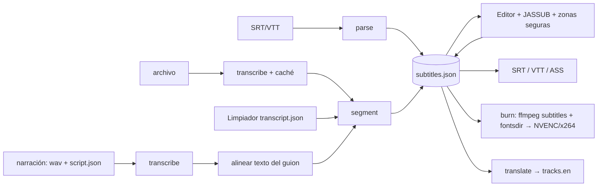

# 012: contexto y decisión

> **Decisiones y pendientes al ejecutar**: quien implemente esta spec puede tomar **todas las decisiones técnicas** que necesite, sin detenerse a pedir confirmación. Cada una queda en [`docs/process/WARNING/`](../../../process/WARNING/README.md); toda revisión pendiente, en [`docs/process/PENDING/`](../../../process/PENDING/README.md).
>
> **Datos del usuario: solo los que crea esta spec**. No borra ni sobrescribe voces grabadas, voces construidas, salidas de `out/` ni modelos que no creó; si algo parece exigirlo, es un `blocked — user-data`. Quemar nunca modifica el video de entrada.

## 1. Precondición

La 011 está fusionada: `git show origin/dev:server/src/content_studio/transcription/cache.py` existe, igual que `clean/exports.py` y `WhisperModelSelect.tsx`.

## 2. Contexto

* La 011 dejó: el trabajo `transcribe` con caché (`transcripts`) y JSON por palabra; el limpiador, con `transcript.json` y los tiempos reasignados; un SRT básico en `clean/exports.py`; el render de video con NVENC o x264; `WhisperModelSelect`; `Waveform` con Regions y Timeline; y `useSyncedMedia` (video y onda sincronizados).
* La narración (006) guarda `script.json` con el texto de cada bloque y el `.wav` final.
* El ffmpeg del sistema (010) puede no tener libass. `system.detect()` tiene que informar si el filtro `subtitles` está disponible (`ffmpeg -filters`).
* Las decisiones del usuario: todo seleccionable y configurable; presets incluidos y propios con ★ según el formato; fuentes incluidas y del sistema; vista previa exacta; zonas seguras; traducción al inglés; palabras clave; los cuatro orígenes.

## 3. Solución

* **D-1: documento**. `subtitles/document.py` define `{version, source: {path, kind}, language, cues: [{id, start, end, text, words: [{start, end, text, keyword?: {color?, emoji?}}]}], style: {...}, tracks: {en?: [...] }}`, con `load`, `save`, `split(cue_id, at_word)`, `merge(a, b)`, `shift(cue_id, delta)` y `set_text(cue_id, text)` (reparte las palabras nuevas en el intervalo, proporcional a los caracteres, si cambia la cantidad de palabras). Todas son puras salvo `load` y `save`. Se guarda en `outputs_dir()/subtitles/<fecha>-<id>-<slug>/subtitles.json`. La migración 4 crea `subtitle_projects (id, name, source_path, doc_path, created_at, updated_at)`, con rutas y nombres solamente. API: `GET|POST /subtitles`, `GET|PUT /subtitles/{id}` (el documento entero; el client manda el documento editado con un debounce de 1 s) y `DELETE` (borra el registro y mueve la carpeta a `.trash/`).
* **D-2: segmentación** (`subtitles/segment.py`, pura). `segment(words, max_chars=42, max_lines=2, max_duration=7.0, min_duration=0.8, words_per_cue=None) -> cues`. Corta en la puntuación fuerte primero, después en la débil y después en el límite de caracteres. Con `words_per_cue` (estilo de redes, de 1 a 4) agrupa por cantidad de palabras sin cruzar la puntuación fuerte. Reemplaza el SRT básico de la 011 (`clean/exports.py` pasa a usarla).
* **D-3: formatos** (`subtitles/formats.py`): `to_srt`, `to_vtt` y `parse_srt` y `parse_vtt` (tolerantes a BOM, CRLF y etiquetas `<i>`; las palabras importadas se estiman repartiendo el tiempo del cue por caracteres). La generación de ASS va en `subtitles/ass.py`:
  * **Clásico**: un `Dialogue` por cue con el estilo del preset.
  * **Redes con resaltado**: por cada palabra activa, un `Dialogue` con el cue entero y la palabra actual en el color de resaltado (`{\c&H..&}`), más la animación opcional «pop» (`\t(0,80,\fscx115\fscy115)\t(80,160,\fscx100\fscy100)`). También admite mayúsculas y las palabras clave (otro color y el emoji al lado).
  * **Karaoke**: `\kf` por palabra.

  `PlayResX` y `PlayResY` toman la resolución del video (o 1920×1080 si es solo audio), y los márgenes salen de la posición del preset. Se descartó generar el estilo de redes solo con `\k` porque no permite el «pop» ni los colores por palabra clave.
* **D-4: orígenes** (`subtitles/sources.py` y el trabajo `subtitles.create {from, ...}`, recurso `gpu` salvo `import`):
  * `file`: transcribe con la caché (011) y segmenta.
  * `cleaner`: toma `transcript.json` del trabajo del limpiador (sin GPU) y su archivo limpio como fuente.
  * `narration`: transcribe el `.wav` de la narración y **alinea** el texto de `script.json`. Normaliza los dos textos (sin tildes ni signos, en minúsculas), los alinea con `difflib.SequenceMatcher` sobre las listas de palabras, usa el texto del guion con los tiempos de whisper en los `equal` y `replace`, e interpola los tiempos de las palabras sin par entre sus vecinas.
  * `import`: `parse_srt` o `parse_vtt` sin GPU.

  En la pantalla de resultado del Limpiador y en la de Narración aparece el botón «Subtitular», que abre Subtítulos con el origen precargado.
* **D-5: estilos y presets** (`subtitles/styles.py`). Un estilo es `{font, size, bold, color, outline_color, outline, shadow, back_box?, position: bottom|middle|top, margin_v, uppercase, mode: classic|social|karaoke, words_per_cue, highlight_color, pop}`. Presets incluidos: `classic` (inferior, blanco con borde negro, 2 líneas), `reels` (centrado, Montserrat ExtraBold, mayúsculas, 2 palabras, resaltado amarillo y pop), `karaoke` (inferior y relleno progresivo) y `minimal` (inferior, chico y caja semitransparente). Los propios van en `settings` como `subtitles.presets` (lista JSON con nombre). El recomendado (★) depende de la relación de aspecto de la fuente: vertical (≤ 0,8) → `reels`, y si no → `classic`. El último usado queda como `subtitles.last_preset`.
* **D-6: fuentes**. El set OFL versionado en `server/data/fonts/` (Montserrat, Poppins, Bebas Neue, Inter e Inter Tight, en los pesos que usan los presets) lleva `OFL.txt` por familia, cerca de 5 MB en total. Es una excepción al «sin binarios en el repo» por ser datos de la app, y queda en WARNING. `subtitles/fonts.py` lista las incluidas y las del sistema (`C:\Windows\Fonts` y `%LOCALAPPDATA%\Microsoft\Windows\Fonts`; en POSIX, `fc-list`) leyendo el nombre de familia de la tabla `name` de cada `.ttf` y `.otf` con `struct` (sin fontTools). El resultado se cachea en `media_cache`, o en un JSON en `tmp/`, solo con rutas. `GET /subtitles/fonts` devuelve `[{family, styles, path, bundled}]` y `/files` permite servir esas rutas para JASSUB.
* **D-7: quemar** (`subtitles.burn {project_id, preset?}`, recurso `cpu`). Escribe el `.ass` y corre `ffmpeg -i <video> -vf "subtitles=<ass>:fontsdir=<dir temporal con enlaces a las fuentes usadas>"`, recodificando con el mismo selector de codificador que la 011, que pasa a `common/encode.py` y lo usan las dos specs. El audio se copia. Si el ffmpeg del sistema no tiene libass, el trabajo falla con `ffmpeg_no_libass` y la UI explica que instale el build completo (`winget install Gyan.FFmpeg` trae libass) con el botón de la 010. Las rutas de Windows se escapan para el filtro (`C\:/...`), con su test. Con solo audio, quemar no aplica y solo hay exportación.
* **D-8: traducir al inglés**. El trabajo `subtitles.translate {project_id}` (recurso `gpu`) corre faster-whisper con `task="translate"` sobre la fuente, segmenta con los mismos límites y guarda `tracks.en`. Se exporta como `<nombre>.en.srt` y `.en.vtt`, y la vista previa permite alternar la pista. Los tiempos de la traducción salen de los segmentos de whisper, porque translate no da palabras, y el editor lo advierte. Se descartó un modelo de traducción aparte porque no está pedido y whisper ya lo trae.
* **D-9: pantalla Subtítulos** (`features/subtitles/`, grupo Editar en `nav.ts`):
  * **Inicio**: los proyectos recientes y «Nuevo», con los cuatro orígenes (archivo, del Limpiador, de una narración o importar), el modelo de whisper ★ e idioma ★ (reusados de la 011) y los límites de segmentación.
  * **Editor**:
    * Arriba, el video (o un fondo neutro con la onda si es solo audio) con la vista previa **JASSUB** del ASS actual, regenerado en el client con un `ass.ts`. Ese archivo es un espejo **solo del renderizado de vista previa**, y el server sigue siendo la fuente para exportar y quemar. Un test compara la salida de los dos sobre los mismos fixtures, así que no pueden divergir sin que falle (WARNING).
    * Encima, las zonas seguras opcionales (Reels, TikTok y Shorts, como datos en `safe-zones.json`).
    * Debajo, la línea de tiempo con los cues como regiones arrastrables (Regions).
    * A la derecha, la lista de cues con el texto editable, inicio y fin en mm:ss.mmm, dividir, unir y borrar, y las palabras como chips donde un clic marca la palabra clave (color o emoji).
    * El panel de estilo tiene el preset ★, los controles del estilo, «Guardar como…» y la fuente (incluidas primero y las del sistema con buscador).
    * Botones: Exportar (SRT, VTT, ASS y la pista en inglés si existe), Quemar y Traducir al inglés.
    * Atajos: Espacio, ← y → por cue, S dividir en el cursor y M unir con el siguiente.
* **D-10: docs**. Ficha nueva `docs/process/01-done/subtitles.md`, más `AGENTS.md` (herramientas) y las licencias de fuentes citadas en el README de datos.

## 4. Fuera de alcance

* Traducir a idiomas distintos del inglés: whisper solo traduce al inglés.
* Edición de video (recortar o reencuadrar): la 013 hace recortar y presets de redes.
* Subtítulos multipista con más de dos idiomas.
* Diarización y colores por hablante.

## 5. Criterios de aceptación

* **AC-1**: WHEN se llama a `segment` con 30 palabras con puntuación y `max_chars 42` THEN ningún cue pasa de 2 líneas de 42 caracteres ni de 7 s, y los cortes caen en la puntuación cuando la hay. Con `words_per_cue 2`, cada cue tiene 1 o 2 palabras. Lo verifica: `test_segment.py`, con doctests.
* **AC-2**: WHEN se hace `parse_srt(to_srt(doc))` THEN queda igual en texto y tiempos (±1 ms), lo mismo con VTT, y un SRT con BOM, CRLF y `<i>` se importa bien. Lo verifica: `test_formats.py`.
* **AC-3**: WHEN se genera ASS con el preset `reels` THEN hay un `Dialogue` por palabra activa con la palabra en el color de resaltado, mayúsculas y `\t` del pop, y con `classic` un `Dialogue` por cue. El `.ass` lo acepta `ffmpeg -i x.ass -f null -`. Lo verifica: `test_ass.py` (golden files y ffmpeg real).
* **AC-4**: Given un guion «Hola mundo, esto es una prueba» y palabras de whisper «hola mundo esto es un a prueba» When se alinea Then el texto del cue es el del guion y cada palabra del guion tiene un tiempo (interpolado donde whisper partió «una»). Lo verifica: `test_sources.py::test_ac4_align_narration`.
* **AC-5**: WHEN se divide un cue en la palabra 3 y después se unen THEN vuelve al original. `set_text` con una palabra más reparte los tiempos dentro del intervalo sin solaparse con el siguiente. Lo verifica: `test_document.py`.
* **AC-6**: WHEN se quema el preset `reels` en un video de fixture vertical de 1080×1920 THEN la salida tiene la misma resolución y duración, y en el cuadro de un tiempo con texto, la zona central tiene píxeles del color de resaltado. Sin libass, el trabajo falla con `ffmpeg_no_libass`. Lo verifica: `test_burn.py` (ffmpeg real; `skipif` sin libass) y un test con `detect()` simulado.
* **AC-7**: WHEN se escapa una ruta de Windows con espacios y `:` para el filtro `subtitles` THEN el resultado es válido para ffmpeg. Lo verifica: un doctest en `subtitles/burn.py`.
* **AC-8**: WHEN se pide `GET /subtitles/fonts` THEN aparecen las 5 familias incluidas con `bundled: true` y al menos Arial y Segoe UI del sistema en Windows. Lo verifica: `test_fonts.py` (lectura de la tabla `name` con un `.ttf` incluido) y la corrida real.
* **AC-9**: Given los mismos cues y estilo When se generan el ASS del server y el del client (`ass.ts`) Then son idénticos línea por línea. Lo verifica: `ass.test.ts` contra los golden files del server.
* **AC-10**: WHEN se guarda un preset propio y se reabre el editor con un video vertical THEN ★ está en `reels`, la preselección es el último usado (el propio) y el preset aparece en la lista. Lo verifica: `StylePanel.test.tsx`.
* **AC-11**: WHEN se crea un proyecto desde un resultado del Limpiador con «Subtitular» THEN no se encola ninguna transcripción (reusa `transcript.json`) y los cues caen sobre el video limpio. Lo verifica: e2e `subtitles/happy-from-cleaner.e2e.ts` y la corrida real.
* **AC-12**: WHEN se traduce al inglés un video en español THEN `tracks.en` tiene cues en inglés sobre los mismos tramos (±0,5 s) y se exporta `<nombre>.en.srt`. Lo verifica: la corrida real (`-m local`, `small`) y `test_translate.py` (simulado).

## 6. Diagrama

