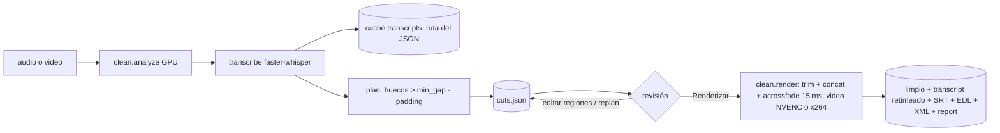

# 013: contexto y decisión

> **Decisiones y pendientes al ejecutar**: quien implemente esta spec puede tomar **todas las decisiones técnicas** que necesite, sin detenerse a pedir confirmación. Cada una queda en [`docs/process/WARNING/`](../../../process/WARNING/README.md); toda revisión pendiente, en [`docs/process/PENDING/`](../../../process/PENDING/README.md).
>
> **Datos del usuario: solo los que crea esta spec**. No borra ni sobrescribe voces grabadas, voces construidas, salidas de `out/` ni modelos que no creó; si algo parece exigirlo, es un `blocked — user-data`. El archivo de entrada nunca se modifica.

## 1. Precondición

La 012 está fusionada: `git show origin/dev:server/src/content_studio/engines/installer.py` existe y `engines/recipes/` también.

## 2. Contexto

* Hoy el whisper es `openai-whisper` como comando externo (`shutil.which('whisper')`). Lo usan `narration/evaluation` (`--evaluate`), `voices/build.py` (`import whisper` en el venv de CosyVoice) y `voice_check` (010).
* La 012 dejó las recetas, el instalador, `models_cache()` (`HF_HOME`), `system.detect()` (GPU, NVENC disponible si hay NVIDIA) y la cola.
* La 006 dejó `Waveform` y `Player` sobre wavesurfer.js, con picos del server, `/media/info` y `media_cache`.
* Las decisiones del usuario: cortar huecos de más de 500 ms con 150 ms de margen, revisar en la onda y la línea de tiempo con el video, audio solo también, el selector de whisper con ★ en large-v3-turbo y memoria, las salidas (limpio, transcripción, SRT, EDL o XML e informe), el selector de idioma con autodetección, el lote con revisión por archivo y la precisión en el video.

## 3. Solución

* **D-1: faster-whisper**. La receta `engines/recipes/faster-whisper.json` (venv 3.12, `faster-whisper==<ver>` y, en Windows, `nvidia-cublas-cu12` y `nvidia-cudnn-cu12` por pip, con sus `bin/` agregados al `PATH` del proceso por el script) pesa unos 0,3 GB sin modelos. Los modelos son un catálogo en `transcription/models.py`: `small`, `medium`, `large-v3-turbo` (★ `recommended`) y `large-v3`, con el repo de hf, el tamaño y la VRAM aproximada (`int8_float16` en GPU e `int8` en CPU). Se descargan la primera vez que se usan, dentro del trabajo, con progreso, o desde la tarjeta de Motores (012), que muestra cada modelo con su estado. La bienvenida de la 012 suma faster-whisper con large-v3-turbo al paquete recomendado.
* **D-2: servicio de transcripción** (`transcription/transcribe_main.py`, que corre en `.venv-whisper`). Los parámetros son `--input <ruta> --model <m> --language <es|en|…|auto> --out <words.json>`. Extrae el audio con ffmpeg a 16 kHz mono si es un video y llama a `WhisperModel.transcribe(word_timestamps=True, vad_filter=True)`. Escribe `{language, language_probability, duration, segments: [{start, end, text, words: [{start, end, word, probability}]}]}` y emite `@@progress` según `segment.end / duration`. `transcription/cache.py` resuelve la caché: la tabla `transcripts (id, source_path, source_mtime, source_size, model, language, json_path, created_at)` (migración 3, solo rutas y metadatos) y el JSON en `data_dir()/transcripts/<sha1(path+mtime+model+lang)>.json`. Si hay un acierto, no se vuelve a transcribir. El trabajo `transcribe {path, model, language}` (recurso `gpu`) lo usan el limpiador, la 014, la evaluación y el chequeo.
* **D-3: plan de cortes** (`clean/plan.py`, puro y con doctests). `plan(words, duration, min_gap=0.5, padding=0.15, edges=True) -> list[Cut]`, donde `Cut = {start, end, enabled}`:
  * Entre la palabra `i` y la `i+1`, si `gap = w[i+1].start - w[i].end > min_gap`, se corta `[w[i].end + padding, w[i+1].start - padding]`.
  * Con `edges`, también el inicio (`[0, w[0].start - padding]`) y el final, si superan `min_gap`.
  * Los cortes de menos de 50 ms se descartan.

  `keep_segments(cuts, duration)` es el complemento, y `remap(t, cuts) -> t'` reasigna un tiempo del original al limpio (las palabras dentro de un corte se pegan al borde). Los dos son puros y tienen tests de propiedades simples (monótono y sin solapes). `POST /clean/{job_id}/plan {min_gap, padding, edges}` replanifica en el momento con las palabras en caché, sin GPU. `PUT /clean/{job_id}/cuts` guarda la lista editada por el usuario (`cuts.json` en la carpeta del trabajo, que también se puede activar o desactivar o mover).
* **D-4: trabajos**. `clean.analyze {path, model, language, min_gap, padding, edges, auto_render}` (recurso `gpu`) transcribe con la caché, escribe `cuts.json` y termina `done` con `result.awaiting_review = true`, salvo con `auto_render` («Aplicar todos sin revisar»), que encola `clean.render` solo. `clean.render {analyze_job}` (recurso `cpu`; NVENC no compite por VRAM de forma significativa) arma la salida:
  * **Audio**: por cada segmento a conservar, `atrim` + `asetpts`, unidos con `acrossfade=d=0.015` entre segmentos (o `afade` de 15 ms en los bordes si un segmento dura menos de 30 ms).
  * **Video**: `trim` + `setpts` por segmento y `concat`, recodificando con `h264_nvenc -preset p5 -cq 19` si `system.detect().gpu` tiene NVENC, y si no, `libx264 -crf 18 -preset medium`. Mantiene la resolución, los fps y el formato del contenedor (mp4 → mp4 y mov → mov; mkv y webm salen como mp4 con H.264 y AAC y se anota). El audio va como arriba y en AAC a 192 kbps.
  * Con cientos de cortes, el `filter_complex` va en un archivo (`-filter_complex_script`) para no pasar el límite de la línea de comandos de Windows.
  * La precisión es de ±1 cuadro, que se verifica.
* **D-5: exportaciones** (`clean/exports.py`, puro salvo la escritura):
  * `transcript.txt` (texto por segmento) y `transcript.json` (las palabras con los tiempos reasignados).
  * `subtitles.srt` básico (segmentos de hasta 42 caracteres por línea, 2 líneas y 7 s, partidos en la palabra más cercana; los estilos completos son de la 014).
  * `cuts.edl` (CMX3600 con timecode a los fps del video, o 25 si es solo audio).
  * `cuts.xml` (FCP7 `xmeml` v5 con un clip por segmento sobre el archivo original, que importan Premiere y Resolve).
  * `report.json`: duración antes y después, segundos y porcentaje cortados, cantidad de cortes, el modelo, el idioma detectado y el tiempo de proceso.

  La UI muestra el informe y enlaces a cada archivo.
* **D-6: pantalla Limpiador** (`features/cleaner/`, grupo Editar en `nav.ts`):
  * **Entrada**: zona de arrastre o diálogo para uno o varios archivos de audio o video (extensiones en `media/formats.py`, que la 015 reutiliza). La configuración común es modelo de whisper ★ (`WhisperModelSelect`, en `shared/`, que la 014 reutiliza; muestra el tamaño y si está descargado), idioma ★ (es por defecto, en, otros y Detectar), hueco mínimo (ms), margen (ms) y bordes. Las preferencias van bajo `cleaner.*`. «Analizar» encola un `clean.analyze` por archivo, y «Aplicar todos sin revisar» los encola con `auto_render`.
  * **Lista del lote**: cada archivo con su estado (en cola, analizando con %, para revisar, renderizando o listo), su informe y «Revisar».
  * **Revisión** (`CleanReview.tsx`):
    * Si es video, arriba un `<video>` con `/files` sincronizado con la onda. Si es audio, solo la onda.
    * Debajo, `Waveform` con el plugin **Regions** (cortes en rojo semitransparente, arrastrables por los bordes, con clic para activar o desactivar) y **Timeline** (marcas de tiempo), zoom con la rueda y Ctrl, y desplazamiento.
    * A un costado, la transcripción con la palabra actual resaltada. Un clic en una palabra salta a ese punto.
    * Controles en vivo de hueco mínimo y margen, que llaman a `/plan` y reemplazan los cortes no editados a mano.
    * «Escuchar sin cortes» reproduce saltando las regiones activas, como vista previa.
    * Muestra la duración resultante en vivo, y «Renderizar» encola `clean.render`.
    * Atajos: Espacio para reproducir, ← y → para pasar de un corte a otro, y D para desactivar el corte actual.
* **D-7: migrar la evaluación y el chequeo**. `narration/evaluation` y `services/voice_check.py` llaman al servicio de transcripción (D-2) en vez del comando `whisper`, con el modelo de `settings` `transcription.model` (★ large-v3-turbo). `voices/build.py` también, si la dependencia de `openai-whisper` en el venv de CosyVoice no se usa para otra cosa (si se usa, queda y se anota). La receta de CosyVoice ya no instala `openai-whisper` si deja de hacer falta. Se cierra `PENDING/010-whisper-a-faster-whisper.md`.
* **D-8: docs**. Ficha nueva `docs/process/01-done/cleaner.md`, más `narration/README.md` (la evaluación con faster-whisper) y `AGENTS.md` (tabla de herramientas: Limpiador).

## 4. Fuera de alcance

* Editor completo de subtítulos, quemado y estilo de redes: los hace la 014.
* Cortar las muletillas (eh, este…): el usuario eligió solo los huecos.
* Reducción de ruido o normalización del limpio: normalizar es de la 015.
* Diarización (quién habla).

## 5. Criterios de aceptación

* **AC-1**: WHEN se llama a `plan` con las palabras `[0.0–0.4] [1.2–1.6] [1.9–2.3]`, duración 3.5, `min_gap 0.5` y `padding 0.15` THEN devuelve los cortes `[0.55–1.05]` y `[2.45–3.35]` (el borde final). El hueco de 0.3 s no se corta. Lo verifica: un doctest y `test_plan.py`.
* **AC-2**: WHEN se llama a `remap` sobre los tiempos de las palabras con esos cortes THEN las palabras quedan en `[0.0–0.4] [0.7–1.1] [1.4–1.8]` y la función es monótona. Lo verifica: `test_plan.py`.
* **AC-3**: Given un WAV de fixture (voz sintética de la narración de prueba con silencios de 1,5 s insertados) When se corre `clean.analyze` y `clean.render` con un transcriptor simulado que devuelve las palabras conocidas Then la salida dura lo esperado ± 20 ms y no hay ningún hueco de más de 0,5 + 2×0,15 s (medido con `silencedetect -50dB`). Lo verifica: `test_clean_render.py` (ffmpeg real).
* **AC-4**: Given un MP4 de fixture de 10 s a 30 fps con un contador de cuadros quemado (`drawtext` con `n`) y silencios conocidos When se renderiza Then el primer cuadro de cada segmento conservado es el esperado ± 1 cuadro (leído del color de un píxel que codifica el número de cuadro, sin OCR). El audio y el video duran lo mismo ± 1 cuadro. Lo verifica: `test_clean_render_video.py`.
* **AC-5**: WHEN se exporta THEN el EDL es CMX3600 válido (un evento por segmento con timecodes que suman la duración), el XML se valida como `xmeml` (estructura mínima: `sequence/media/video/track/clipitem`), el SRT no tiene líneas de más de 42 caracteres y `report.json` tiene las cifras correctas. Lo verifica: `test_exports.py`, con fixtures de golden files.
* **AC-6**: Given un archivo ya transcrito con el mismo modelo e idioma When se vuelve a analizar Then no se encola ninguna transcripción (acierto en `transcripts`) y la base no guarda el texto, solo la ruta del JSON. Lo verifica: `test_cache.py` y `test_no_blob_columns`.
* **AC-7**: WHEN se cambia el hueco mínimo de 500 a 800 ms en la revisión THEN `/plan` responde en menos de 200 ms (sin GPU), los cortes sin editar se recalculan y los editados a mano se conservan. Lo verifica: `test_clean_api.py` y `CleanReview.test.tsx`.
* **AC-8**: Given tres archivos arrastrados con «Aplicar todos sin revisar» When terminan Then hay tres salidas con sus exportaciones, y en la lista los tres están listos con su informe. Lo verifica: e2e `cleaner/happy-batch-auto.e2e.ts` (mock) y la corrida real.
* **AC-9**: WHEN se elige `medium` en el selector de whisper THEN queda como preselección la próxima vez (★ sigue en large-v3-turbo), y si el modelo no está descargado se muestra su tamaño y la descarga entra en el trabajo. Lo verifica: `WhisperModelSelect.test.tsx`.
* **AC-10**: WHEN se corre `narration tts --evaluate` y el chequeo de una toma THEN usan faster-whisper (no queda ningún `shutil.which('whisper')` en el código) y siguen detectando las palabras distintas en el fixture de evaluación. Lo verifica: `test_compare.py` (simulado), un `grep` en `test_structure.py` y la corrida real.
* **AC-11**: WHEN se limpia un video real de 3 a 5 minutos con large-v3-turbo THEN la transcripción usa menos de 3 GB de VRAM, el video limpio no tiene huecos de más de 0,8 s, no se oyen clics en los cortes y el SRT está sincronizado con la voz. Lo verifica: la verificación final (medición, espectrograma y escucha del usuario).

## 6. Diagrama

## 7. Debe sonar / no debe sonar

| Salida | Debe | No debe |
| :--- | :--- | :--- |
| Audio limpio | Habla continua y natural, con pausas de 0,3 s como máximo entre frases | Clics en los cortes, sílabas comidas en los bordes ni saltos de volumen |
| Video limpio | La imagen y el audio sincronizados en cada corte (±1 cuadro), con la misma resolución y fps | Cuadros congelados, desincronización acumulada ni pérdida de calidad visible |
| SRT del limpio | Cada subtítulo entra y sale con la voz (±150 ms) | Texto que aparece en un tramo cortado |
