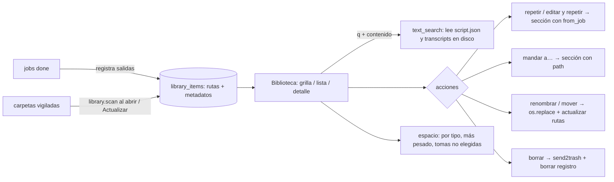

# 014: contexto y decisión

> **Decisiones y pendientes al ejecutar**: quien implemente esta spec puede tomar **todas las decisiones técnicas** que necesite, sin detenerse a pedir confirmación. Cada una queda en [`docs/process/WARNING/`](../../../process/WARNING/README.md); toda revisión pendiente, en [`docs/process/PENDING/`](../../../process/PENDING/README.md).
>
> **Datos del usuario: solo los que crea esta spec**. No borra ni sobrescribe voces grabadas, voces construidas, salidas de `out/` ni modelos que no creó; si algo parece exigirlo, es un `blocked — user-data`. La Biblioteca nunca borra nada sola.

## 1. Precondición

La 013 está fusionada: `git show origin/dev:server/src/content_studio/mix/render.py` existe y `db/schema.py` tiene las migraciones 1 a 5.

## 2. Contexto

* Cada trabajo deja su carpeta `outputs_dir()/<kind>/<fecha>-<id>-<slug>/` con las salidas y `params.json`. La tabla `jobs` tiene `kind`, `status`, `params`, `output_dir`, `result`, `starred` y `group_key` (004 y 006).
* Las transcripciones están en caché en `data_dir()/transcripts/*.json` (010) y las narraciones guardan `script.json` (006).
* `/media/info` cachea la duración y los LUFS en `media_cache`, y `/media/frame` saca cuadros (012).
* La regla del usuario: **SQLite solo para rutas, metadatos y cachés, nunca para contenido**.
* Las decisiones del usuario: salidas y carpetas vigiladas; filtros y búsqueda, etiquetas, proyectos y grilla o lista; mandar a…, origen y repetir, renombrar y mover, y papelera; el resumen del espacio.

## 3. Solución

* **D-1: índice** (`library/index.py`, migración 6):

  ```sql
  CREATE TABLE library_items (id INTEGER PRIMARY KEY, path TEXT NOT NULL UNIQUE, kind TEXT NOT NULL,
    origin TEXT NOT NULL CHECK (origin IN ('job','watched')), job_id INTEGER REFERENCES jobs(id),
    size INTEGER NOT NULL, mtime REAL NOT NULL, duration REAL, width INTEGER, height INTEGER,
    media_type TEXT NOT NULL CHECK (media_type IN ('audio','video','subtitle','other')),
    missing INTEGER NOT NULL DEFAULT 0, indexed_at TEXT NOT NULL);
  CREATE TABLE library_folders (id INTEGER PRIMARY KEY, path TEXT NOT NULL UNIQUE, name TEXT, added_at TEXT NOT NULL);
  CREATE TABLE tags (id INTEGER PRIMARY KEY, name TEXT NOT NULL UNIQUE);
  CREATE TABLE item_tags (item_id INTEGER REFERENCES library_items(id) ON DELETE CASCADE, tag_id INTEGER REFERENCES tags(id) ON DELETE CASCADE, PRIMARY KEY (item_id, tag_id));
  CREATE TABLE projects (id INTEGER PRIMARY KEY, name TEXT NOT NULL, created_at TEXT NOT NULL);
  CREATE TABLE project_items (project_id INTEGER REFERENCES projects(id) ON DELETE CASCADE, item_id INTEGER REFERENCES library_items(id) ON DELETE CASCADE, PRIMARY KEY (project_id, item_id));
  ```

  * Cuando un trabajo pasa a `done`, el worker registra sus salidas (`origin = job`, `kind` = el del trabajo: `narration`, `music`, `clean`, `subtitles`, `mix`, `convert`…).
  * Los trabajos `done` anteriores a esta spec se indexan una vez en la migración, recorriendo `jobs`.
  * `library.scan {folder_id?}` (recurso `cpu`) recorre cada carpeta vigilada con `os.scandir` recursivo y las extensiones de `media/formats.py`. Agrega los archivos nuevos (con `ffprobe` para la duración y el tamaño), actualiza los que cambiaron de `mtime` o `size` y marca `missing = 1` los que ya no están. Nunca borra registros solo.
  * Al abrir la Biblioteca se encola un escaneo si el último tiene más de 5 minutos, y hay un botón «Actualizar».
  * **Miniaturas**: de video, un cuadro al 10 % (`/media/frame`), guardado en `data_dir()/cache/thumbs/<sha1(path+mtime)>.jpg` y generado bajo demanda al mostrarlo. De audio, la onda chica a partir de `/media/peaks?n=200`, dibujada en un canvas. La base no guarda imágenes.
  * Se descartó un watcher en vivo (`watchdog`) porque es una dependencia y un hilo extra para una biblioteca personal (WARNING).
* **D-2: búsqueda y filtros**. `GET /library?q=&kind=&media_type=&tag=&project=&starred=&from=&to=&min_dur=&max_dur=&sort=&page=`. Los filtros son SQL sobre `library_items` con `jobs` y `tags`. El texto `q` busca en el nombre del archivo y en las etiquetas (SQL `LIKE`) y, si el usuario activa «Buscar también en el contenido», en el texto de `script.json` de las narraciones y en los JSON de transcripción de la caché (`library/text_search.py`, que lee de disco con un límite de tiempo y devuelve los ids que coinciden). La base no guarda texto. A la escala de una biblioteca personal (miles de archivos), la lectura en disco alcanza. Si deja de alcanzar, la mejora es un índice FTS como caché (WARNING `014-busqueda-en-disco.md`, que pide decidirlo con el usuario por la regla de la base).
* **D-3: etiquetas y proyectos**. CRUD en `api/routes/library.py`: `POST|DELETE /library/{id}/tags`, `GET /tags`, `GET|POST|PATCH|DELETE /projects` y `POST|DELETE /projects/{id}/items`. Un proyecto es una agrupación (no copia archivos), y borrarlo solo borra la agrupación.
* **D-4: acciones**:
  * **Origen**: `GET /library/{id}` devuelve el ítem, su trabajo (con `params`, `result`, fechas y duración del proceso), las otras salidas del mismo trabajo y las tomas del mismo `group_key`.
  * **Repetir**: encola un trabajo nuevo con los mismos `params` (como `retry` de la 004). **Editar y repetir** abre la sección del `kind` con los parámetros precargados (`#/narration?from_job=<id>` y lo mismo en cada sección, que leen `from_job` al montarse).
  * **Mandar a…**: abre Limpiador, Subtítulos, Convertir, Normalizar, Recortar o Mezcla con el archivo cargado (`?path=`). Solo aparecen las secciones compatibles con el `media_type`.
  * **Renombrar** `{name}` y **mover** `{folder}`: `os.replace` (o `storage/relocate.py` si cambia de volumen), y se actualizan `library_items.path` y las rutas que coinciden dentro de `jobs.result` y `jobs.output_dir` (si se mueve la carpeta entera de un trabajo). Si el destino existe, responde 409 `path_exists`, y nunca sobrescribe.
  * **Borrar** `{files: bool}`: con `files`, el archivo (o la carpeta entera del trabajo, si se elige «Borrar el trabajo completo») va a la papelera con `send2trash`, y el registro se borra. Sin `files`, solo se borra el registro (y en una carpeta vigilada, el archivo vuelve a aparecer en el próximo escaneo, salvo que se marque «ignorar», que queda en `settings` como `library.ignored`). Las rutas dentro de `reference/` (referencias de voz) y `engines_dir()` no se pueden borrar desde la Biblioteca (`protected_path`).
* **D-5: espacio** (`GET /library/storage`): suma `size` por `kind` y el total de `outputs_dir()` y de cada carpeta vigilada (sin contar los motores, que están en Motores y Almacenamiento). «Lo más pesado» son los 50 ítems más grandes. «Tomas no elegidas» son los ítems de `origin = job` cuyo `group_key` tiene una ★ y que no son la ★. Desde las dos vistas se puede seleccionar varios y «Mandar a la papelera» con una sola confirmación, que muestra la cantidad y el tamaño.
* **D-6: pantalla Biblioteca** (`features/library/`, grupo Biblioteca en `nav.ts`):
  * **Barra superior**: búsqueda (con «Buscar en el contenido»), filtros en chips (tipo, medio, ★, fecha y duración), etiquetas, proyecto, orden y el selector de grilla o lista (`library.view`).
  * **Panel lateral**: «Todo», «Generado», cada carpeta vigilada (más «Agregar carpeta…» con `dialog.open` de carpeta), los proyectos y «Espacio».
  * **Grilla**: tarjetas con miniatura (cuadro u onda), nombre, duración, tipo, ★ y etiquetas.
  * **Lista**: tabla densa (nombre, tipo, duración, tamaño, fecha y origen) con selección múltiple.
  * **Detalle** (panel derecho o diálogo): `Player` (video o audio), metadatos, origen (los parámetros legibles, «Repetir» y «Editar y repetir»), otras salidas, tomas, etiquetas (con agregar), proyectos y las acciones (Mandar a…, Abrir carpeta, Renombrar, Mover y Borrar, con un diálogo que pregunta «¿Borrar también el archivo? Va a la papelera de Windows»).
  * **Espacio**: barras por tipo (siguiendo la skill `dataviz`), «Lo más pesado» y «Tomas no elegidas».
  * La lista es virtualizada (`@tanstack/react-virtual`) para miles de ítems. Si el budget lo pide, va en un chunk diferido.
* **D-7: docs**. Ficha nueva `docs/process/01-done/library.md`, más `AGENTS.md`.

## 4. Fuera de alcance

* Watcher en vivo de las carpetas: se escanea al abrir y con «Actualizar».
* Índice de texto en la base: la búsqueda lee de disco (D-2).
* Sincronizar con la nube o compartir.
* Editar los metadatos internos de los archivos (tags ID3).

## 5. Criterios de aceptación

* **AC-1**: WHEN termina un trabajo de narración THEN aparece en `GET /library` con `origin = job`, su `kind`, la duración y el tamaño. Después de la migración 6, los trabajos `done` anteriores también aparecen. Lo verifica: `test_index.py` y `test_schema.py` (sin BLOB).
* **AC-2**: Given una carpeta vigilada con 3 medios When se escanea, se agrega un archivo, se borra otro y se escanea de nuevo Then hay 4 ítems, uno con `missing = 1`, y no se borró ningún registro. Lo verifica: `test_scan.py`.
* **AC-3**: WHEN se busca «registrado» con «Buscar en el contenido» THEN devuelve la narración cuyo `script.json` lo contiene y el limpio cuya transcripción lo contiene. Sin la opción, solo busca en el nombre y las etiquetas. Ningún texto queda en la base. Lo verifica: `test_text_search.py` y `test_no_blob_columns`, más una comprobación de que ninguna tabla tiene columnas de texto largo con el contenido.
* **AC-4**: WHEN se renombra un ítem que ya existe en el destino THEN responde 409 `path_exists` sin tocar nada. Si se renombra bien, el archivo cambia en disco y `library_items.path` y las rutas de `jobs.result` se actualizan. Lo verifica: `test_actions.py`.
* **AC-5**: WHEN se borra con `files: true` THEN el archivo va a la papelera (`send2trash` simulado en CI, real en local) y el registro desaparece. Con una ruta dentro de `reference/`, responde `protected_path`. Lo verifica: `test_actions.py` (y `-m local` con la papelera real sobre un archivo de `tmp/spec-014/`).
* **AC-6**: WHEN se pide `GET /library/storage` THEN las sumas por tipo coinciden con los `size`, y «Tomas no elegidas» lista solo los no ★ de los grupos que tienen ★. Lo verifica: `test_storage.py`.
* **AC-7**: WHEN se pulsa «Editar y repetir» sobre una música THEN Música abre con los mismos estilos, duración y opciones avanzadas. Lo verifica: el e2e `library/happy-edit-repeat.e2e.ts` y `MusicPage.test.tsx` (`from_job`).
* **AC-8**: WHEN se etiqueta un ítem con «reel 12», se agrega a un proyecto y se filtra por la etiqueta y el proyecto THEN aparece solo ese ítem. Lo verifica: `test_tags_projects.py` y el e2e `library/happy-tags-projects.e2e.ts`.
* **AC-9**: Given 5.000 ítems simulados When se desplaza la lista THEN solo hay unos cien elementos en el DOM (virtualizada), y la búsqueda por nombre responde en menos de 300 ms. Lo verifica: `LibraryList.test.tsx` y `test_index.py` (con un índice SQL en `path`, `kind` y `mtime`).

## 6. Diagrama


