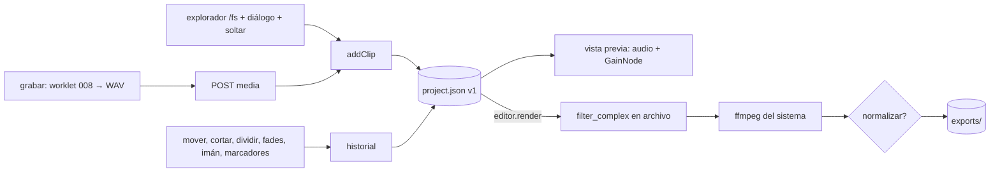

# 015: contexto y decisión

> **Decisiones y pendientes al ejecutar**: quien implemente esta spec puede tomar **todas las decisiones técnicas** que necesite, sin detenerse a pedir confirmación. Cada una queda en [`docs/process/WARNING/`](../../../process/WARNING/README.md); toda revisión pendiente, en [`docs/process/PENDING/`](../../../process/PENDING/README.md).
>
> **Datos del usuario: solo los que crea esta spec**. No borra ni sobrescribe voces grabadas, voces construidas, salidas de `out/` ni modelos que no creó; si algo parece exigirlo, es un `blocked — user-data`. El editor nunca modifica sus archivos de entrada y el explorador solo lee.

## 1. Precondición

La 014 está fusionada: `git show origin/dev:server/src/content_studio/mix/render.py` existe, igual que `media/edit.py` y `media/normalize.py` (013) y `client/src/features/recording/capture/recorder-worklet.ts` (008).

## 2. Contexto

* Pedido del usuario (2026-11-19): una sección para editar audios que permita grabar el audio inicial, importarlo o elegirlo navegando las carpetas del sistema operativo, juntar varios, y una línea de tiempo para superponer, unir y cortar. En la entrevista eligió: el editor **absorbe** la pantalla «Recortar y unir» de la 013 (que queda solo con sus trabajos del server); explorador **propio + diálogo nativo**; alcance de **NLE completo** con pistas de video e imágenes con transparencia (016) y texto, velocidad, color, chroma y fusión (017); y como extras deshacer y rehacer, imán y marcadores, normalizar al exportar y «Mandar a» desde y hacia las secciones (017).
* Ya existen: `common/ffmpeg.py` (probe, loudness, picos), `common/encode.py` (NVENC o x264), `media/formats.py` (extensiones y salidas), `media/edit.py` (`trim`, `concat`, `split`), `media/normalize.py` (loudnorm en dos pasadas), `/media/info` y `/media/peaks` con `media_cache`, `Waveform` y `Player` sobre wavesurfer (006), `useSyncedMedia`, la cola con trabajos `cpu` en paralelo y SSE, `RecommendedSelect`, `IconButton` e `ICONS` (007) y la captura con AudioWorklet y `encodeWav` (008).
* Investigación del 2026-11-19 (agente `researcher`): MLT (melt) es GPL en su ejecutable y trae su propio FFmpeg, lo que choca con «ffmpeg del sistema»; Remotion prohíbe que el usuario renderice proyectos propios sin licencia; @diffusionstudio/core tiene la licencia ambigua. La recomendación es un modelo de proyecto propio, un `filter_complex` generado en el server para exportar y una vista previa propia en el client, con la matemática definida una vez y fixtures compartidas para que no diverjan.

## 3. Solución

Cada decisión pasó la escalera de `plan-format.md` §0:

* **D-1: proyecto** (`server/src/content_studio/editor/project.py`, puro y stdlib). Un proyecto es la carpeta `outputs_dir()/editor/<AAAA-MM-DD>-<slug>/` con `project.json`, `media/` (grabaciones e imágenes que genera el editor) y `exports/`. El esquema v1:
  * `{version: 1, name, sample_rate: 48000, duration?, tracks: [...], clips: [...], markers: [...]}`; la 016 agrega `canvas` y pistas visuales con `version: 2` y una función `migrate(doc)` que sube de versión sin perder campos.
  * Pista: `{id, kind: 'audio', name, volume_db, mute, solo, locked, height}`. El orden del array es el orden visual.
  * Clip: `{id, track, src, src_in, src_out, start, gain_db, fade_in, fade_out}` en segundos (float, redondeados a 1/48000 al guardar). `src` es una ruta absoluta (archivo del usuario, sin copiarlo) o relativa a la carpeta del proyecto (`media/rec-003.wav`).
  * Marcador: `{id, t, label, color}`.
  * `validate(doc) -> list[Error]` (ids únicos, clip dentro de su fuente, pista existente, `start ≥ 0`, fades que no superan la duración) y `duration(doc)`.

  SQLite no gana tabla: los proyectos recientes van en `settings` como `editor.recent` (lista de rutas, máximo 20) y las carpetas favoritas del explorador como `editor.favorites`. Se descartó una tabla `editor_projects` porque el proyecto ya es un archivo y la lista de recientes cabe en una preferencia; además no desplaza los números de migración de la 018 a la 020.
* **D-2: espejo con fixtures**. `client/src/features/editor/model/` replica en TypeScript los tipos, `validate`, `duration` y las operaciones puras (D-6). La fuente de verdad del comportamiento son las fixtures `server/tests/fixtures/editor/*.json` (`{doc, op, expected}`) que leen `server/tests/unit/.../editor/test_project.py` y `client/src/features/editor/model/*.test.ts`. Un cambio de semántica se hace en las dos implementaciones y en las fixtures en el mismo commit. Descartado: generar el TS desde Python (más maquinaria que las ~200 líneas que espeja) y validar solo en el server (el deshacer y el imán tienen que ser instantáneos).
* **D-3: API** (`api/routes/editor.py` y `api/routes/fs.py`):
  * `POST /editor/projects {name}` → crea la carpeta y el JSON; `GET /editor/projects/recent`; `GET /editor/projects?path=`; `PUT /editor/projects?path=` con `If-Match` (hash del contenido) que responde 409 `project_changed` si otro guardado se adelantó. El client guarda solo, 1 s después del último cambio.
  * `POST /editor/projects/media?path=` (subida de una grabación en WAV) → `media/rec-<n>.wav`.
  * `GET /fs/roots` → unidades (en Windows, las letras `A:`–`Z:` que existen; Python 3.10 no tiene `os.listdrives`), la carpeta de usuario, Escritorio, Música, Videos, Descargas y las favoritas. `GET /fs/list?path=&kinds=audio,video,image` → carpetas y archivos de medios (extensiones de `media/formats.py`), con tamaño y fecha; nunca lista ocultas ni del sistema salvo que se pida. Solo lectura: no hay endpoint de `fs` que escriba. Rutas inexistentes o sin permiso dan 404 o 403 con mensaje del catálogo.
* **D-4: render de audio** (`editor/render_audio.py`, puro: `build(doc, out, options) -> (args, filter_script)`). Por clip: `atrim=start=src_in:end=src_out`, `asetpts=PTS-STARTPTS`, `aresample=48000`, `afade` de entrada y salida, `volume=<gain+track>dB` y `adelay=<start ms>:all=1`; mute y solo se resuelven antes de armar el grafo; todo termina en `amix=inputs=N:normalize=0:dropout_transition=0` y `apad`/`atrim` a la duración del proyecto. El grafo se escribe en `exports/<id>.filter` y se pasa con `-filter_complex_script` para no chocar con el límite de 32 767 caracteres de la línea de comandos de Windows. Un video importado en una pista de audio aporta su stream de audio. El trabajo `editor.render {path, format, options, normalize?}` (recurso `cpu`) escribe `exports/<AAAA-MM-DD>-<id>-<slug>.<ext>`, con el formato y la calidad de los presets de audio de `media/formats.py` (013). Con `normalize` (preset ★ `podcast` −16 o `youtube` −14), pasa la salida por `media/normalize.py`. El progreso sale de `-progress pipe:1`. Se descartó encadenar los trabajos `media.trim` y `media.concat` de la 013: no superponen pistas y recodificarían varias veces.
* **D-5: vista previa** (`features/editor/playback/`). Un `<audio>` por clip activo (el que cruza la ventana de reproducción ± 2 s), cada uno con `MediaElementAudioSourceNode` → `GainNode` (fades y volumen programados con `linearRampToValueAtTime`) → `GainNode` de pista → destino. El reloj maestro es `AudioContext.currentTime`; cada 250 ms se corrige el `currentTime` de un elemento que se desvía más de 40 ms. Se descartó `decodeAudioData` de archivos enteros (una hora en estéreo a 48 kHz son ~1,4 GB en Float32). La onda de cada clip sale de `/media/peaks` (la 006) recortada a `src_in`–`src_out`.
* **D-6: operaciones** (`model/ops.ts` y su espejo en `editor/ops.py` para las fixtures): `addClip`, `moveClip(id, track, start)` (superponer está permitido: varios clips en el mismo tiempo en pistas distintas, y en la misma pista el que se mueve no puede pisar a otro, queda pegado al borde), `trimClip(id, edge, t)`, `splitAt(t, ids?)` (en el cabezal, `S`), `deleteClips(ids, ripple)` (`Supr` y `Mayús+Supr` corre lo que sigue), `setFade`, `setGain`, `addTrack`, `removeTrack`, `reorderTracks`, `addMarker`, `moveMarker`. Unir es poner clips seguidos (con un crossfade opcional, que en audio es solapar con fades: `crossfade(idA, idB, d)`).
* **D-7: historial** (`model/history.ts`): pila de documentos inmutables (deshacer y rehacer por instantáneas, máximo 200, con agrupación de un arrastre en un solo paso), `Ctrl+Z`, `Ctrl+Y` y `Ctrl+Mayús+Z` con `useShortcut`. Se descartó un historial de comandos inversos: el documento es chico y las instantáneas son triviales de probar.
* **D-8: imán y marcadores** (`model/snap.ts`): con el imán activo (`N`, botón con `ICONS.magnet` y `aria-pressed`), los bordes de un clip que se mueve o recorta se pegan al borde más cercano dentro de 8 px de pantalla entre: bordes de otros clips, el cabezal, los marcadores, el 0 y la grilla de la regla (según el zoom: 1 s, 5 s, 10 s…). `M` agrega un marcador en el cabezal; los marcadores se renombran con doble clic y se borran con `Supr`; la regla muestra la grilla y los marcadores.
* **D-9: pantalla** (`features/editor/`, grupo Editar en `nav.ts`, icono `ICONS.editor`):
  * **Inicio**: recientes (de `editor.recent`), «Nuevo proyecto» y «Abrir…» (diálogo nativo de carpeta).
  * **Disposición**: a la izquierda el **explorador** (D-10), arriba la barra de transporte (ir al inicio, reproducir y pausar con Espacio, detener, grabar `R`, bucle entre marcadores, tiempo actual, imán, zoom `+`/`-` y ajustar a la ventana), y abajo la **línea de tiempo**: cabeceras de pista (nombre, volumen, mute `M` sobre la pista, solo, bloquear y armar para grabar) y los clips con su onda, sus asas de fade y su volumen, arrastrables entre pistas; clic y arrastre en vacío selecciona varios; Ctrl+rueda hace zoom y rueda desplaza. Todas las acciones de solo icono usan `IconButton` (007).
  * **Exportar**: diálogo con formato ★ (los de audio de la 013), calidad, normalizar (preset ★) y nombre; encola `editor.render`, muestra el progreso en la cola y, al terminar, «Abrir carpeta» y «Reproducir».
  * La 013 no crea `features/edit/`: el editor es la pantalla de recortar, unir y dividir (dividir es `S` y exportar cada tramo entre marcadores, con «Exportar por marcadores», que encola un `editor.render` por tramo).
* **D-10: explorador y entrada de medios**:
  * Panel con árbol de `GET /fs/roots`, migas de pan, lista de la carpeta con filtro por tipo y búsqueda por nombre; escucha previa al pasar el cursor (o con Espacio sobre el ítem), con un solo `<audio>` compartido; estrella para agregar a favoritas. Se arrastra un archivo a una pista (o se suelta en vacío para crear una) y se puede seleccionar varios.
  * «Importar» abre el diálogo nativo (`@tauri-apps/plugin-dialog`, que la 005 dejó en Cargo y esta spec suma al paquete JS, cerrando el punto 2 de `PENDING/005-desvios-d1-d8` para el diálogo de archivos).
  * Soltar archivos desde el Explorador de Windows con `getCurrentWebview().onDragDropEvent` (rutas reales, sin copiar).
* **D-11: grabar**. Con una pista armada, `R` (o el botón rojo) inicia la grabación en el cabezal con la captura de la 008 (AudioWorklet, mono, 48 kHz, 24 bits, el dispositivo elegido en el selector de la pista); si hay otras pistas, suenan mientras se graba (grabar sobre lo que ya suena). Al parar, `encodeWav` → `POST /editor/projects/media` → un clip nuevo en la pista armada desde el tiempo de inicio, corrido por la latencia medida (`AudioContext.baseLatency + outputLatency` + la de entrada que informa el worklet; ajustable en Ajustes como `editor.record_offset_ms`). Un vúmetro en la cabecera de la pista armada. Se puede grabar sin proyecto: «Grabar» en Inicio crea uno con la toma.

## 4. Fuera de alcance

* Pistas de video e imagen, lienzo y exportar video: 016. Texto, velocidad, color, chroma, fusión, subtítulos como pista y «Mandar a» desde y hacia otras secciones: 017.
* Efectos de audio por clip más allá de ganancia y fades (EQ, compresor, reverb), automatización de volumen con curvas por pista y buses.
* Edición colaborativa, varios proyectos abiertos a la vez y autosave con versiones.
* Escribir, renombrar o borrar en el explorador: es de solo lectura (borrar y mover es de la Biblioteca, 018).
* Grabar video desde la cámara.

## 5. Criterios de aceptación

* **AC-1**: WHEN se aplican las operaciones de las fixtures `server/tests/fixtures/editor/ops-*.json` (mover sin pisar, recortar, dividir, borrar con y sin ripple, crossfade) THEN Python y TypeScript producen exactamente el `expected` de cada fixture, y `validate` rechaza los documentos inválidos de `invalid-*.json` con el mismo código de error. Lo verifica: `editor/test_project.py`, `editor/test_ops.py` y `model/ops.test.ts`.
* **AC-2**: Given un `project.json` guardado con hash `h1` When llega un `PUT` con `If-Match: h0` Then responde 409 `project_changed` y el archivo no cambia. Lo verifica: `api/routes/test_editor.py`.
* **AC-3**: WHEN se pide `GET /fs/list` de una carpeta de fixture con 2 WAV, 1 MP4, 1 PNG, 1 TXT y una subcarpeta THEN devuelve la subcarpeta y los 4 medios (el TXT no), con `kinds=audio` solo los WAV, y no existe ningún método de `/fs` distinto de GET. Lo verifica: `api/routes/test_fs.py`.
* **AC-4**: Given un proyecto con un tono de 440 Hz de 0–4 s en la pista 1 y uno de 880 Hz de 2–6 s en la pista 2, con fade de 0,5 s When se exporta a WAV Then la salida dura 6 s ± 1 cuadro de audio, entre 2 y 4 s están las dos frecuencias, los primeros 50 ms tienen un RMS al menos 20 dB menor que el del segundo 1, y con la pista 2 en mute solo queda 440 Hz. Lo verifica: `editor/test_render_audio.py` (ffmpeg real, FFT de ventanas con numpy de los tests).
* **AC-5**: WHEN se exporta con `normalize=podcast` THEN la salida mide −16 ± 0,5 LUFS y TP ≤ −1 dBTP con `ebur128`, y los archivos de entrada tienen el mismo hash antes y después. Lo verifica: `editor/test_render_audio.py`.
* **AC-6**: WHEN se hacen 3 cambios y luego Ctrl+Z tres veces y Ctrl+Y una THEN el documento es igual al de después del primer cambio, y un arrastre de 30 eventos de movimiento cuenta como un solo paso. Lo verifica: `model/history.test.ts`.
* **AC-7**: Given el imán activo y un marcador en 10 s When se suelta un clip con el borde izquierdo a 4 px de pantalla del marcador Then el clip empieza en 10 s; con el imán apagado, donde se soltó. Lo verifica: `model/snap.test.ts` y `Timeline.test.tsx`.
* **AC-8**: WHEN se arrastra un WAV del explorador a una pista vacía, se divide en el cabezal con `S`, se borra la mitad derecha con `Mayús+Supr` y se exporta THEN la cola muestra el trabajo `editor.render` con progreso y al terminar aparece «Abrir carpeta». Lo verifica: el e2e `editor/happy-browse-split-export.e2e.ts`.
* **AC-9**: WHEN se graba 3 s en una pista armada mientras suena otra THEN aparece un clip de 3 s ± 0,1 s que empieza en el cabezal corrido por el offset de latencia, con su archivo en `media/rec-<n>.wav`. Lo verifica: `useTrackRecorder.test.ts` (worklet simulado) y la verificación final (grabación real).
* **AC-10**: WHEN se abre un proyecto cuya fuente fue movida o borrada THEN el clip se ve como «fuente no encontrada» con la opción «Buscar…» (diálogo nativo) que reasigna `src` a todos los clips con esa ruta, y exportar falla con `missing_source` y la lista de rutas. Lo verifica: `api/routes/test_editor.py` y `ClipMissing.test.tsx`.

## 6. Diagrama

## 7. Debe sonar / no debe sonar

| Salida | Debe | No debe |
| :--- | :--- | :--- |
| Exportación de un proyecto con voz grabada y música superpuesta | Las dos pistas con su volumen relativo, los fades suaves y la duración del proyecto | Clics en los cortes, desfase entre la vista previa y la exportación, clipping |
| Con normalizar `podcast` | −16 LUFS ± 0,5 y TP ≤ −1 dBTP | Bombeo ni cambio de tono |
| Grabación sobre lo que suena | La toma alineada con lo que se escuchaba al grabar (desvío < 20 ms tras el offset) | Eco de la reproducción en la toma si se usan auriculares |
