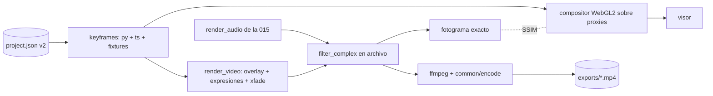

# 016: contexto y decisión

> **Decisiones y pendientes al ejecutar**: quien implemente esta spec puede tomar **todas las decisiones técnicas** que necesite, sin detenerse a pedir confirmación. Cada una queda en [`docs/process/WARNING/`](../../../process/WARNING/README.md); toda revisión pendiente, en [`docs/process/PENDING/`](../../../process/PENDING/README.md).
>
> **Datos del usuario: solo los que crea esta spec**. No borra ni sobrescribe voces grabadas, voces construidas, salidas de `out/` ni modelos que no creó; si algo parece exigirlo, es un `blocked — user-data`. El editor nunca modifica sus entradas.

## 1. Precondición

La 015 está fusionada: `git show origin/dev:server/src/content_studio/editor/render_audio.py` existe, igual que `client/src/features/editor/model/ops.ts`.

## 2. Contexto

* El usuario pidió un editor «tan potente como un NLE», con imágenes con transparencia (un logo) además de video y audio. La 015 dejó el proyecto v1 (solo audio), el espejo de fixtures entre Python y TypeScript, el historial, el imán, el explorador, la grabación y `editor.render` para audio.
* Ya existen `common/encode.py` (NVENC o x264, 012), los presets de redes y de tamaño de `media/presets.py` (013), `/media/frame?path=&t=` (013, un JPEG temporal) y `media/reframe.py` con `scale`, `crop` y `pad`.
* La investigación del 2026-11-19 recomendó: vista previa propia en canvas o WebGL sobre proxies, exportación con `filter_complex` desde el mismo JSON, keyframes como expresiones por tramos dentro de los filtros (y no `sendcmd` ni `zmq`, que no todas las opciones aceptan en tiempo de ejecución), y un test de paridad que compare un fotograma de la vista previa con el de la exportación por SSIM. Quedó sin verificar el límite práctico del largo del grafo: lo mide esta spec (D-4, AC-6).

## 3. Solución

Cada decisión pasó la escalera de `plan-format.md` §0:

* **D-1: esquema v2** (`editor/project.py`, `migrate` v1 → v2 sin perder campos):
  * `canvas: {width, height, fps, background}` con los tamaños de `media/presets.py` (★ según el primer video importado; 1920×1080 a 30 si no hay).
  * Pistas `kind: 'video'` (además de `audio`): `{id, kind, name, opacity, hidden, locked}`; se componen de abajo hacia arriba en el orden del array de pistas visuales.
  * Clip visual: los campos de la 015 más `media: 'video'|'image'`, `transform: {x, y, scale_x, scale_y, rotation, opacity, crop: {l, t, r, b}, anchor_x, anchor_y}` (posición en píxeles del lienzo desde el centro, crop normalizado 0–1) y `keyframes: {<propiedad>: [{t, value, ease}]}` con `t` relativo al inicio del clip y `ease` en `linear`, `ease-in-out` (cúbica) o `hold`. Una imagen tiene `src_in = 0` y la duración que se le dé (5 s por defecto, estirable). Un video con audio aporta además un clip de audio enlazado en una pista de audio (`link` con el mismo id de grupo: se mueven y cortan juntos salvo que se desenlacen).
  * Transición: `{id, track, a, b, type, duration}` entre dos clips contiguos de la misma pista; los clips se solapan `duration` y la transición ocupa ese tramo.
* **D-2: interpolación compartida**. `editor/keyframes.py` (puro) y `model/keyframes.ts`: `value_at(keyframes, t, default)` y `segments(keyframes, clip_duration) -> [(t0, t1, v0, v1, ease)]`. Fixtures `server/tests/fixtures/editor/keyframes-*.json` con valores esperados en tiempos fijos, probadas en los dos lados como en la 015.
* **D-3: proxies** (`editor/proxy.py`, trabajo `editor.proxy {path}`, recurso `cpu`). Al importar un video, se genera en la caché del proyecto (`.cache/proxies/<hash>.mp4`) un proxy de 540 p de alto, H.264 con GOP de 15 cuadros (búsquedas rápidas), con `common/encode.py`; si la fuente tiene alfa (VP9 con `alpha_mode`), el proxy es WebM VP9 con alfa. Las imágenes se usan tal cual. El hash es de `(ruta, mtime, size)`; borrar la caché nunca rompe un proyecto (se regenera). Mientras el proxy no existe, el clip muestra el primer cuadro de `/media/frame`.
* **D-4: render de video** (`editor/render_video.py`, puro: `build(doc, out, options) -> (args, filter_script)`):
  * Base: `color=c=<background>:s=<w>x<h>:r=<fps>:d=<duración>`.
  * Por clip visual: `trim`/`setpts` (en imágenes, `loop` + `trim`), `format=rgba`, `crop` (del crop normalizado), `scale` y `rotate` (`ow`/`oh` de la caja rotada, `fillcolor=none`), opacidad con `colorchannelmixer=aa=<expr>` y `overlay=x=<expr>:y=<expr>:enable='between(t,s,e)':format=auto`. Las propiedades con keyframes se escriben como expresiones por tramos: `if(lt(t,t1), lerp(v0,v1,(t-t0)/(t1-t0)), if(…))`, con la curva suave como `3p²−2p³`; `scale` animado usa `scale=eval=frame`. Una propiedad sin keyframes es una constante.
  * Transiciones: los clips de una pista con transiciones se encadenan con `xfade=transition=<tipo>:duration=<d>:offset=<o>` antes de superponer la pista. Lista: `fade`, `fadeblack`, `fadewhite`, `wipeleft`, `wiperight`, `slideleft`, `slideright` y `circleopen` (cada una con su shader equivalente en D-5).
  * Audio: el grafo de la 015 (`render_audio.build`) en el mismo comando.
  * Salida: MP4 (H.264 o H.265 con `common/encode.py`, AAC) o WebM (VP9, Opus), con el tamaño y los fps del lienzo, y normalizar opcional como en la 015. El trabajo `editor.render` gana `format` de video y conserva los de audio (exportar solo el audio de un proyecto con video).
  * El grafo va en archivo (`-filter_complex_script`, D-4 de la 015). AC-6 mide un proyecto de 40 clips visuales con keyframes; si el grafo no cabe o es lento, el render se parte por tramos entre cortes y se une con `concat` sin recodificar (decisión con ficha).
* **D-5: vista previa** (`features/editor/preview/`):
  * `compositor.ts`: WebGL2, un quad por capa activa en el tiempo `t`, con la matriz de `transform` evaluada con `model/keyframes.ts`, el crop como coordenadas de textura y la opacidad multiplicada en el shader con alfa premultiplicado. Las texturas salen de un `<video>` por clip activo (proxy) o de un `ImageBitmap` (imágenes). Las transiciones son shaders que reciben las dos texturas y el progreso, con la misma fórmula que cada `xfade` de D-4.
  * Lienzo a la resolución del panel (máximo la del lienzo), con «Calidad» media o completa; si un cuadro no se compone a tiempo, se salta (la reproducción manda).
  * **Fotograma exacto**: `GET /editor/projects/frame?path=&t=` renderiza ese instante con el mismo grafo de D-4 (`-ss` sobre la salida, un cuadro, PNG en `tmp/`). En la UI es «Ver fotograma exacto» y en los tests es la referencia de paridad.
  * Se descartaron WebCodecs (decodificar a mano no aporta frente a `<video>` sobre proxies con GOP corto, y en WebView2 su soporte de H.265 tiene huecos), Remotion (licencia), @diffusionstudio/core (licencia ambigua) y MLT (GPL y su propio FFmpeg).
* **D-6: pantalla** (sobre la de la 015):
  * **Visor** arriba al centro con el lienzo, las guías de zonas seguras (de los presets de redes) y, con un clip visual seleccionado, sus asas: mover arrastrando, escalar por las esquinas (Mayús conserva la proporción), rotar con el asa superior y recortar con Alt. Cada cambio con el cabezal en un tiempo con keyframe activo crea o mueve un keyframe.
  * **Inspector** a la derecha: transformación numérica, opacidad, el botón de keyframe por propiedad (`ICONS.keyframe`, `aria-pressed` si hay uno en el cabezal), ir al anterior o al siguiente, y el tipo de curva. Ajustes del proyecto: tamaño y fps del lienzo (presets ★) y fondo.
  * **Línea de tiempo**: pistas visuales arriba de las de audio, miniaturas en los clips de video (de `/media/frame` cada N segundos según el zoom), los rombos de keyframes bajo el clip seleccionado (arrastrables, con imán) y las transiciones como una zona entre dos clips: se agregan arrastrando desde el panel «Transiciones» o con `T` en un corte, y se ajusta la duración desde sus bordes.
  * **Exportar**: el diálogo de la 015 suma MP4 (★) y WebM, calidad (CRF o CQ) y «Solo audio».

## 4. Fuera de alcance

* Texto y títulos, velocidad, color, LUT, chroma key, modos de fusión y subtítulos como pista: 017.
* Máscaras dibujadas, seguimiento de movimiento, estabilización, 3D y cámaras.
* GIF animados y secuencias de imágenes como clip (se convierten antes con la 013).
* Render en segundo plano de la vista previa (cache de cuadros renderizados) y GPU para los filtros de ffmpeg (CUDA filters).
* Proyectos de más de 2 horas o en 8K: se permiten, pero no se optimizan.

## 5. Criterios de aceptación

* **AC-1**: WHEN se migra un `project.json` v1 de fixture a v2 THEN conserva todos sus campos, gana `canvas` por defecto y `validate` no da errores; y las fixtures `keyframes-*.json` dan los mismos valores en Python y en TypeScript (tolerancia 1e-9). Lo verifica: `editor/test_project.py`, `editor/test_keyframes.py` y `model/keyframes.test.ts`.
* **AC-2**: Given un lienzo de 1280×720 negro, un PNG de 200×200 rojo con alfa 50 % en el centro y un keyframe de `x` de 0 a 400 entre 0 y 2 s When se exporta Then en 1 s el centro del rojo está en x = 840 ± 2 px (centro del lienzo + 200), el píxel del centro del logo vale (127 ± 3, 0, 0) sobre negro y fuera del logo es negro. Lo verifica: `editor/test_render_video.py` (cuadros leídos con ffmpeg a `rawvideo`).
* **AC-3**: WHEN dos clips de color de 3 s se unen con `fade` de 1 s THEN la salida dura 5 s ± 1 cuadro, y en la mitad de la transición el color es el promedio de los dos ± 4. Lo mismo para cada transición de la lista, con su patrón esperado (por ejemplo, `wipeleft` divide el cuadro en dos colores). Lo verifica: `editor/test_render_video.py`.
* **AC-4**: WHEN se importa un MP4 de 1080p con audio THEN se encola `editor.proxy`, el proxy tiene 540 de alto y un keyframe cada 15 cuadros (`ffprobe -show_frames`), y en el proyecto aparecen el clip de video y su clip de audio enlazado, que se mueven juntos. Lo verifica: `editor/test_proxy.py` y `model/ops.test.ts` (fixture `ops-link-*.json`).
* **AC-5**: Given los proyectos de fixture `parity-*.json` (capas con alfa, rotación, crop, keyframes y cada transición) When se compara el fotograma del compositor WebGL con el de `GET /editor/projects/frame` en 5 tiempos Then el SSIM es ≥ 0,95 en todos. Lo verifica: el e2e `editor/parity-preview-export.e2e.ts` (Chromium con WebGL2; el umbral queda en la ficha WARNING).
* **AC-6**: WHEN se exporta un proyecto de fixture de 60 s con 40 clips visuales, 20 de ellos con keyframes en 3 propiedades THEN el render termina sin error y en menos de 3 veces la duración del proyecto con NVENC (o 6 veces con x264), y el `.filter` resultante se registra con su tamaño. Lo verifica: `editor/test_render_video.py` marcado `-m local` y la verificación final.
* **AC-7**: WHEN se arrastra en el visor el asa de escala de un clip con el cabezal en 2 s y la propiedad `scale` con keyframes activos THEN aparece un keyframe en 2 s con el valor nuevo, deshacer lo quita y la vista previa lo refleja en el mismo cuadro. Lo verifica: `preview/Viewer.test.tsx` e `Inspector.test.tsx`.

## 6. Diagrama

## 7. Debe sonar / no debe sonar

| Salida | Debe | No debe |
| :--- | :--- | :--- |
| Exportación MP4 de un proyecto con video, logo y voz | El audio de la 015 sincronizado con el video (desvío < 1 cuadro) y el LUFS pedido | Desincronización al final, cortes en las transiciones de audio ni cambio de tono |
