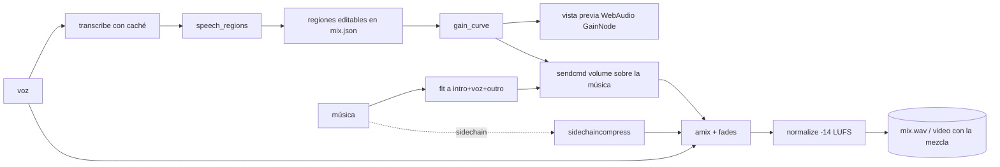

# 016: contexto y decisión

> **Decisiones y pendientes al ejecutar**: quien implemente esta spec puede tomar **todas las decisiones técnicas** que necesite, sin detenerse a pedir confirmación. Cada una queda en [`docs/process/WARNING/`](../../../process/WARNING/README.md); toda revisión pendiente, en [`docs/process/PENDING/`](../../../process/PENDING/README.md).
>
> **Datos del usuario: solo los que crea esta spec**. No borra ni sobrescribe voces grabadas, voces construidas, salidas de `out/` ni modelos que no creó; si algo parece exigirlo, es un `blocked — user-data`. La mezcla nunca modifica las pistas de entrada.

## 1. Precondición

La 015 está fusionada: `git show origin/dev:server/src/content_studio/media/normalize.py` existe, igual que `media/edit.py`.

## 2. Contexto

* Ya existen: transcripción con caché por palabra (013), `music/duration.fit` (corte exacto con fade, 011), `media/normalize.py` (loudnorm en dos pasadas y medición con `ebur128`, 015), `common/encode.py`, `Waveform` con Regions y Timeline, `useSyncedMedia` y los botones «Mandar a Mezclar» deshabilitados en Narración y Música (006 y 011).
* `music/README.md` §«Cómo usarlo en un video» pide la música con la duración de la narración más 10 s y una mezcla con la música por debajo. Hoy se hace a mano.
* Las decisiones del usuario: voz, música y video opcional; ducking por transcripción o sidechain (los dos, con la transcripción por defecto); volúmenes y LUFS final, intro y outro, rampas editables y vista previa; los cuatro orígenes.

## 3. Solución

* **D-1: envolvente** (`mix/envelope.py`, puro y con doctests):
  * `speech_regions(words, merge_gap=0.6, pre=0.2, post=0.4) -> [(start, end)]` une las palabras separadas por menos de `merge_gap` y agrega los márgenes.
  * `gain_curve(regions, duration, duck_db=-12, ramp=0.3, base_db=0) -> [(t, db)]` da los puntos de una curva por tramos lineales: baja `ramp` s antes del inicio y sube `ramp` s después del fin, y si dos rampas se solapan, se fusionan en un solo valle.
  * Las regiones las puede editar el usuario (las guarda `mix.json` en la carpeta del trabajo), y la curva siempre se recalcula a partir de ellas.
  * Los valores por defecto van a WARNING.
* **D-2: render** (`mix/render.py` y el trabajo `mix.render`, recurso `cpu`):
  1. La voz se desplaza `intro` s y la música se ajusta a `intro + voz + outro`. Si la música dura más, `fit` (corte con fade de 2 s), y si dura menos, falla con `music_too_short` y la sugerencia «Generar música a medida» (D-4). Se descartó el loop, igual que en la 011.
  2. El ducking `transcript` aplica la curva con un `sendcmd` de comandos `volume` (un paso cada 20 ms en las rampas y ninguno en los tramos planos) sobre la música. El modo `sidechain` hace `[music][voice]sidechaincompress=threshold=0.05:ratio=8:attack=20:release=300:makeup=1` (con los parámetros en Avanzado).
  3. `amix=inputs=2:normalize=0` con los volúmenes base: `music_db` (por defecto -6 dB con respecto a la voz) y `voice_db` (0).
  4. Fades de intro y outro en la música.
  5. `media/normalize.py` al LUFS final (por defecto -14, `mix.lufs`) con TP ≤ -1 dBTP.

  Con **video**, `video_mode: replace` usa la mezcla como el audio del video, y `under` mezcla la música (con ducking contra la voz del video, transcrita con la caché) por debajo del audio original. En los dos casos el video va con `-c:v copy` y solo se recodifica el audio. La salida es `mix.wav` (y `mix.m4a`) o el video con la mezcla, y `result` guarda el LUFS, el TP y la cantidad de tramos de ducking.
* **D-3: API**. `POST /mix/prepare {voice, music, video?, video_mode}` transcribe la voz (con la caché; es un trabajo `transcribe` si no hay acierto) y devuelve el `mix_id` con las regiones iniciales y la duración de cada pista. `PUT /mix/{id}` recibe las regiones editadas y los parámetros, y `GET /mix/{id}/curve` devuelve la curva (`[(t, db)]`), que usa la vista previa. `POST /jobs {kind: "mix.render", params: {mix_id}}`. Los proyectos de mezcla se guardan en `outputs_dir()/mix/<fecha>-<id>/mix.json`, y la base solo registra la ruta, en la tabla `mix_projects` (migración 5: `id`, `name`, `doc_path` y fechas, sin contenido).
* **D-4: pantalla Mezcla** (`features/mix/`, grupo Editar en `nav.ts`):
  * **Pistas**: tres ranuras (Voz, Música y Video opcional). Cada una con «Del historial» (`JobPicker` de las narraciones o músicas `done`, con ★ primero, en `shared/components/`), «Archivo…» o arrastrar. Con la voz cargada y sin música, «Generar música para esta voz» abre Música con la duración igualada a `intro + voz + outro` (con el parámetro `?match=<voice>` de la 011). Al terminar esa música, el botón «Mandar a Mezclar» la carga en la ranura.
  * «Mandar a Mezclar» en Narración y Música (se habilita en esta spec) abre Mezcla con esa pista en su ranura.
  * **Línea de tiempo**: dos ondas apiladas (la voz y la música), con las regiones de ducking sobre la música (Regions, que se pueden arrastrar, borrar con Supr o agregar arrastrando sobre una zona vacía) y la curva de ganancia dibujada. Con video, el reproductor va arriba.
  * **Controles**: el modo de ducking ★ (transcripción) o sidechain, la atenuación (dB), las rampas (ms), los márgenes, el volumen de la música con respecto a la voz, la intro y el outro (s), el LUFS final ★ (-14) y, si hay video, `replace` o `under`. Todo queda en `mix.*`.
  * **Vista previa** (`useMixPreview.ts`): WebAudio con dos `AudioBufferSourceNode` (decodificados desde `/files`), un `GainNode` para la música con `linearRampToValueAtTime` por cada punto de la curva y otro con el volumen base, sincronizados con el reproductor. Al cambiar las regiones o los parámetros, la curva se pide de nuevo al server y se reprograma la ganancia.
  * «Renderizar» encola `mix.render`, y el resultado muestra el `Player`, el LUFS y el TP medidos y «Abrir carpeta».
* **D-5: docs**. `music/README.md` §«Cómo usarlo en un video» apunta a la Mezcla. Ficha nueva `docs/process/01-done/mix.md`.

## 4. Fuera de alcance

* Multipista libre (más de una voz o una música): el usuario eligió voz, música y video.
* Loop o extensión de la música si queda corta: se ofrece generar una a medida.
* Efectos sobre la voz (reverb, EQ): «mejorar voz» de la 015 se aplica antes, si se quiere.

## 5. Criterios de aceptación

* **AC-1**: WHEN se llama a `speech_regions` con palabras en `[1.0–1.4] [1.6–2.0] [4.0–4.5]` THEN da `[(0.8, 2.4), (3.8, 4.9)]`, y `gain_curve` con una duración de 6 baja a -12 dB en 0,5–0,8 s, sube en 2,4–2,7, baja en 3,5–3,8 y sube en 4,9–5,2. Lo verifica: doctests y `test_envelope.py`.
* **AC-2**: Given dos regiones a 0,4 s una de otra y rampas de 0,3 When se calcula la curva Then queda un solo valle, sin subir entre las dos. Lo verifica: `test_envelope.py`.
* **AC-3**: Given una voz sintética (un tono de 1 kHz con pausas conocidas) y una música sintética (ruido rosa) When se renderiza con ducking `transcript` de -12 dB Then el nivel de la música medido en la salida (filtrando la banda del tono) es ~12 dB menor (±1,5) dentro de las regiones que fuera de ellas, y el LUFS final es -14 ± 0,5 con TP ≤ -1. Lo verifica: `test_mix_render.py` (ffmpeg real, medición con `astats` por ventanas).
* **AC-4**: WHEN la música dura menos que `intro + voz + outro` THEN el trabajo falla con `music_too_short`, y si dura más, la salida dura exactamente `intro + voz + outro` ± 10 ms con un fade final. Lo verifica: `test_mix_render.py`.
* **AC-5**: WHEN se mezcla con un video en `replace` y en `under` THEN el stream de video es idéntico al original (copiado) y la duración del audio coincide con la del video ± 1 cuadro. En `under`, la voz original sigue presente (su nivel no baja). Lo verifica: `test_mix_video.py`.
* **AC-6**: WHEN se mueve una región en la UI THEN se llama a `PUT /mix/{id}`, se pide la curva nueva y la vista previa reprograma la ganancia sin cortar la reproducción. Lo verifica: `MixTimeline.test.tsx` y `useMixPreview.test.ts` (AudioContext simulado: los `linearRampToValueAtTime` coinciden con la curva).
* **AC-7**: WHEN se pulsa «Mandar a Mezclar» en una narración THEN Mezcla abre con la voz cargada, y «Generar música para esta voz» abre Música con la duración = intro + voz + outro. Lo verifica: el e2e `mix/happy-send-and-generate.e2e.ts`.
* **AC-8**: WHEN se mezclan una narración real de la 006 y una música de la 011 con los valores por defecto THEN la voz se entiende con claridad en toda la pista, la música sube en las pausas y no se oye bombeo. Lo verifica: la verificación final (medición y escucha del usuario).

## 6. Diagrama

## 7. Debe sonar / no debe sonar

| Salida | Debe | No debe |
| :--- | :--- | :--- |
| Mezcla por transcripción | La voz siempre por encima. La música baja ~12 dB con rampas suaves y vuelve en las pausas, la intro y el outro. -14 LUFS | Bombeo, cortes de la música, entradas bruscas ni clipping |
| Mezcla sidechain | Un ducking automático parecido | Un «respirar» audible en cada sílaba con los valores por defecto |
| Video `under` | La voz original intacta y la música por debajo | Desincronización ni pérdida de la calidad de video |
