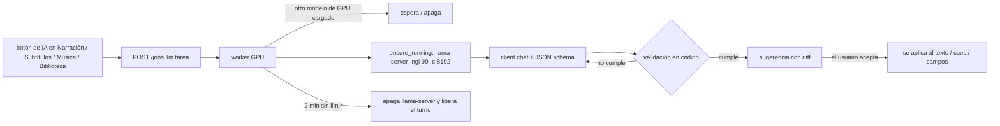

# 017: contexto y decisión

> **Decisiones y pendientes al ejecutar**: quien implemente esta spec puede tomar **todas las decisiones técnicas** que necesite, sin detenerse a pedir confirmación. Cada una queda en [`docs/process/WARNING/`](../../../process/WARNING/README.md); toda revisión pendiente, en [`docs/process/PENDING/`](../../../process/PENDING/README.md).
>
> **Datos del usuario: solo los que crea esta spec**. No borra ni sobrescribe voces grabadas, voces construidas, salidas de `out/` ni modelos que no creó; si algo parece exigirlo, es un `blocked — user-data`. El LLM solo propone.

## 1. Precondición

La 014 está fusionada: `git show origin/dev:server/src/content_studio/library/index.py` existe, igual que `engines/installer.py` (009) y `subtitles/document.py` (011).

## 2. Contexto

* La investigación está en [docs/research/llm-locales/](../../../research/llm-locales/README.md):
  * En 8 GB caben Gemma 4 E4B-it (Q4_K_M, 4,98 GB, Apache 2.0, multimodal) y Qwen3.5-9B (Q4_K_M, 5,68 GB, Apache 2.0). Los de 12B en adelante no entran.
  * Los benchmarks del fabricante favorecen a Qwen3.5-9B en razonamiento (MMLU-Pro 82,5 contra 69,4). La única prueba de traducción con español favorece a Gemma 4.
  * **No hay ningún benchmark de español**.
  * El runtime recomendado para embeber en Windows es `llama-server`.
* Lo que hay en el lote para engancharse:
  * El linter del guion (006, `narration/script_lint.py`) detecta las reglas 1, 2, 3, 6, 10, 11, 13 y 19, pero **no las arregla**. Las reglas 14–18 y otras no las detecta.
  * Subtítulos (011) solo traduce al inglés con whisper (`tracks.en`) y su texto sale de whisper, con errores en los nombres propios.
  * El texto libre de Música (008) exige un caption en inglés y tonalidad, BPM y compás a mano.
  * La Biblioteca (014) tiene el detalle de cada ítem con la transcripción en caché.
  * Las recetas y el instalador de Motores (009), el turno de la GPU en el worker (004) y `WhisperModelSelect` como patrón de selector de modelo (010).
* Las decisiones del usuario: las cuatro funciones; Gemma 4 E4B ★ y Qwen3.5-9B; la prueba para fijar el ★; carga bajo demanda con espera; dentro del lote, antes del instalador.

## 3. Solución

* **D-1: runtime** (`llm/runtime.py`):
  * **Receta** `engines/recipes/llama-cpp.json`. Suma a la 009 un paso nuevo `download {url, sha256, extract}` (zip del release `llama-*-bin-win-cuda-*.zip` de `ggml-org/llama.cpp`, con tag y sha256 fijados, más el zip de las DLL `cudart` del mismo release). Un comando `verify` corre `llama-server --version`.
  * **Modelos** (`llm/models.py`): `gemma-4-e4b` (`unsloth/gemma-4-E4B-it-GGUF`, archivo `*Q4_K_M.gguf`, con revisión fijada) y `qwen3.5-9b` (`unsloth/Qwen3.5-9B-GGUF`, `*Q4_K_M.gguf`). Cada uno lleva su tamaño, la VRAM medida en la verificación, el contexto por defecto (8192), el muestreo de su card y cómo apagar el thinking: para Gemma, sin el token `<|think|>`; para Qwen, `chat_template_kwargs.enable_thinking=false`. Se descargan como un paso `hf` con `allow_patterns`, y Motores muestra los dos como modelos del motor «Asistente (llama.cpp)».
  * **Ciclo de vida**: `ensure_running(model)` lanza `llama-server -m <gguf> --port <libre> -c 8192 -ngl 99 --jinja --no-webui` (con el Job Object en Windows para que muera con el server), espera `GET /health` y devuelve la URL. `stop()` lo apaga. El modelo activo y su último uso viven en memoria del worker.
  * Se descartaron Ollama (otro servicio residente que gestiona su propia VRAM, fuera del turno) y `llama-cpp-python` (compilar CUDA en Windows y más un venv).
* **D-2: integración con la cola y la GPU**. Las tareas son trabajos `llm.<tarea>` con recurso `gpu`. El worker (004) cambia así: antes de correr un trabajo `gpu` que **no** es `llm.*`, si el LLM está corriendo, lo apaga. Después de un trabajo `llm.*`, mantiene el candado de GPU y el servidor caliente hasta 2 minutos (`llm.idle_seconds`) o hasta que llegue un trabajo `gpu` distinto, lo que pase primero. Si el candado lo tiene otra sesión, los trabajos `llm.*` esperan como cualquier otro trabajo de GPU. Así nunca hay dos modelos en la GPU (`turno-gpu.md`). La UI muestra «Asistente cargado (se libera en 1:45)» en el panel de cola.
* **D-3: cliente HTTP** (`llm/client.py`, stdlib). `chat(url, messages, schema, sampling) -> dict` con `urllib.request` hacia `/v1/chat/completions` y `response_format: {type: "json_schema", json_schema: …}`. Valida el JSON con un validador mínimo propio de los tipos usados (objeto, arreglo, string con `maxLength`, entero con rango y `enum`), sin `jsonschema`. Si la respuesta no valida, reintenta una vez con el error en el mensaje, y si vuelve a fallar responde `llm_invalid_output`. Timeout configurable.
* **D-4: tareas** (`llm/tasks/<tarea>.py` + `llm/prompts/<tarea>.md` + el schema dentro del módulo). Los prompts van en `.md` (español, ignorados por cspell como el resto de `.md`) con marcadores `{{variable}}`. Cada tarea **valida lo que devuelve el modelo con código** y descarta o reintenta lo que rompe la regla.
  * **`llm.script_review {text}`**: por cada párrafo con avisos del linter (o todos, con «revisar todo»), pide `{paragraphs: [{index, revised, changes: [{rule, before, after}]}]}`. La validación corre `script_lint.lint()` sobre `revised` y descarta el párrafo si el linter da más avisos que antes. Exige que no queden cifras (regla 13) y que no cambie el sentido: la cantidad de palabras de contenido difiere ≤ 30 %, salvo por los números expandidos. Las reglas que el LLM tiene que aplicar salen del propio `formato-guion.md` (las reglas obligatorias se inyectan en el prompt desde el archivo, no se copian).
  * **`llm.subtitles_translate {project_id, language}`**: por lotes de ~30 cues con los 5 anteriores como contexto, pide `{cues: [{id, text}]}`. Valida que estén todos los `id`, que se respete `max_chars × max_lines` del estilo (si se pasa, reintenta solo esos cues pidiendo «más corto») y que no quede texto sin traducir (que no sea idéntico al original salvo nombres). Guarda `tracks[<lang>]` (la 011 pasa de `tracks.en` a `tracks` por idioma, y su traducción con whisper queda como una opción más para el inglés). Los idiomas son una lista de datos (es, en, pt, fr, it, de y otros) con ★ en el inglés.
  * **`llm.subtitles_correct {project_id, glossary}`**: pide la corrección por cue (`{cues: [{id, text}]}`) con el glosario del usuario (`subtitles.glossary` en `settings`: nombres propios y marcas). Valida que cada cue tenga la misma cantidad de palabras ± 2, y reubica los tiempos de las palabras con `difflib` sobre las originales, como la alineación de la 011. Si un cue cambia más, queda marcado para revisión y no se aplica solo.
  * **`llm.subtitles_keywords {project_id, max_per_cue: 1}`**: pide `{cues: [{id, keyword_index, emoji?}]}`. Valida que el índice exista y que el emoji sea un solo grafema.
  * **`llm.music_caption {description}`**: pide `{caption, key, bpm, time_signature}`. Valida `key` contra las tonalidades estables del catálogo de la 008, `bpm` entre 30 y 300, `time_signature` en `2|3|4|6`, el caption en inglés de 300 caracteres o menos, sin tempo ni tonalidad dentro, y que termine en «no vocals» (se agrega si falta). Las recomendaciones de ACE-Step que ya tiene `styles.py` se inyectan en el prompt.
  * **`llm.publish {item_id, platforms}`**: con la transcripción (caché de la 010, con tiempos) pide, por plataforma, `{titles: [3], description, hashtags: [..], chapters?: [{t, title}]}`. Valida los límites por plataforma (datos en `llm/platforms.json`: título de YouTube ≤ 100 caracteres, descripción ≤ 5.000, y los hashtags y largos de Reels y TikTok). Los capítulos solo van en YouTube, con el primero en 0:00, al menos 3 y separados ≥ 10 s. Las `t` se redondean a un límite de segmento real. Guarda `publish.json` junto al archivo y su ruta en la Biblioteca (columna nueva `library_items.publish_path`, migración 7, solo la ruta).
* **D-5: pantallas**:
  * **Ajustes > Asistente**: activar o desactivar el asistente (si está apagado, no aparece ningún botón de IA), el modelo ★ (`LlmModelSelect`, con el mismo patrón que `WhisperModelSelect`) y el tiempo de espera para liberar la GPU.
  * **Motores**: la tarjeta «Asistente (llama.cpp)», con llama.cpp y los dos modelos (instalar, verificar y desinstalar, como en la 009).
  * **Narración**: botón «Revisar con IA» en el editor. El resultado es un diff por párrafo (antes y después, con los cambios marcados y la regla de cada uno) con «Aceptar» y «Descartar» por párrafo y «Aceptar todo». Aceptar reemplaza el texto en el editor y el linter vuelve a correr.
  * **Subtítulos**: «Traducir a…» (selector de idioma ★), «Corregir transcripción» (con el editor del glosario) y «Sugerir palabras clave». Cada uno muestra un diff por cue con aceptar o descartar, por cue y en bloque. La pista traducida aparece en el selector de pistas de la vista previa y en Exportar.
  * **Música** (texto libre): «Describir en español», un textarea con un botón que llena caption, tonalidad, BPM y compás como sugerencia editable.
  * **Biblioteca** (detalle de un video o audio con transcripción): pestaña «Publicar», con las plataformas a elegir, «Generar», las tarjetas por plataforma con botón Copiar por campo, los capítulos con saltos al reproductor, y «Regenerar».
  * Sin modelo instalado, cada botón dice «Instala el asistente en Motores» con el atajo. Mientras el modelo carga, el botón muestra «Cargando el asistente…».
* **D-6: prueba de modelos** (`devtools/llm_eval.py`, `python -m devtools llm-eval`). Usa `tests/llm_eval/cases.jsonl`: unos 50 segmentos reales, con 25 de guion sacados de los guiones de prueba y de fragmentos con números, siglas y oraciones largas, más 25 cues de subtítulos en español para traducir al inglés y al portugués. Cada caso tiene sus **chequeos automáticos**: guion sin cifras, lint sin avisos y la cantidad de palabras de contenido; traducción con todos los `id`, el largo y que no sea igual al original. Corre cada caso con cada modelo instalado, a través de la API del server con el turno de la GPU, y mide el porcentaje de chequeos que pasan, la latencia media y los tok/s. Deja `tmp/llm-eval/<fecha>/report.md`, con una columna para la puntuación humana de la traducción (1–5), que completa el usuario. El ★ (`recommended` en `llm/models.py`) se fija con el resultado en la verificación final, y queda en WARNING `017-recomendado.md`.
* **D-7: docs**. `AGENTS.md` (herramientas y licencias: Gemma 4 y Qwen3.5 son Apache 2.0), la ficha nueva `docs/process/01-done/llm.md`, `formato-guion.md` («Revisar con IA» y qué reglas cubre) y `stack.md` (llama.cpp).

## 4. Fuera de alcance

* La visión y el audio de Gemma 4 (miniaturas, describir cuadros o evaluar audio): PENDING `017-vision-miniaturas.md`.
* Modelos de más de 8 GB y el modo lote con offload a la RAM (Gemma 4 26B-A4B): el usuario no lo eligió.
* Chat libre con el modelo: el asistente solo existe dentro de las tareas.
* Ajuste fino (fine-tuning) y RAG.

## 5. Criterios de aceptación

* **AC-1**: WHEN se carga la receta `llama-cpp.json` THEN valida, con el paso `download` con URL, sha256 y `extract`, y los dos modelos tienen la revisión de hf fijada. Un sha256 distinto aborta la instalación con `checksum_mismatch`. Lo verifica: `test_recipes.py` y `test_installer.py` (descarga simulada).
* **AC-2**: Given un trabajo `llm.music_caption` seguido de un `narration` When corre el worker Then el servidor LLM se apaga antes de la narración, el candado de GPU nunca queda tomado por los dos a la vez, y tras un `llm.*` sin otro trabajo el servidor se apaga a los `idle_seconds`. Lo verifica: `test_worker_llm.py` (runtime simulado y reloj controlado).
* **AC-3**: WHEN el modelo devuelve un JSON que no cumple el schema dos veces THEN el trabajo termina con `llm_invalid_output`. Si cumple a la segunda, se usa esa respuesta. Lo verifica: `test_client.py` (servidor HTTP falso con `http.server`).
* **AC-4**: Given un párrafo «Tienes 24 horas; es DEMO.» When se revisa con un modelo falso que devuelve «Tienes veinticuatro horas. Es demo.» Then se acepta (el lint mejora y no quedan cifras). Si el modelo falso devuelve un texto con otra idea, se descarta por la diferencia de palabras de contenido. Lo verifica: `test_script_review.py`.
* **AC-5**: Given 40 cues y un estilo de 42×2 When se traduce con un modelo falso que devuelve uno demasiado largo Then se reintenta solo ese cue, y si sigue largo queda marcado. La pista queda en `tracks["pt"]` con todos los `id`. Lo verifica: `test_subtitles_translate.py`.
* **AC-6**: WHEN la corrección de un cue cambia «Clinicae» por «Klinikae» (en el glosario) THEN los tiempos de las palabras se conservan, y un cue con más de 2 palabras de diferencia queda «para revisar» sin aplicarse. Lo verifica: `test_subtitles_correct.py`.
* **AC-7**: WHEN `llm.music_caption` devuelve `key: "H Major"` o `bpm: 400` THEN se rechaza y se reintenta. Un caption sin «no vocals» se completa. Lo verifica: `test_music_caption.py`.
* **AC-8**: WHEN `llm.publish` genera los capítulos de YouTube de un video de 5 min THEN el primero está en 0:00, hay al menos 3, están separados ≥ 10 s, cada `t` coincide con el inicio de un segmento, y los títulos tienen ≤ 100 caracteres. `publish.json` queda en disco y la base solo guarda su ruta. Lo verifica: `test_publish.py` y `test_no_blob_columns`.
* **AC-9**: WHEN en Narración se pulsa «Revisar con IA», se acepta un párrafo y se descarta otro THEN el editor tiene el texto aceptado y el original en el descartado, y el linter se vuelve a correr. Con el asistente apagado en Ajustes, el botón no aparece. Lo verifica: `ScriptReviewDiff.test.tsx` y el e2e `narration/happy-ai-review.e2e.ts`.
* **AC-10**: WHEN se corre `python -m devtools llm-eval` con los dos modelos instalados THEN el informe tiene, por modelo, el porcentaje de chequeos que pasan por tarea, la latencia, los tok/s y la VRAM pico, y el ★ se fija con ese resultado. Lo verifica: la verificación final (`-m local` y la corrida real).
* **AC-11**: WHEN se usa cada función real con el modelo ★ (revisar un guion de 4 párrafos, traducir 30 cues al portugués, corregir con un glosario, describir una música y publicar un video de 3 min) THEN cada sugerencia llega en menos de 60 s después de la carga, pasa las validaciones y el usuario la juzga útil. Lo verifica: la verificación final.

## 6. Diagrama

