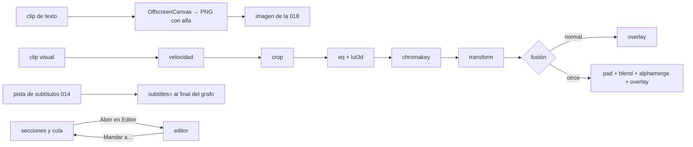

# 019: contexto y decisión

> **Decisiones y pendientes al ejecutar**: quien implemente esta spec puede tomar **todas las decisiones técnicas** que necesite, sin detenerse a pedir confirmación. Cada una queda en [`docs/process/WARNING/`](../../../process/WARNING/README.md); toda revisión pendiente, en [`docs/process/PENDING/`](../../../process/PENDING/README.md).
>
> **Datos del usuario: solo los que crea esta spec**. No borra ni sobrescribe voces grabadas, voces construidas, salidas de `out/` ni modelos que no creó; si algo parece exigirlo, es un `blocked — user-data`. El editor nunca modifica sus entradas.

## 1. Precondición

La 018 está fusionada: `git show origin/dev:server/src/content_studio/editor/render_video.py` existe, igual que `client/src/features/editor/preview/compositor.ts`.

## 2. Contexto

* En la entrevista del 2026-11-19 el usuario sumó al NLE: transformar con keyframes (018), texto y títulos, velocidad y color, chroma y fusión, y «Mandar a» desde y hacia las secciones.
* La 018 dejó el proyecto v2, el compositor WebGL2 con paridad SSIM frente al fotograma exacto del server, `render_video.py` con capas, expresiones por tramos y `xfade`, y los proxies.
* La 014 dejó los proyectos de subtítulos con su ASS, las fuentes OFL de `server/data/fonts/`, la lista de fuentes del sistema, `subtitles.burn` (`subtitles=` con libass, informado por `system.detect()`) y la vista previa con JASSUB.
* Las secciones que generan medios (Narración 006, Música 011, Limpiador 013, Subtítulos 014, Convertir 015, Mezcla 016) muestran sus resultados con acciones; la 016 ya tiene «Mandar a Mezclar» y la Biblioteca (020) tendrá su propio «Mandar a…».

## 3. Solución

Cada decisión pasó la escalera de `plan-format.md` §0:

* **D-1: esquema v3** (`migrate` v2 → v3): clips `media: 'text'` en pistas visuales con `text: {content, font, weight, size, color, stroke: {width, color}, shadow: {x, y, blur, color}, box: {color, padding, radius}?, align, line_height, max_width}` y `raster: 'media/text-<id>-<hash>.png'`; en todo clip `speed` (0,25–4, por defecto 1); en clips visuales `color: {brightness, contrast, saturation, gamma, lut?}`, `chroma?: {color, similarity, blend}` y `blend_mode` (`normal`, `multiply`, `screen`, `overlay`, `darken`, `lighten`, `add`, `difference`); y pistas `kind: 'subtitles'` con `{subtitles_project}`.
* **D-2: texto rasterizado** (`features/editor/text/rasterize.ts`). Al cambiar un clip de texto, el client lo dibuja en un `OffscreenCanvas` del tamaño justo (fuentes cargadas con `FontFace` desde `/fonts/<archivo>`: las OFL de la 014 y las del sistema que lista el server), lo exporta a PNG con alfa y lo sube a `media/` con su hash (`POST /editor/projects/media`). La vista previa y la exportación lo tratan como una imagen de la 018, así que se anima con la misma transformación y keyframes. Presets de título (`lower-third`, `title-center`, `caption-bold`) con valores por defecto. Se descartó `drawtext` de ffmpeg: su render de fuentes (FreeType sin el mismo hinting ni kerning que el navegador) no coincide con la vista previa y duplicaría el dibujo.
* **D-3: velocidad** (`editor/timing.py` y `model/timing.ts`, con fixtures `timing-*.json`): la duración en la línea de tiempo es `(src_out − src_in) / speed`, y mapear un tiempo de la línea de tiempo a la fuente es `src_in + (t − start) · speed`. Video con `setpts=(PTS-STARTPTS)/<speed>`; audio con `atempo` encadenado (cada eslabón en 0,5–2, que es lo que acepta: 4× es `atempo=2,atempo=2`), que conserva el tono. Los keyframes siguen en tiempo del clip en la línea de tiempo. En la vista previa, `playbackRate` del `<video>` y `<audio>` con `preservesPitch`.
* **D-4: color, LUT, chroma y fusión** (`editor/effects.py` para los filtros, `preview/effects.glsl.ts` para los shaders):
  * Color: `eq=brightness:contrast:saturation:gamma` y su fórmula equivalente en el shader (los coeficientes de `vf_eq` documentados en la ficha). LUT: `.cube` importado a `media/luts/` y aplicado con `lut3d=file=…:interp=tetrahedral`; en la vista previa, textura 3D de WebGL2 con interpolación trilineal (la diferencia queda acotada por AC-3).
  * Chroma key: `chromakey=color:similarity:blend` (distancia en el plano UV, el mismo cálculo en el shader), y después `despill` opcional.
  * Fusión: `normal` es el `overlay` de la 018. Los demás: la capa se lleva al tamaño del lienzo con `pad` transparente, `blend=all_mode=<modo>` contra lo compuesto hasta ahí, `alphamerge` con el alfa de la capa por su opacidad, y `overlay` sobre lo compuesto (así el modo respeta la transparencia, que `blend` sola ignora). Los shaders usan las fórmulas estándar de cada modo con alfa premultiplicado.
  * Orden fijo por clip: velocidad → crop → color → LUT → chroma → transform → fusión.
* **D-5: pista de subtítulos**. «Agregar subtítulos» crea una pista que apunta a un proyecto de la 014 (uno existente o uno nuevo con la transcripción de la mezcla del editor, encolando `transcribe` de la 013). La vista previa los dibuja con JASSUB sobre el visor; la exportación agrega `subtitles=<ass>:fontsdir=…` al final del grafo de video (como `subtitles.burn`), o exporta el SRT o VTT aparte si se elige. Editar los subtítulos abre la sección Subtítulos con ese proyecto. Si el ffmpeg no tiene libass, la opción de quemar se deshabilita con el mensaje de la 014.
* **D-6: «Abrir en Editor» y «Mandar a…»**:
  * En los resultados de Narración, Música, Limpiador, Subtítulos (el video quemado), Convertir, Mezcla y en la fila de un trabajo terminado de la cola: «Abrir en Editor» con `?add=<ruta>` (o varias): si hay un proyecto abierto, agrega los medios en pistas nuevas en el cabezal; si no, crea uno con ellos. Es un `UIIconButton` con `UIIcon name="editor"` y el texto en el tooltip.
  * En el editor, al terminar una exportación: «Mandar a…» Convertir, Normalizar, Subtítulos o Mezcla, con la salida cargada (`?path=`). La Biblioteca (020) suma su propia entrada.
  * Un solo helper `shared/navigation/sendTo.ts` con la lista de destinos por tipo de medio (audio o video), que reutilizan las secciones y la 020.
* **D-7: pantalla**. El inspector gana las pestañas Texto, Velocidad, Color y Efectos (chroma con cuentagotas sobre el visor, y fusión), y el panel de recursos gana «Texto» (presets arrastrables) y «LUT» (importar `.cube`).

## 4. Fuera de alcance

* Velocidad variable (rampas de velocidad), reproducir hacia atrás y congelar cuadro.
* Ruedas de color, curvas, HSL por canal y scopes.
* Texto 3D, texto en trayecto y animaciones de texto por carácter.
* Plantillas de motion graphics y efectos de partículas.
* Editar los subtítulos dentro del editor (se editan en la sección Subtítulos).

## 5. Criterios de aceptación

* **AC-1**: WHEN se migra un proyecto v2 de fixture a v3 THEN conserva sus campos y las fixtures `timing-*.json` (duración con velocidad, mapeo de tiempo y cadena de `atempo`) dan lo mismo en Python y en TypeScript. Lo verifica: `editor/test_project.py`, `editor/test_timing.py` y `model/timing.test.ts`.
* **AC-2**: WHEN se crea un clip de texto «Hola» con borde y sombra THEN se sube un PNG con alfa a `media/` cuyo hash cambia al cambiar el texto y no al moverlo, y el fotograma exacto de la exportación coincide con la vista previa con SSIM ≥ 0,95. Lo verifica: `text/rasterize.test.ts` y el e2e `editor/parity-effects.e2e.ts`.
* **AC-3**: Given los proyectos de fixture `parity-effects-*.json` (eq, LUT de identidad y uno de contraste, chroma sobre un verde con sujeto, y cada modo de fusión sobre una capa con alfa) When se comparan la vista previa y el fotograma exacto en 3 tiempos Then el SSIM es ≥ 0,95 (≥ 0,92 en LUT, por la interpolación). Lo verifica: `editor/parity-effects.e2e.ts`.
* **AC-4**: WHEN un clip de video de 4 s con audio va a `speed = 2` THEN ocupa 2 s, el audio dura 2 s ± 20 ms con la misma frecuencia fundamental ± 2 % (tono conservado), y con `speed = 4` la cadena es `atempo=2,atempo=2`. Lo verifica: `editor/test_render_speed.py`.
* **AC-5**: WHEN se aplica `chromakey` verde a un cuadro de fixture con fondo verde y un sujeto rojo sobre un fondo azul THEN donde había verde se ve el azul y el rojo queda intacto ± 4; y `multiply` de un 50 % gris sobre blanco da 50 % gris, respetando la transparencia de la capa. Lo verifica: `editor/test_effects.py` (cuadros a `rawvideo`).
* **AC-6**: WHEN se agrega una pista de subtítulos de un proyecto de la 014 y se exporta con «quemar» THEN el video tiene los subtítulos (un cuadro con texto, revisado por píxeles distintos del fondo en la zona del subtítulo), y sin libass la opción está deshabilitada con su mensaje. Lo verifica: `editor/test_render_subtitles.py` (con `skipif` si el ffmpeg de CI no tiene libass) y `SubtitleTrack.test.tsx`.
* **AC-7**: WHEN se pulsa «Abrir en Editor» en un resultado de Narración con un proyecto abierto THEN el audio se agrega en una pista nueva en el cabezal; sin proyecto, se crea uno con él. Y «Mandar a Normalizar» desde una exportación abre Normalizar con la ruta cargada. Lo verifica: `shared/navigation/sendTo.test.ts` y el e2e `editor/happy-open-from-narration.e2e.ts`.

## 6. Diagrama

## 7. Debe sonar / no debe sonar

| Salida | Debe | No debe |
| :--- | :--- | :--- |
| Clip con velocidad 0,5× y 2× | El mismo tono que el original y la duración esperada | Voz de ardilla o grave, artefactos metálicos fuertes en 2×, desincronización con el video |
