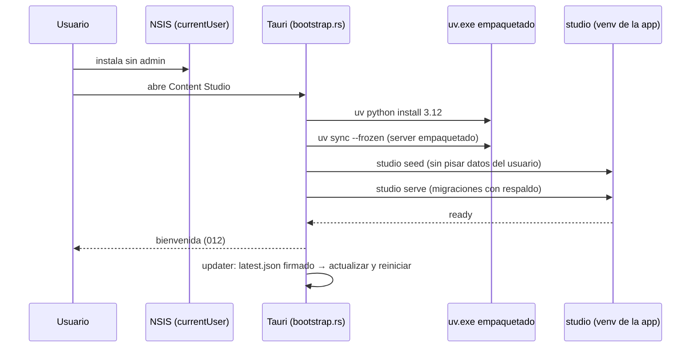

# 022: contexto y decisión

> **Decisiones y pendientes al ejecutar**: quien implemente esta spec puede tomar **todas las decisiones técnicas** que necesite, sin detenerse a pedir confirmación. Cada una queda en [`docs/process/WARNING/`](../../../process/WARNING/README.md); toda revisión pendiente, en [`docs/process/PENDING/`](../../../process/PENDING/README.md).
>
> **Datos del usuario: solo los que crea esta spec**. No borra ni sobrescribe voces grabadas, voces construidas, salidas de `out/` ni modelos que no creó; si algo parece exigirlo, es un `blocked — user-data`. Cargar el secret de GitHub requiere la aprobación del usuario.

## 1. Precondición

La 020 está fusionada: `git show origin/dev:server/src/content_studio/library/index.py` existe y `paths.py` tiene el modo `installed` (012).

## 2. Contexto

* La 005 dejó `src-tauri` levantando `uv run --project <raíz> studio serve` en modo dev, con un Job Object y `get_connection`.
* La 012 dejó `paths` con el modo `installed` (por `CONTENT_STUDIO_MODE`): `%LOCALAPPDATA%\Content Studio\` para la base, los venvs y los motores, y `Documentos\Content Studio\` para las salidas, que se pueden cambiar en Ajustes. También dejó la bienvenida, las recetas, el instalador de motores y la detección e instalación de ffmpeg y git con winget.
* audio-converter (la referencia): NSIS por usuario en español e inglés, `tauri.conf.json` con la ventana y el instalador.
* El repo es público (`bypabloc/content-studio`) con licencia MIT. `main` se publica desde `dev` y los rulesets protegen `main` y `dev` (los tags no están protegidos).
* Las decisiones del usuario: por usuario sin admin, actualizaciones automáticas desde Releases, sin firma de código por ahora, y un workflow en tags `v*`.

## 3. Solución

* **D-1: recursos empaquetados** (`tauri.conf.json` → `bundle.resources`):
  * `uv.exe`, una versión fija descargada en el build, con su hash verificado, en `bin/`.
  * `server/` (copia de `server/src/**`, `server/pyproject.toml` y un `uv.lock` exportado para el miembro `server` con `uv export --frozen --package content-studio`, o el lock del workspace con `--package`; la forma exacta la decide quien implementa y va a WARNING).
  * `seed/`: lo versionado de `server/data/`, es decir el `catalog.json` de voces, `docs/scripts/`, `fonts/`, las recetas (que ya viven en `src`) y los textos de las referencias de prueba (`reference/test/`). Sin venvs, modelos ni grabaciones.
  * `seed/VERSION`, con la versión de la app.
* **D-2: primer arranque** (`src-tauri/src/bootstrap.rs`). Si la app está instalada (el ejecutable no está dentro de un checkout: no hay `server/src` dos niveles arriba), se pone `CONTENT_STUDIO_MODE=installed` y `CONTENT_STUDIO_RESOURCES=<resources>` para el server. Después, en orden y con un evento `bootstrap` por paso hacia la ventana `splash` (una página mínima en `client/src/bootstrap/` con su progreso y los textos del catálogo):
  1. `uv python install 3.12` (con `UV_PYTHON_INSTALL_DIR` dentro de `%LOCALAPPDATA%\Content Studio\python`).
  2. `uv sync --frozen --no-dev --project <resources>/server` con `UV_PROJECT_ENVIRONMENT=%LOCALAPPDATA%\Content Studio\venv` (solo si `venv/.app-version` no coincide con la versión de la app).
  3. La siembra (D-3), que la hace el server con `studio seed` al arrancar en modo instalado.
  4. `studio serve`, como en la 005, pero con el `python` de ese venv.

  Cada paso es idempotente. Si falla, la pantalla muestra el error del catálogo con «Reintentar» y «Ver log» (`%LOCALAPPDATA%\Content Studio\logs\bootstrap.log`). Sin conexión en el primer arranque, informa que hace falta internet una vez. Se descartó embeber un Python portable en el instalador porque pesa unos 100 MB y uv ya resuelve la instalación (decisión del lote).
* **D-3: siembra** (`content_studio/seed.py` y `studio seed`). Copia `seed/**` a `data_dir()` solo si el destino no existe, o si existe con la marca `.seeded` de una versión anterior y el contenido no cambió desde la siembra (compara el sha256 guardado en `.seeded.json`). Si el usuario lo modificó, no lo pisa y deja `<archivo>.new` al lado, con un aviso en el log. Nunca toca `reference/<perfil>/`, las voces construidas ni las salidas.
* **D-4: migraciones al actualizar**. Al arrancar, el server corre `migrate()` (la base) y los pasos de `MIGRATIONS` de datos que apliquen al modo instalado, con un respaldo previo de la base en `var/backups/<fecha>-v<anterior>.db` (se guardan los 5 últimos). Si una migración falla, se restaura el respaldo y la app muestra el error.
* **D-5: NSIS** (`bundle.windows.nsis`): `installMode: "currentUser"`, `languages: ["Spanish"]` (con los textos propios en `installer/nsis/strings-es.nsh`), acceso en el menú de inicio, una casilla «Crear acceso en el escritorio» y el ícono de la app. Un hook de desinstalación (`installer/nsis/hooks.nsh`, `NSIS_HOOK_PREUNINSTALL`) agrega la casilla «Borrar también mis datos (motores, voces y salidas)», desmarcada por defecto, que borra `%LOCALAPPDATA%\Content Studio\` y la carpeta de salidas por defecto solo si está marcada, con una confirmación más. Sin la casilla, los datos quedan para una reinstalación.
* **D-6: updater**. `tauri-plugin-updater` con `endpoints: ["https://github.com/bypabloc/content-studio/releases/latest/download/latest.json"]` y la `pubkey` del par generado con `tauri signer generate`. La clave privada vive fuera del repo (en `~/.tauri/content-studio.key` del usuario) y como secret `TAURI_SIGNING_PRIVATE_KEY` (y su contraseña) en GitHub. Cargar el secret lo aprueba el usuario. Al abrir, la app consulta en segundo plano. Si hay una versión nueva, un toast persistente ofrece «Actualizar y reiniciar» (y Ajustes > Acerca de muestra la versión y un botón «Buscar actualizaciones»). Antes de instalar, espera a que no haya trabajos corriendo y lo avisa.
* **D-7: versión y release**. `python -m devtools version <x.y.z>` (`devtools/version.py`) actualiza `client/src-tauri/tauri.conf.json`, `client/src-tauri/Cargo.toml`, `client/package.json`, `server/pyproject.toml` y `package.json` de la raíz, valida semver, y con `--check` falla si difieren (el test-runner lo suma a `validators`). `.github/workflows/release.yml` corre en `push` de tags `v*`, en `windows-latest`:
  1. Comprueba que el tag coincide con la versión (`version --check`).
  2. `bun install --frozen-lockfile`, `uv` y la descarga de `uv.exe` con su hash.
  3. `tauri build` con los secrets del updater.
  4. Genera `latest.json`.
  5. Publica el Release con el instalador, la firma y `latest.json`.

  Las notas salen de los commits entre tags (Conventional Commits) y suman una sección fija de SmartScreen. `git-workflow.md` documenta el paso: con `dev` ya fusionado en `main`, se crea el tag `vX.Y.Z` en `main` y se hace push del tag (los tags no son ramas protegidas). `origen-pr.yml` no cambia.
* **D-8: sin firma de código**. El README de la release y `docs/operations/release.md` (nuevo) explican el aviso «Windows protegió tu PC» y cómo seguir (Más información > Ejecutar de todas formas). `PENDING/022-firma-de-codigo.md` deja las opciones (Azure Trusted Signing, un certificado OV o EV, con sus costos) para que el usuario decida.
* **D-9: docs y reglas**. `AGENTS.md` (cómo se publica e instala), `git-workflow.md` (tags y release), `devtools.md` (comando `version`), `frontend-stack.md` (bundle y updater), `docs/operations/release.md` y una ficha nueva `docs/process/01-done/installer.md`.

## 4. Fuera de alcance

* La firma de código: tiene costo y queda en PENDING para que el usuario decida.
* macOS y Linux: el instalador es solo Windows (el código ya es portable, pero no se empaqueta ni se prueba).
* La Microsoft Store y winget como canal de distribución.
* Modo portable (sin instalar).

## 5. Criterios de aceptación

* **AC-1**: WHEN el ejecutable corre fuera de un checkout THEN se detecta el modo `installed` y el server recibe `CONTENT_STUDIO_MODE` y `CONTENT_STUDIO_RESOURCES`. Dentro de un checkout, sigue en modo dev. Lo verifica: un test de Rust de `detect_mode` y uno de Python de `paths`.
* **AC-2**: Given un `data_dir()` vacío When se corre `studio seed` Then se copian todos los archivos de `seed/` con `.seeded.json`. Si se modifica un archivo y se siembra una versión nueva, no se pisa y aparece `<archivo>.new`. Las carpetas `reference/<perfil>/` nunca se tocan. Lo verifica: `test_seed.py`.
* **AC-3**: Given una base de la versión N-1 When arranca la versión N Then queda un respaldo en `var/backups/`, `user_version` sube, y si una migración simulada falla, la base queda igual al respaldo. Lo verifica: `test_schema.py::test_ac3_backup_restore`.
* **AC-4**: WHEN se corre `python -m devtools version 1.2.3` THEN los 5 manifiestos dicen 1.2.3, y `--check` sale con exit 0. Con uno distinto, sale con exit 1 y nombra el archivo. Lo verifica: `devtools/tests/unit/test_version.py`.
* **AC-5**: Given el bootstrap con un paso `uv sync` que falla When se reintenta Then los pasos ya hechos no se repiten (`.app-version`) y la pantalla muestra el error y «Reintentar». Lo verifica: un test de Rust con un ejecutor de comandos simulado y un e2e de la página de bootstrap con los eventos simulados.
* **AC-6**: WHEN se compila con `tauri build` THEN sale un `.exe` NSIS con `installMode currentUser`, en español, y el bundle incluye `bin/uv.exe`, `server/` y `seed/` (listado del bundle). El instalador pesa menos de 60 MB. Lo verifica: la verificación final.
* **AC-7**: WHEN se instala en un usuario de prueba de Windows (o con `CONTENT_STUDIO_HOME` temporal) sin Python ni uv en el PATH THEN no pide permisos de administrador, el primer arranque prepara Python y el venv mostrando el progreso, se siembran los datos y aparece la bienvenida. La app genera una narración después de instalar un motor desde la bienvenida. Lo verifica: la verificación final.
* **AC-8**: WHEN se desinstala sin la casilla THEN la app desaparece y `%LOCALAPPDATA%\Content Studio\` y las salidas quedan. Con la casilla y la confirmación, se borran. Lo verifica: la verificación final, en el usuario o la carpeta de prueba.
* **AC-9**: Given la versión 0.1.0 instalada y un Release 0.1.1 de prueba (en un repo fork o en un endpoint local con `latest.json` firmado) When se abre la app Then ofrece actualizar, espera a que no haya trabajos, actualiza, reinicia y las migraciones corren. Lo verifica: la verificación final, con un servidor local que sirve `latest.json` (sin publicar un Release real si el usuario no lo aprueba).
* **AC-10**: WHEN se hace push de un tag que no coincide con la versión THEN `release.yml` falla en el primer paso. Lo verifica: un `act`, o una corrida del workflow en una rama de prueba con `workflow_dispatch` en modo `dry-run` (que compila sin publicar).

## 6. Diagrama

