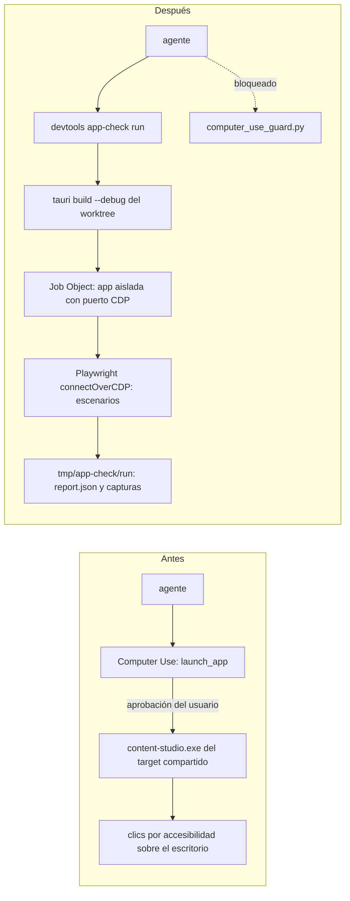

# 024: contexto y decisión

> **Decisiones y pendientes al ejecutar**: quien implemente esta spec puede tomar **todas las decisiones técnicas** que necesite, sin detenerse a pedir confirmación. Cada una queda en [`docs/process/WARNING/`](../../process/WARNING/README.md); toda revisión pendiente, en [`docs/process/PENDING/`](../../process/PENDING/README.md).
>
> **Datos del usuario: solo los que crea esta spec**. No borra ni sobrescribe voces grabadas, voces construidas, salidas de `out/` ni modelos que no creó; si algo parece exigirlo, es un `blocked — user-data`.

## 1. Precondición

Ninguna spec previa. Se comprueba que `origin/dev` tenga la app de Tauri y el harness e2e que esta spec reutiliza:

```bash
git show origin/dev:client/src-tauri/src/lib.rs | grep -n "fn project_root"
git show origin/dev:tests/e2e/support/app.ts | grep -n "plugin:dialog|open"
git show origin/dev:server/src/content_studio/paths.py | grep -n "CONTENT_STUDIO_HOME\|CONTENT_STUDIO_DB"
```

## 2. Contexto

Al verificar la UI (lote 012, sesiones del 20 y 21-11-2026), Codex usa Computer Use (`@oai/sky` por `mcp__node_repl__js`). En los registros de `~/.codex/sessions/` se ven estas fallas:

| Falla | Causa |
| :--- | :--- |
| El canal nativo no conecta; `Kernel state was reset after inactivity` | Computer Use depende de un REPL que se reinicia y de un pipe de Windows |
| `app approval timed out` en 4 aperturas | Cada `launch_app` espera una aprobación del usuario |
| Abre un `content-studio.exe` compilado antes del commit bajo prueba | `worktree prepare` enlaza `client/src-tauri/target` al compartido `<principal>/tmp/cargo-target` (`devtools/worktree.py:87`), y `project_root()` (`client/src-tauri/src/lib.rs`) queda fijo en el checkout que compiló |
| WebView2 `0x800700AA` y una instancia oculta que da «Acceso denegado» al cerrarla | Dos instancias con la misma carpeta de datos de WebView2 (`com.bypabloc.contentstudio`); el proceso no se lanzó dentro de un grupo que el agente controle |
| `ERR_CONNECTION_REFUSED` | Se abrió el binario de `tauri dev`, que espera Vite en `localhost:1420` |
| `element 262 is not available in cached app state`, «No pude fijar la ruta del selector» | Maneja el selector de carpetas de Windows clic a clic por el árbol de accesibilidad |
| El usuario no puede usar la PC mientras tanto | Computer Use toma el escritorio |

Resultado: las aceptaciones visuales de 012 quedaron como `external-wait` y luego en `PENDING/` (`WARNING/012-aceptacion-sin-usuario.md`, `PENDING/012-instalar-motor-real.md`).

Lo que ya existe y se reutiliza:

* `tests/e2e/` (Playwright 1.65.1, workspace de bun): `support/select.ts` (`pickOption`) y la simulación de `plugin:dialog|open` de `support/app.ts`. Hoy corre sobre `vite preview` con la API simulada; no toca Tauri ni el server real.
* `paths.py`: `CONTENT_STUDIO_HOME` (datos, motores por defecto) y `CONTENT_STUDIO_DB` (base) aíslan una instalación. El server que lanza Tauri (`server.rs`, `uv run --project <raíz> studio serve --port 0`) hereda el entorno.
* `jobs/queue.py`: la pausa de la cola persiste en la preferencia `queue.paused`, y el worker la respeta (`jobs/worker.py:139`).
* `.agents/hooks/shell_guard.py`: hook compartido por los tres agentes, con el formato de bloqueo `Blocked by …: … Why: … Instead: …` y la salida para Antigravity (`{"decision": "deny"}`).
* `client/src/app/nav.ts`: la lista de secciones (`navItems()`), que el escenario `smoke` recorre.

## 3. Solución

Una sola. Cada decisión pasó la escalera de `plan-format.md` §0.

* **D-1: Playwright por CDP contra el WebView2 real.** `chromium.connectOverCDP('http://127.0.0.1:<puerto>')` toma la página de la ventana de Tauri y la maneja con selectores por rol, sin mouse del sistema. ¿Ya existe? Playwright está en `tests/e2e/package.json`: no hay dependencia nueva. Descartadas: Computer Use (las fallas de §2); `tauri-driver` con `msedgedriver` (dos binarios más que fijar por versión de WebView2, y WebDriver no comparte los helpers de Playwright); solo `vite preview` (ya existe como e2e y no prueba Tauri, el server real ni los datos).
* **D-2: Un binario por worktree.** `bun run --cwd client tauri build --debug --no-bundle` con `CARGO_TARGET_DIR=<worktree>/tmp/app-check/cargo-target`. El frontend queda embebido (`frontendDist`), así que no hace falta Vite ni el puerto 1420, y dos sesiones no chocan. No se toca el enlace de `worktree prepare`: la variable tiene precedencia. Primera compilación lenta (minutos) y luego incremental; se acepta porque un binario de otro checkout no prueba nada. El informe registra el commit (`git rev-parse HEAD`) y la ruta del binario.
* **D-3: Aislamiento por corrida** en `tmp/app-check/<AAAAMMDD-HHMMSS>/`: `webview2/` (`WEBVIEW2_USER_DATA_FOLDER`), `home/` (`CONTENT_STUDIO_HOME`), `content-studio.db` (`CONTENT_STUDIO_DB`), `shots/` y `report.json`. El puerto de CDP es uno libre de 127.0.0.1 y se pasa con `WEBVIEW2_ADDITIONAL_BROWSER_ARGUMENTS=--remote-debugging-port=<p>`. Si T1 demuestra que Tauri ignora esa variable, el respaldo es leer `CONTENT_STUDIO_CDP_PORT` solo en compilaciones debug (`cfg(debug_assertions)`) y pasarlo con `additional_browser_args` al crear la ventana (ficha `WARNING/024-cdp-webview2`). El log de la app y del server va a `logs/app-check-<run>.log` (`command-output.md`).
* **D-4: `--data=temp` por defecto y `--data=real` de solo lectura.** En `real` no se fija `CONTENT_STUDIO_HOME`: se ven los motores, voces, referencias y salidas del usuario. La base se copia a la carpeta de la corrida con `sqlite3.Connection.backup` (stdlib, consistente con WAL), y en la copia se fija `queue.paused = true` antes de abrir. Así el worker de la segunda instancia no corre los trabajos del usuario. La fixture de Playwright aborta (`route.abort`) todo método que no sea GET hacia la API y lo anota en el informe como `blocked_writes`. Un escenario que necesite escribir falla en `real` y se corre en `temp`. Descartadas: abrir la base real (dos workers sobre la misma cola) y copiar `out/` o los motores (decenas de GB).
* **D-5: Cierre con un Job Object.** devtools crea el proceso dentro de un Job con `JOB_OBJECT_LIMIT_KILL_ON_JOB_CLOSE` (ctypes: `CreateJobObjectW`, `SetInformationJobObject`, `AssignProcessToJobObject`). Al cerrar el handle, en `finally` o porque devtools murió, Windows termina la app, WebView2, uv y el server de esa corrida, y nada más. `server.rs` ya usa la misma técnica para el server (`job::KillOnClose`). El PID y la ruta del binario quedan en `report.json`. En POSIX el comando sale con exit 2 («app-check needs Windows and WebView2»): la CI no lo corre.
* **D-6: Diálogos simulados.** `tests/e2e/app-check/support/tauri.ts` envuelve el `invoke` real de Tauri desde el escenario (`page.evaluate`): `plugin:dialog|open` y `plugin:dialog|save` devuelven la ruta que fija `pickPaths(page, rutas)` (una sola si `multiple === false`, como en `support/app.ts`), y el resto de comandos pasa al `invoke` original. Las rutas de prueba están bajo la carpeta de la corrida, salvo en `real`, que solo lee.
* **D-7: Escenarios.** `tests/e2e/app-check/<nombre>.check.ts`, con su propia configuración `tests/e2e/playwright.app-check.config.ts` (sin `webServer`, `workers: 1`, `outputDir` en la carpeta de la corrida). El patrón `*.e2e.ts` de la configuración actual no los toma. Incluye:
  * `smoke`: recorre cada sección de `navItems()` por su enlace, en claro y en oscuro, con una captura por sección y tema en `shots/<seccion>-<tema>.png`. Falla si hay errores de consola, `pageerror` o respuestas 5xx de la API. En `temp` cambia el tema con el control de la app; en `real`, con la clase `dark` de `<html>`, para no escribir `ui.theme`.
  * Las specs que vengan agregan su escenario (`<NN>-<flujo>.check.ts`) para su AC con el server real; esta spec deja `dialog-pick.check.ts`, que comprueba D-6 en una pantalla que use el diálogo (Importar o Almacenamiento).
* **D-8: CLI.** `python -m devtools app-check run [--scenario=<n>]... [--data=temp|real]`, con `smoke` por defecto. Exit 0 si todo pasa, 1 si un escenario falla, 2 si fallan la compilación, el arranque o la espera de CDP, o si un argumento no es válido. stdout: una línea JSON con `run`, `commit`, `binary`, `data`, `scenarios` (estado y duración), `shots`, `blocked_writes` y `log`. stderr: el progreso. La espera de CDP consulta `/json/version` con un plazo de 60 s, y vence con exit 2 y la cola del log. No hay `sleep` fijo: cada reintento espera la respuesta del socket. Código en el paquete `devtools/app_check/` (`main.py` CLI, `env.py` carpeta y entorno, `launch.py` compilación, Job y CDP), para quedar en menos de 300 líneas por archivo. Un comando nuevo con varios archivos se justifica porque D-2 a D-5 son responsabilidades distintas.
* **D-9: Computer Use prohibido, en cuatro capas.**
  1. Hook `.agents/hooks/computer_use_guard.py` (stdlib) que bloquea por nombre de herramienta (`mcp__computer-use__*`, `mcp__remote-devices__computer*`) y por contenido: código que importe `@oai/sky` o llame a `sky.` en `mcp__node_repl__js`, `js` o `exec` (Codex en modo código). El mensaje sigue el formato de `shell_guard` y apunta a `app-check`.
  2. Cableado en `.claude/settings.json` (PreToolUse con `matcher` de esos nombres), `.codex/hooks.json` y `.agents/hooks.json` (Antigravity). Los nombres y eventos exactos de Codex y Antigravity salen del sondeo T1 y quedan en `WARNING/024-hooks-por-agente`. Si un agente no dispara PreToolUse para esas herramientas, se registra ahí y quedan las capas 3 y 4.
  3. `.codex/config.toml` del proyecto con `[plugins."computer-use@openai-bundled"]` y `[plugins."unified-computer-use@openai-bundled"]` en `enabled = false`, si T1 confirma que Codex respeta la configuración de plugins del proyecto.
  4. Regla: en `verify-before-claiming-done.md`, «Verificar la UI: `app-check`; Computer Use prohibido» y la fila de la tabla §1. También una línea en `AGENTS.md` (Reglas), `frontend-stack.md` (tabla de comandos), `devtools.md` (tabla) y la skill `devtools`. Todo editado en `.agents/` y copiado con `rules --sync`.
  * Solo se bloquea el control del escritorio. Los plugins de navegador (`browser`, `chrome`, Claude in Chrome) quedan fuera (§4).

## 4. Fuera de alcance

* Cerrar las fichas de revisión visual que `app-check` destraba (`PENDING/008-revision-visual-organismos`, `012-instalar-motor-real`, `014-capturas-editor`, `015-escucha-y-revision`, `005-tema-sin-parpadeo`): cada una en su PR, con su escenario.
* Correr `app-check` en la CI: necesita Windows y WebView2 con ventana, y la CI es Linux.
* Bloquear los plugins de navegador de Codex o de Claude (`browser`, `chrome`): no controlan el escritorio. Si el usuario los quiere fuera, es otra tarea de `02-next/`.
* Editar `~/.codex/computer-use/config.toml` ni otra configuración del usuario fuera del repo: queda como paso manual en `PENDING/024-allowlist-computer-use`.
* Migrar los e2e actuales (`*.e2e.ts`, API simulada) a CDP: siguen igual y siguen en el job `client`.
* Ocultar la ventana o abrirla fuera de pantalla: el usuario eligió que se vea.
* Revisión de accesibilidad con axe en `app-check`: ya la cubre `happy-apariencia-axe.e2e.ts`.

## 5. Criterios de aceptación

* **AC-1**: WHEN un agente llama a una herramienta de Computer Use (`mcp__computer-use__*`, `mcp__remote-devices__computer*`) o a `mcp__node_repl__js`/`js`/`exec` con código que importa `@oai/sky` o llama a `sky.` THEN `computer_use_guard.py` lo bloquea (exit 2 con el motivo en stderr para Claude Code y Codex; `{"decision": "deny"}` en stdout para Antigravity), con el mensaje `Blocked by .agents/hooks/computer_use_guard.py: … Why: … Instead: python -m devtools app-check run …`. Lo verifican: `.agents/hooks/tests/test_computer_use_guard.py` (el hook ejecutado de verdad con los eventos de los tres agentes) y sus doctests.
* **AC-2**: WHEN la herramienta es otra (Bash, Read, `mcp__node_repl__js` sin `sky`, un `exec` que solo menciona «sky» en un string de commit) THEN el hook sale con 0 y sin salida. Lo verifica: `test_computer_use_guard.py` (casos negativos).
* **AC-3**: Given `.claude/settings.json`, `.codex/hooks.json` y `.agents/hooks.json` When se leen Then cada uno cablea `computer_use_guard.py` en PreToolUse con el matcher que T1 determinó para ese agente, y `.codex/config.toml` desactiva los dos plugins de Computer Use (si T1 lo confirmó). Lo verifica: `tests/validators/test_structure.py::test_ac3_computer_use_guard_wired_for_every_agent`.
* **AC-4**: WHEN `app-check run` prepara una corrida THEN arma un entorno con `WEBVIEW2_USER_DATA_FOLDER`, `CONTENT_STUDIO_HOME` y `CONTENT_STUDIO_DB` bajo `tmp/app-check/<run>/`, `CARGO_TARGET_DIR` en `tmp/app-check/cargo-target` del worktree y `WEBVIEW2_ADDITIONAL_BROWSER_ARGUMENTS` con un puerto libre; con `--data=real` no fija `CONTENT_STUDIO_HOME` y la base es una copia con `queue.paused = true`, sin tocar la original (mismo hash y mtime). Lo verifica: `devtools/tests/unit/app_check/test_env.py`.
* **AC-5**: WHEN la compilación falla, el binario no existe o CDP no responde en el plazo THEN exit 2, stdout con `{"error": …, "log": "logs/app-check-<run>.log"}` y ningún proceso de la corrida vivo. Lo verifican: `devtools/tests/unit/app_check/test_launch.py` (subprocess y socket simulados) y la corrida real con un puerto ocupado (verificación final).
* **AC-6**: WHEN termina una corrida, por éxito, fallo, excepción o Ctrl+C, THEN el Job Object se cierra y no queda vivo ningún proceso que la corrida lanzó, mientras otro `content-studio.exe` abierto antes sigue vivo. Lo verifican: `test_launch.py` (el `finally` cierra el Job) y la verificación final (`Get-Process` antes y después, con una instancia ajena abierta).
* **AC-7**: WHEN se corre `app-check run` en el worktree THEN el escenario `smoke` abre el binario compilado en ese commit, recorre las secciones de `navItems()` en claro y en oscuro, guarda una captura por sección y tema, y sale con 0 sin errores de consola ni 5xx. El informe trae `commit` igual a `git rev-parse HEAD` y `binary` bajo `tmp/app-check/cargo-target`. Lo verifica: la corrida real (verificación final) y `image-reader` sobre dos capturas.
* **AC-8**: WHEN un escenario pide un diálogo nativo con `pickPaths` THEN la app recibe la ruta sin abrir el selector de Windows, y el resto de comandos de Tauri siguen yendo al `invoke` real. Lo verifica: `dialog-pick.check.ts` en la corrida real.
* **AC-9**: Given `--data=real` When un escenario intenta un POST, PUT o DELETE a la API Then la petición se aborta, el informe la lista en `blocked_writes` y la base original del usuario no cambia. Lo verifican: `test_env.py` (copia y pausa), una prueba de la fixture y la corrida real `--data=real --scenario=smoke` con el hash de `var/content-studio.db` antes y después.
* **AC-10**: WHEN se le pregunta a Claude Code, Codex y Antigravity cómo verificar la UI de la app THEN responden `python -m devtools app-check run` y rechazan Computer Use (trampa); una pregunta ajena no arrastra la regla (negativo). Lo verifica: la validación headless de `agent-config-testing.md` (`tmp/config-tests/024-app-check.json`, 9/9 PASS o el agente no disponible registrado en WARNING).

## 6. Diagrama antes y después


