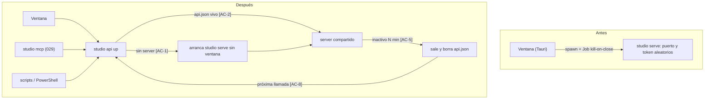

# Spec 028: diseño

> **Decisiones y pendientes al ejecutar**: quien implemente esta spec puede tomar **todas las decisiones técnicas** que necesite, sin detenerse a pedir confirmación.
> Cada una queda anotada en [`docs/process/WARNING/`](../../../process/WARNING/README.md) (ficha `028-<tema>.md` con contexto, elegida, descartadas, cómo revertir y cómo comprobarla, y su fila en el README de la carpeta).
> Toda revisión pendiente queda en [`docs/process/PENDING/`](../../../process/PENDING/README.md) (ficha y fila, con qué la cierra).
>
> **Datos del usuario: solo los que crea esta spec**. La spec no borra ni sobrescribe voces grabadas (`server/data/narration/voz/`), voces construidas, salidas de `out/` ni modelos descargados que ella no creó. Sus pruebas escriben en carpetas nuevas (`out/<herramienta>/spec-028/` o `tmp/spec-028/`). Si algo parece exigir tocar datos existentes, no se decide al ejecutar: es un `blocked — user-data` y se pregunta. Los cambios locales o sin rastrear del checkout principal no son de la spec: no se tocan y no bloquean.

## 1. Flujo antes y después

## 2. CLI y API

| Superficie | Entrada | Salida | Errores |
| :--- | :--- | :--- | :--- |
| `studio api up [--with-token]` | — | JSON en una línea: `{"ready": {"url", "port", "pid", "version"}}` (+ `token` con `--with-token`, solo para Tauri) | exit 2 si el server no responde en 30 s, con la ruta del log |
| `studio api status` | — | El contenido de `api.json` y `alive` | exit 1 si no corre |
| `studio api down [--force]` | — | `{"stopped": true}` | exit 1 si hay un trabajo corriendo y no va `--force` |
| `studio api token [--rotate]` | — | La ruta del archivo del token (nunca el token) | — |
| `studio serve` | `--port 0` conserva el comportamiento aislado de los tests y `app-check` | igual que hoy | — |
| Toda ruta | `Host` distinto de `127.0.0.1:<puerto>` o `localhost:<puerto>` | 400 `error.host_not_allowed` | [AC-10] |

## 3. Datos y migración

* `<carpeta de la base>/api.json`: `{"url", "port", "pid", "version", "started_at"}`. La carpeta es la de `paths.db_path()` (`var/` en un checkout; la de `CONTENT_STUDIO_HOME` o `%LOCALAPPDATA%\Content Studio` instalada).
* `<carpeta de la base>/api-token`: 32 bytes en hex; en POSIX con modo 0600. Se crea la primera vez.
* `<carpeta de la base>/api.lock`: lo retiene el server mientras vive (`msvcrt.locking` en Windows, `fcntl.flock` en POSIX).
* Ajustes nuevos en `settings`: `api.port` (41830), `api.idle_minutes` (10). Sin migración SQL: `settings` es clave-valor.

## 4. Diseño por módulo

### 4.1 `server/src/content_studio/runtime/` (solo stdlib)

* `discovery.py`: `write(info)`, `read() -> dict | None`, `clear()`, `token(rotate=False) -> str`. Escribe con archivo temporal y `os.replace`.
* `instance.py`: `hold_lock() -> contextmanager` y `ensure_running(timeout=30) -> dict`. `ensure_running` lee `api.json`, prueba `GET /health` con `urllib.request`; si no responde, toma el lock en modo no bloqueante para saber si alguien arranca, y si nadie lo tiene lanza `studio serve` sin ventana (`CREATE_NO_WINDOW | DETACHED_PROCESS` en Windows, `start_new_session` en POSIX) con la salida en `logs/server.log`, y espera su `api.json`.
* `idle.py`: `IdleClock(minutes)` con `touch()`, `hold(name)`/`release(name)` (para la carpeta caliente de la 030) e `idle() -> bool`.

### 4.2 `server/src/content_studio/cli/serve.py` y `api/app.py`

* `serve`: puerto de `api.port`; si `bind` falla (ocupado o reservado por Hyper-V), el que elige el sistema y un aviso en el log [AC-3]. Token del archivo si no llega `--token`. Toma el lock; escribe `api.json` al estar listo y lo borra al salir.
* Un hilo revisa cada 30 s: si `IdleClock.idle()` y la cola no tiene trabajos `queued` ni `running`, `server.should_exit = True` [AC-5].
* Middleware: `touch()` en cada petición salvo `/health` y `/events`; `TrustedHostMiddleware` con `127.0.0.1` y `localhost` [AC-10].
* `/health` suma `version` y `pid`.

### 4.3 `client/src-tauri/src/`

* `ServerState::connect` corre `studio api up --with-token` y lee la línea `ready` (mismo `parse_ready`, ahora con `url` y `token`). Ya no asigna el server a un Job: el server vive más que la ventana [AC-7].
* Si `version` difiere de la de la app: `studio api down` (sin `--force`) y `up` de nuevo; si hay un trabajo corriendo, se adjunta y lo reintenta al terminar [AC-9]. El updater corre `studio api down --force` antes de instalar.

### 4.4 `client/src/shared/api/`

* Un fallo de red (no un 4xx/5xx) vuelve a pedir `get_connection` y reintenta una vez; el SSE se reconecta con la conexión nueva [AC-8]. Mientras, la barra de estado dice «Reactivando el servidor…».
* Ajustes > Integraciones: URL, puerto, minutos de inactividad, «Copiar token» y «Cambiar token» [AC-11].

## 5. Textos

| Clave en `messages/{es,en,pt}.json` | Texto en es |
| :--- | :--- |
| `settings.integrations.title` | Integraciones |
| `settings.integrations.url` | Dirección del servidor local |
| `settings.integrations.port` | Puerto (se aplica al reiniciar el servidor) |
| `settings.integrations.idle` | Apagar el servidor tras {minutes} min sin uso |
| `settings.integrations.copy_token` | Copiar token |
| `settings.integrations.rotate_token` | Cambiar token |
| `settings.integrations.rotate_confirm` | Las apps conectadas dejarán de funcionar hasta que copies el token nuevo. ¿Cambiarlo? |
| `server.waking` | Reactivando el servidor… |
| `error.host_not_allowed` | Esta dirección no puede usar el servidor local. |
