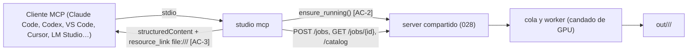

# Spec 029: diseño

> **Decisiones y pendientes al ejecutar**: quien implemente esta spec puede tomar **todas las decisiones técnicas** que necesite, sin detenerse a pedir confirmación.
> Cada una queda anotada en [`docs/process/WARNING/`](../../../process/WARNING/README.md) (ficha `029-<tema>.md` con contexto, elegida, descartadas, cómo revertir y cómo comprobarla, y su fila en el README de la carpeta).
> Toda revisión pendiente queda en [`docs/process/PENDING/`](../../../process/PENDING/README.md) (ficha y fila, con qué la cierra).
>
> **Datos del usuario: solo los que crea esta spec**. La spec no borra ni sobrescribe voces grabadas (`server/data/narration/voz/`), voces construidas, salidas de `out/` ni modelos descargados que ella no creó. Sus pruebas escriben en carpetas nuevas (`out/<herramienta>/spec-029/` o `tmp/spec-029/`). Si algo parece exigir tocar datos existentes, no se decide al ejecutar: es un `blocked — user-data` y se pregunta. Los cambios locales o sin rastrear del checkout principal no son de la spec: no se tocan y no bloquean.

## 1. Flujo

## 2. Herramientas

Pocas y orientadas a tareas, con prefijo `studio_`: la guía de Anthropic para herramientas de agentes recomienda consolidar en vez de envolver cada endpoint, nombres con espacio propio y respuestas cortas con lo que el agente necesita ([Writing effective tools for agents](https://www.anthropic.com/engineering/writing-tools-for-agents)). Con modelos locales chicos (Qwen3.5 9B en LM Studio) una lista larga empeora la elección. VoiceStudio llegó a lo mismo: herramientas por tarea y salida por archivo ([11-mcp-y-agentes.md](../../../research/voicestudio-narracion/herramientas/11-mcp-y-agentes.md)).

| Herramienta | Entrada | Devuelve | Anotaciones |
| :--- | :--- | :--- | :--- |
| `studio_capabilities` | — | Motores instalados, voces, estilos, presets de música y conversión, y los tipos de trabajo con su esquema de `params` | `readOnlyHint` |
| `studio_narrate` | `text` o `script_path`, `voice`, `model?`, `style?` | `job` | — |
| `studio_make_music` | `style` o `prompt`, `duration_s`, `model?` | `job` | — |
| `studio_transcribe` | `input_path`, `language?` | `job` (al terminar, ruta del `.srt` y del texto) | — |
| `studio_clean_silences` | `input_path`, `preset?` | `job` | — |
| `studio_convert_media` | `input_path`, `target` (`mp3`, `wav`, preset de redes…), `normalize?` | `job` | — |
| `studio_submit_job` | `kind`, `params` (lo que lista `studio_capabilities`) | `job` | — |
| `studio_get_job` | `job_id?` (sin id: los 10 últimos) | `job` o lista | `readOnlyHint` |
| `studio_wait_job` | `job_id`, `timeout_s` (≤ 300) | `job`; emite `notifications/progress` si llega `progressToken` [AC-5] | `readOnlyHint` |
| `studio_cancel_job` | `job_id` | `job` | `destructiveHint` |

`job` en `structuredContent`: `{"job_id", "kind", "status", "progress", "waiting_on", "outputs": [{"path", "media", "duration_s"}], "output_dir", "error"}`; `status` es el de la cola más `waiting_gpu` [AC-7]. Cada salida va además como `resource_link` con `file:///`. Nunca audio en base64.

**No se exponen**: instalar o desinstalar motores, mover almacenamiento, ajustes, `/fs`, la papelera ni borrar ítems de la Biblioteca. Un guion o un subtítulo puede traer una inyección de prompt.

## 3. CLI

| Superficie | Entrada | Salida | Errores |
| :--- | :--- | :--- | :--- |
| `studio mcp` | stdio | El protocolo MCP | exit 2 si el server no arranca, con la ruta del log en stderr |
| `studio mcp config --client <c>` | `claude-code`, `codex`, `vscode`, `cursor`, `claude-desktop`, `lm-studio`, `jan`, `anythingllm` | El fragmento de configuración de ese cliente, con la ruta absoluta de `studio` (instalada) o `uv run --project <raíz> studio mcp` (checkout) | exit 2 con un cliente desconocido |

## 4. Diseño por módulo

### 4.1 `server/src/content_studio/mcp_server/`

* `tools.py`: las definiciones (nombre, descripción en inglés, `inputSchema`, `outputSchema`) y el armado de `params` por herramienta, sin importar el SDK (se prueba solo).
* `bridge.py`: `run_stdio()` importa el SDK `mcp` dentro de la función, llama a `runtime.instance.ensure_running()` y lee el token con `runtime.discovery.token()` (credenciales del entorno, como pide la spec para stdio). Cliente HTTP con `urllib.request`.
* `config.py`: los fragmentos por cliente.
* Rutas de entrada: cualquier archivo existente del sistema, resuelto con `Path.resolve(strict=True)`; si no existe, error `input_not_found` (decisión del usuario: local = todo el sistema).
* Errores de herramienta (`isError: true`) con el `message` del catálogo en el idioma de `ui.locale`.

### 4.2 `client/src/features/settings/`

* En Integraciones (028): «Conectar un asistente», un selector del cliente y «Copiar configuración» con el fragmento de `GET /integrations/mcp-config?client=<c>`.

## 5. Textos

| Clave en `messages/{es,en,pt}.json` | Texto en es |
| :--- | :--- |
| `settings.integrations.mcp_title` | Conectar un asistente (MCP) |
| `settings.integrations.mcp_client` | Aplicación |
| `settings.integrations.mcp_copy` | Copiar configuración |
| `error.input_not_found` | No existe el archivo {path}. |
| `error.gpu_waiting` | El trabajo espera la GPU, que está usando {holder}. |
