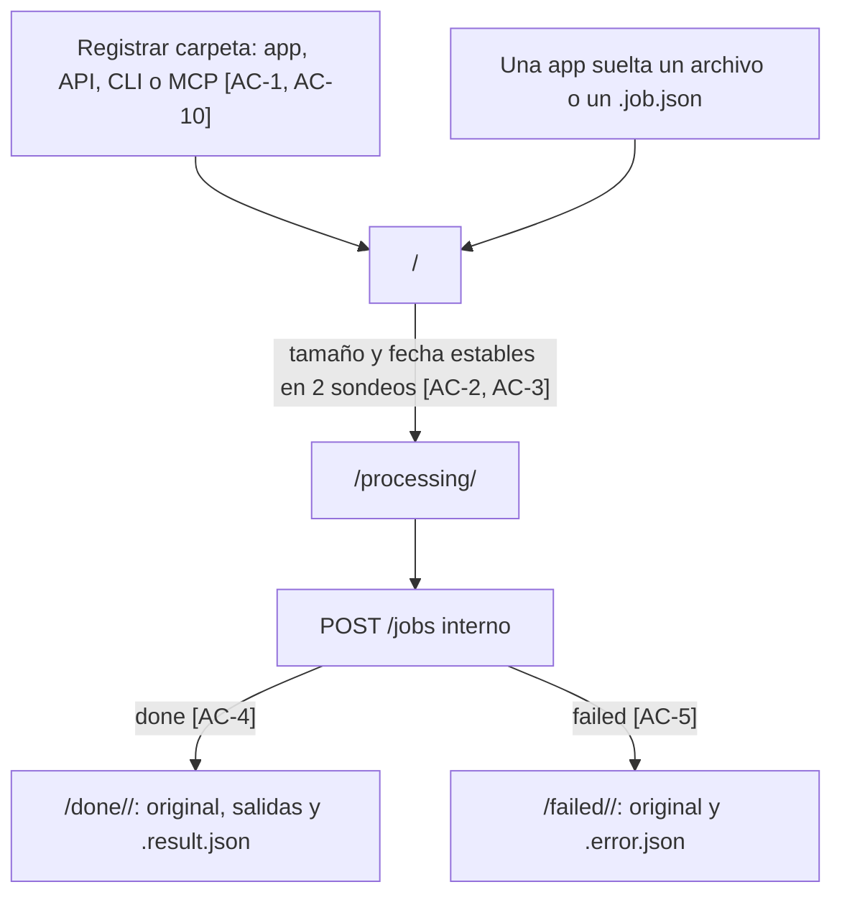

# Spec 030: diseño

> **Decisiones y pendientes al ejecutar**: quien implemente esta spec puede tomar **todas las decisiones técnicas** que necesite, sin detenerse a pedir confirmación.
> Cada una queda anotada en [`docs/process/WARNING/`](../../../process/WARNING/README.md) (ficha `030-<tema>.md` con contexto, elegida, descartadas, cómo revertir y cómo comprobarla, y su fila en el README de la carpeta).
> Toda revisión pendiente queda en [`docs/process/PENDING/`](../../../process/PENDING/README.md) (ficha y fila, con qué la cierra).
>
> **Datos del usuario: solo los que crea esta spec**. La spec no borra ni sobrescribe voces grabadas (`server/data/narration/voz/`), voces construidas, salidas de `out/` ni modelos descargados que ella no creó. Sus pruebas escriben en carpetas nuevas (`out/<herramienta>/spec-030/` o `tmp/spec-030/`). Si algo parece exigir tocar datos existentes, no se decide al ejecutar: es un `blocked — user-data` y se pregunta. Los cambios locales o sin rastrear del checkout principal no son de la spec: no se tocan y no bloquean.

## 1. Flujo



## 2. CLI, API y MCP

| Superficie | Entrada | Salida | Errores |
| :--- | :--- | :--- | :--- |
| `POST /inbox/folders` | `{"path", "kind", "params", "keep_awake": true}` | La carpeta registrada | 422 `folder_not_found`, `unknown_kind` o los errores de `validate` |
| `GET /inbox/folders` · `DELETE /inbox/folders/{id}` · `POST /inbox/folders/{id}/pause` | — | Lista, 204, estado | 404 `inbox_folder_not_found` |
| `studio inbox add PATH --kind K [--param k=v]… [--no-keep-awake]` · `list` · `remove ID` | flags en inglés | JSON en una línea | exit 2 con el error de la API |
| MCP `studio_watch_folder` | `path`, `kind`, `params`, `keep_awake?` | La carpeta registrada | `isError` con el mismo código |

## 3. Datos y migración

Migración SQL nueva en `db/schema.py` (solo agrega):

```sql
CREATE TABLE inbox_folders (id INTEGER PRIMARY KEY, path TEXT NOT NULL UNIQUE, kind TEXT NOT NULL,
  params TEXT NOT NULL, keep_awake INTEGER NOT NULL DEFAULT 1, paused INTEGER NOT NULL DEFAULT 0, created_at TEXT NOT NULL);
CREATE TABLE inbox_items (id INTEGER PRIMARY KEY, folder_id INTEGER NOT NULL REFERENCES inbox_folders(id) ON DELETE CASCADE,
  name TEXT NOT NULL, size INTEGER NOT NULL, mtime REAL NOT NULL, job_id INTEGER, state TEXT NOT NULL,
  UNIQUE (folder_id, name, size, mtime));
```

`<nombre>.result.json`: `{"job_id", "kind", "outputs": [ruta, …], "finished_at"}`. `<nombre>.error.json`: `{"job_id", "code", "message", "errors"}` con el `message` en el idioma de `ui.locale`.

## 4. Diseño por módulo

### 4.1 `server/src/content_studio/inbox/` (solo stdlib)

* `store.py`: altas, bajas y lecturas de las dos tablas.
* `inputs.py`: `INPUT_PARAM`, el nombre del parámetro de entrada de cada `kind` que acepta un archivo (`media.convert`, `media.normalize`, `clean.analyze`, `transcribe`, `subtitles.create`, `narration` con un `.txt` o un guion), en un solo lugar.
* `scanner.py`: `scan_once(conn, now)` con `os.scandir`; ignora carpetas, ocultos, `.part`, `.tmp`, `~$*` y lo que ya está en `inbox_items`; un archivo pasa a `processing/` cuando su tamaño y fecha no cambian entre dos sondeos.
* `receipts.py`: al terminar un trabajo (evento del worker), copia las salidas a `done/<nombre>/` o escribe el error en `failed/<nombre>/`.
* Un hilo del server llama `scan_once` cada 2 s; al arrancar, procesa lo que quedó (archivos soltados con el server apagado) [AC-7]. Cada carpeta con `keep_awake` y sin pausa retiene el `IdleClock` de la 028 [AC-8].

### 4.2 `client/src/features/settings/`

* En Integraciones: «Carpetas de entrada», con la lista, «Agregar» (elige la carpeta con `pickPaths`, la operación y sus opciones con los mismos formularios de cada sección), pausar y quitar.

## 5. Textos

| Clave en `messages/{es,en,pt}.json` | Texto en es |
| :--- | :--- |
| `settings.inbox.title` | Carpetas de entrada |
| `settings.inbox.help` | Lo que sueltes en una de estas carpetas se procesa solo; el resultado queda en su subcarpeta done. |
| `settings.inbox.add` | Agregar carpeta |
| `settings.inbox.operation` | Qué hacer con cada archivo |
| `settings.inbox.keep_awake` | Mantener el servidor encendido para esta carpeta |
| `settings.inbox.empty` | No hay carpetas de entrada. |
| `error.folder_not_found` | No existe la carpeta {path}. |
| `error.inbox_folder_not_found` | La carpeta de entrada {id} no existe. |
