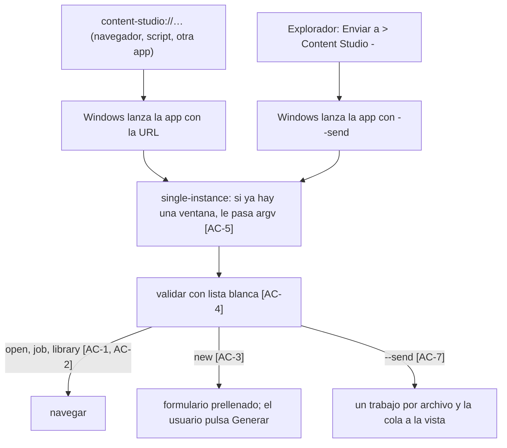

# Spec 031: diseño

> **Decisiones y pendientes al ejecutar**: quien implemente esta spec puede tomar **todas las decisiones técnicas** que necesite, sin detenerse a pedir confirmación.
> Cada una queda anotada en [`docs/process/WARNING/`](../../../process/WARNING/README.md) (ficha `031-<tema>.md` con contexto, elegida, descartadas, cómo revertir y cómo comprobarla, y su fila en el README de la carpeta).
> Toda revisión pendiente queda en [`docs/process/PENDING/`](../../../process/PENDING/README.md) (ficha y fila, con qué la cierra).
>
> **Datos del usuario: solo los que crea esta spec**. La spec no borra ni sobrescribe voces grabadas (`server/data/narration/voz/`), voces construidas, salidas de `out/` ni modelos descargados que ella no creó. Sus pruebas escriben en carpetas nuevas (`out/<herramienta>/spec-031/` o `tmp/spec-031/`). Si algo parece exigir tocar datos existentes, no se decide al ejecutar: es un `blocked — user-data` y se pregunta. Los cambios locales o sin rastrear del checkout principal no son de la spec: no se tocan y no bloquean.

## 1. Flujo

## 2. Superficies

| Superficie | Forma | Resultado | Errores |
| :--- | :--- | :--- | :--- |
| `content-studio://open/<sección>` | una sección de `app/nav.ts` | La sección | Sección desconocida: aviso `deeplink.invalid` |
| `content-studio://job/<id>` · `library/<id>` | id entero | El detalle | No existe: aviso con el error de la API |
| `content-studio://new/<kind>?<params>` | `narration` (`text`, `voice`, `style`), `music` (`style`, `duration`), `media.convert` (`input`, `target`) | El formulario de la sección, prellenado | Parámetro fuera de la lista, ruta inexistente o URL de más de 4096 caracteres: aviso y nada prellenado |
| `<app>.exe --send <acción> <archivo>…` | `convert-mp3`, `normalize`, `clean`, `transcribe`, `editor` | Un trabajo por archivo (o el Editor con los archivos) | Archivo que no existe: se salta y se cuenta en el aviso |
| Ajustes > Sistema > «Iniciar el servidor con Windows» | interruptor | `HKCU\...\Run\ContentStudioServer` = `"<venv>\Scripts\pythonw.exe" -m content_studio api up` | — |

## 3. Datos

* Ajuste `system.start_at_login` (booleano) en `settings`.
* Accesos directos en `%APPDATA%\Microsoft\Windows\SendTo\`: «Content Studio - Convertir a MP3», «- Normalizar», «- Limpiar silencios», «- Transcribir», «- Abrir en el Editor». Los crea y los borra el hook NSIS (`client/src-tauri/installer/nsis/hooks.nsh`).

## 4. Diseño por módulo

### 4.1 `client/src-tauri/`

* `tauri-plugin-single-instance` con la feature `deep-link`, registrado primero, y `tauri-plugin-deep-link` con `plugins.deep-link.desktop.schemes = ["content-studio"]` en `tauri.conf.json` ([Tauri](https://v2.tauri.app/plugin/deep-linking/)).
* El callback reenvía `argv` a la ventana con un evento `external-request`; Rust no interpreta nada.
* `start_at_login(enabled)` escribe o borra el valor `Run` con la crate `windows` (registro de HKCU, sin admin).

### 4.2 `client/src/app/external/`

* `parseExternal(argv: string[]): ExternalRequest | ExternalError` (función pura, probada): lista blanca de acciones y parámetros, enteros para ids, largo máximo.
* `useExternalRequests()`: navega, prellena (estado de cada sección) o encola con el cliente de la API. Nunca encola algo que vino de una URL sin que el usuario pulse el botón de la sección [AC-3]. «Enviar a» sí encola, porque el usuario eligió la acción en el Explorador [AC-7].

## 5. Textos

| Clave en `messages/{es,en,pt}.json` | Texto en es |
| :--- | :--- |
| `deeplink.invalid` | Se ignoró un enlace de otra aplicación porque no es válido. |
| `deeplink.prefilled` | Revisa los datos que trajo el enlace y pulsa {action} para continuar. |
| `sendto.queued` | {count} archivos en la cola. |
| `sendto.skipped` | {count} archivos no existen y se saltaron. |
| `settings.system.start_at_login` | Iniciar el servidor con Windows |
| `settings.system.start_at_login_help` | Útil si usas carpetas de entrada o un asistente sin abrir la app. |
