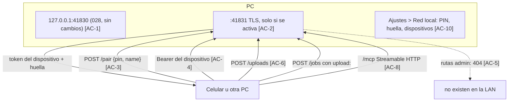

# Spec 032: diseño

> **Decisiones y pendientes al ejecutar**: quien implemente esta spec puede tomar **todas las decisiones técnicas** que necesite, sin detenerse a pedir confirmación.
> Cada una queda anotada en [`docs/process/WARNING/`](../../../process/WARNING/README.md) (ficha `032-<tema>.md` con contexto, elegida, descartadas, cómo revertir y cómo comprobarla, y su fila en el README de la carpeta).
> Toda revisión pendiente queda en [`docs/process/PENDING/`](../../../process/PENDING/README.md) (ficha y fila, con qué la cierra).
>
> **Datos del usuario: solo los que crea esta spec**. La spec no borra ni sobrescribe voces grabadas (`server/data/narration/voz/`), voces construidas, salidas de `out/` ni modelos descargados que ella no creó. Sus pruebas escriben en carpetas nuevas (`out/<herramienta>/spec-032/` o `tmp/spec-032/`). Si algo parece exigir tocar datos existentes, no se decide al ejecutar: es un `blocked — user-data` y se pregunta. Los cambios locales o sin rastrear del checkout principal no son de la spec: no se tocan y no bloquean.

## 1. Flujo



## 2. API de la LAN

Un segundo `uvicorn.Server` en el mismo proceso, con una app armada por `create_app(..., remote=True)`: solo estas rutas.

| Ruta | Permiso | Notas |
| :--- | :--- | :--- |
| `POST /pair` | ninguno (PIN) | `{"pin", "name"}` → `{"token", "fingerprint"}`; el token se muestra una sola vez |
| `GET /health`, `GET /catalog/{kind}`, `GET /voices/profiles` | `jobs` | Lectura |
| `POST /uploads` | `files` | multipart; tope `api.lan.max_upload_mb` (2048) → 413 |
| `POST /jobs` | `jobs` | `kind` en `REMOTE_KINDS`; rutas solo como `upload:<id>` |
| `GET /jobs`, `GET /jobs/{id}`, `POST /jobs/{id}/cancel`, `GET /jobs/{id}/outputs` | `jobs` | Solo los trabajos del dispositivo |
| `GET /files?path=` | `files` | Solo salidas de sus trabajos |
| `/mcp` | `jobs` | Streamable HTTP del SDK, con `Origin` validado; las herramientas de la 029 menos `studio_watch_folder` |

Rutas locales nuevas (solo en 127.0.0.1): `POST /lan/pairing` (crea el PIN), `GET /lan/devices`, `DELETE /lan/devices/{id}`, `GET/PUT /lan/settings`.

## 3. Datos y migración

```sql
CREATE TABLE api_clients (id INTEGER PRIMARY KEY, name TEXT NOT NULL, token_sha256 TEXT NOT NULL UNIQUE,
  scopes TEXT NOT NULL, created_at TEXT NOT NULL, last_seen TEXT, revoked_at TEXT);
CREATE TABLE uploads (id INTEGER PRIMARY KEY, client_id INTEGER NOT NULL REFERENCES api_clients(id),
  path TEXT NOT NULL, size INTEGER NOT NULL, created_at TEXT NOT NULL);
ALTER TABLE jobs ADD COLUMN client_id INTEGER REFERENCES api_clients(id);
```

* Ajustes: `api.lan.enabled` (false), `api.lan.address`, `api.lan.port` (41831), `api.lan.max_upload_mb` (2048), `api.lan.keep_awake` (true).
* Certificado autofirmado `lan-cert.pem` y `lan-key.pem` junto a la base, creados al activar; la huella SHA-256 se muestra en la app y se devuelve al emparejar.
* Subidas en `<carpeta de salidas>/uploads/<client_id>/`.

## 4. Diseño por módulo

### 4.1 `server/src/content_studio/lan/`

* `clients.py`: alta con el hash del token, revocar, `authenticate(token) -> client | None`, `last_seen`.
* `pairing.py`: PIN de 6 dígitos con `secrets`, válido 5 min y de un solo uso; 5 intentos fallidos lo anulan (429).
* `cert.py`: genera el certificado con `cryptography` (importado dentro de la función).
* `guard.py`: `REMOTE_KINDS` (`narration`, `music` y los de `inbox.inputs.INPUT_PARAM`); reemplaza `upload:<id>` por la ruta y rechaza cualquier otro valor que parezca una ruta (`remote_path_not_allowed`).
* `server.py`: arma y levanta el segundo listener con `ssl_certfile`; con `keep_awake`, retiene el `IdleClock`.

### 4.2 `client/src-tauri/src/firewall.rs`

* `firewall_rule(enabled)`: `netsh advfirewall firewall add|delete rule name="Content Studio LAN" dir=in action=allow protocol=TCP localport=<puerto> profile=private` con `ShellExecuteW` y el verbo `runas` (aviso de UAC). Si el usuario lo rechaza, devuelve `firewall_declined`.

### 4.3 `client/src/features/settings/LanPanel.tsx`

* Interruptor, dirección (las IPv4 privadas del equipo), URL, huella, «Emparejar dispositivo» (diálogo con el PIN y la cuenta regresiva) y la lista de dispositivos con «Revocar».

## 5. Textos

| Clave en `messages/{es,en,pt}.json` | Texto en es |
| :--- | :--- |
| `settings.lan.title` | Red local |
| `settings.lan.enable` | Permitir que otros equipos de mi red usen Content Studio |
| `settings.lan.warning` | Solo en redes privadas de confianza. Cada dispositivo necesita emparejarse con un PIN. |
| `settings.lan.address` | Dirección en la red |
| `settings.lan.fingerprint` | Huella del certificado |
| `settings.lan.pair` | Emparejar dispositivo |
| `settings.lan.pin` | PIN: {pin} (vence en {seconds} s) |
| `settings.lan.devices` | Dispositivos emparejados |
| `settings.lan.revoke` | Revocar |
| `settings.lan.firewall_declined` | Windows no abrió el puerto. Permite Content Studio en el firewall para redes privadas o vuelve a intentarlo. |
| `error.pairing_invalid` | El PIN no es válido o venció. |
| `error.pairing_locked` | Demasiados intentos. Genera un PIN nuevo en la app. |
| `error.remote_path_not_allowed` | Desde otro equipo, sube el archivo primero; no se aceptan rutas de esta PC. |
| `error.kind_not_allowed_remote` | Este tipo de trabajo no está disponible desde otro equipo. |
| `error.upload_too_large` | El archivo supera el máximo de {max_mb} MB. |
