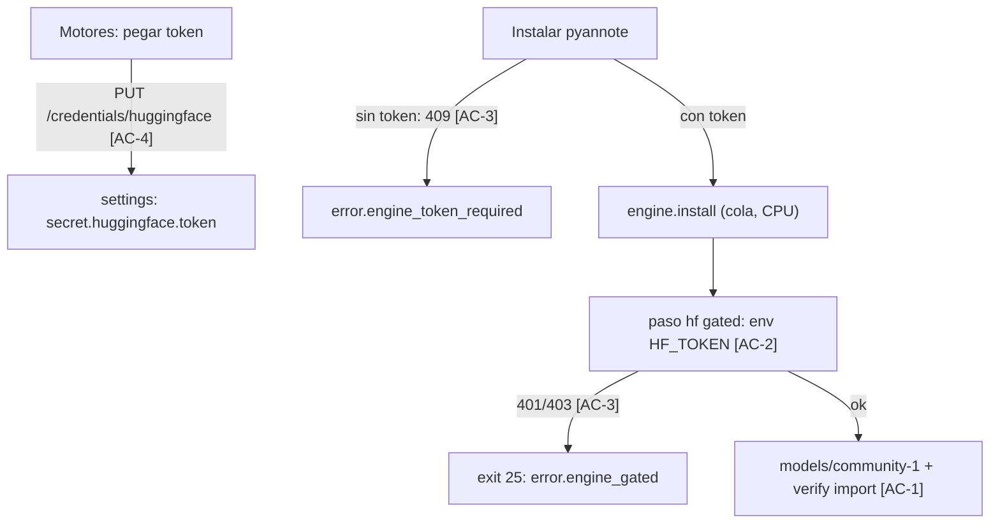

# Spec 034: diseño

> **Decisiones y pendientes al ejecutar**: quien implemente esta spec puede tomar **todas las decisiones técnicas** que necesite, sin detenerse a pedir confirmación.
> Cada una queda anotada en [`docs/process/WARNING/`](../../../process/WARNING/README.md) (ficha `034-<tema>.md` con contexto, elegida, descartadas, cómo revertir y cómo comprobarla, y su fila en el README de la carpeta).
> Toda revisión pendiente queda en [`docs/process/PENDING/`](../../../process/PENDING/README.md) (ficha y fila, con qué la cierra).
>
> **Datos del usuario: solo los que crea esta spec**. La spec no borra ni sobrescribe voces grabadas (`server/data/narration/voz/`), voces construidas, salidas de `out/` ni modelos descargados que ella no creó. Sus pruebas escriben en carpetas nuevas (`out/<herramienta>/spec-034/` o `tmp/spec-034/`). Si algo parece exigir tocar datos existentes, no se decide al ejecutar: es un `blocked — user-data` y se pregunta. Los cambios locales o sin rastrear del checkout principal no son de la spec: no se tocan y no bloquean.

## 1. Flujo



## 2. API

| Superficie | Entrada | Salida | Errores |
| :--- | :--- | :--- | :--- |
| `GET /credentials/huggingface` | — | `{"configured": bool}` | — |
| `PUT /credentials/huggingface` | `{"token": "hf_…"}` | `{"configured": true}` | 422 `error.invalid_token` |
| `DELETE /credentials/huggingface` | — | `{"configured": false}` | — |
| `GET/PUT /settings/secret.*` | — | — | 403 `error.secret_setting` |
| `POST /engines/pyannote/install` | — | trabajo `engine.install` | 409 `error.engine_token_required` |
| Trabajo `engine.install` | — | — | exit 25, `error.engine_gated` |

## 3. Datos

`server/src/content_studio/engines/recipes/pyannote.json` (D-5):

```json
{
  "engine": "pyannote",
  "family": "diarization",
  "size_gb": 6,
  "vram_gb": 2,
  "cpu": true,
  "license": "MIT / CC-BY-4.0",
  "steps": [
    {"kind": "python", "version": "3.14"},
    {"kind": "venv", "path": ".venv-diarize"},
    {"kind": "pip", "packages": ["torch==2.11.0+cu128", "torchaudio==2.11.0+cu128"], "index": "https://download.pytorch.org/whl/cu128"},
    {"kind": "pip", "packages": ["pyannote.audio==4.1.1", "torchcodec==0.17.0", "huggingface-hub==0.36.2"]},
    {"kind": "hf", "repo": "pyannote/speaker-diarization-community-1", "revision": "3533c8cf8e369892e6b79ff1bf80f7b0286a54ee", "into": "models/community-1", "gated": true, "allow_patterns": ["config.yaml", "segmentation/*", "embedding/*", "plda/*"]},
    {"kind": "verify", "import": "pyannote.audio"}
  ]
}
```

* `size_gb` y `vram_gb` son provisionales: la 039 los reemplaza por lo medido.
* Si `huggingface-hub==0.36.2` choca con lo que pide pyannote 4.1.1 (`>=0.28.1`), se sube al mínimo compatible y se registra en `WARNING/034-receta-pyannote`.

No hay migración: el token es una fila de `settings`.

## 4. Diseño por módulo

### 4.1 `engines/recipes.py`

* Se agrega `'diarization'` a `FAMILIES`.
* `OPTIONAL['hf']` suma `gated`, que debe ser booleano.
* `Recipe.gated` es una propiedad: `True` si algún paso `hf` lo declara.

### 4.2 `engines/steps.py` y `installer.py`

* `execute_step(step, …, token=None)`: si `step.get('gated')` y hay token, agrega `HF_TOKEN` al `env` del hijo. Si no es restringido, quita `HF_TOKEN` del `env` heredado, para que nunca se filtre a otros motores.
* `_download` captura `GatedRepoError` y los `HfHubHTTPError` con estado 401 o 403. Escribe en stderr, en inglés y sin el token: `Access denied to <repo>. Accept its conditions on Hugging Face and check the token.`. Luego sale con 25.
* `installer.EXIT_CODES['engine_gated'] = 25`.
* `install` lee el token con `credentials.huggingface_token(conn)` solo si `recipe.gated`.

### 4.3 `credentials.py` (módulo nuevo, solo stdlib)

`huggingface_token(conn) -> str | None`, `set_huggingface_token(conn, token)` y `clear_huggingface_token(conn)`, sobre la tabla `settings` y la clave `secret.huggingface.token`. La validación del formato es un doctest: `^hf_[A-Za-z0-9]{20,}$`.

### 4.4 API

* `api/routes/credentials.py` es nuevo.
* `api/routes/settings.py` responde 403 a `secret.*` en `GET` y `PUT`.
* `api/routes/engines.py` responde 409 `engine_token_required` si la receta es restringida y no hay token.
* El mapeo de exit 25 a `engine_gated` va donde hoy están los demás códigos del instalador.

### 4.5 Client

* `features/engines/EnginesPage.tsx` suma el grupo `['diarization', 'engines.group.diarization']`.
* `features/engines/HfTokenField.tsx` es nuevo (una molécula `UIInput` de tipo contraseña):
  * un botón «Guardar» y, si hay token, el estado «Token guardado» con «Quitar»;
  * el enlace `https://huggingface.co/pyannote/speaker-diarization-community-1`, que abre en el navegador con el *opener* de Tauri, como los demás enlaces externos;
  * se muestra en la tarjeta si el motor viene marcado como restringido (`GET /engines` agrega `gated: true`).
* `EngineCard` deshabilita «Instalar» si `gated && !configured`.
* `features/settings/About.tsx` (o el componente actual de «Acerca de») muestra la atribución.

## 5. Textos

| Clave | Texto en es |
| :--- | :--- |
| `engines.group.diarization` | Diarización |
| `engines.hf.token` | Token de Hugging Face |
| `engines.hf.save` | Guardar token |
| `engines.hf.saved` | Token guardado |
| `engines.hf.remove` | Quitar |
| `engines.hf.accept` | Acepta las condiciones del modelo en Hugging Face |
| `engines.hf.help` | Crea un token de lectura en huggingface.co/settings/tokens con la misma cuenta con la que aceptaste las condiciones. |
| `error.engine_token_required` | Este motor necesita tu token de Hugging Face. Pégalo en su tarjeta antes de instalar. |
| `error.engine_gated` | Hugging Face no dio acceso al modelo. Acepta sus condiciones con tu cuenta y revisa que el token sea de esa cuenta. |
| `error.invalid_token` | El token no tiene el formato de Hugging Face (empieza con hf_). |
| `error.secret_setting` | Este ajuste es privado y no se puede leer ni escribir por aquí. |
| `settings.about.diarization` | Diarización: modelo pyannote/speaker-diarization-community-1 de pyannote, licencia CC BY 4.0. Biblioteca pyannote.audio, licencia MIT. |
