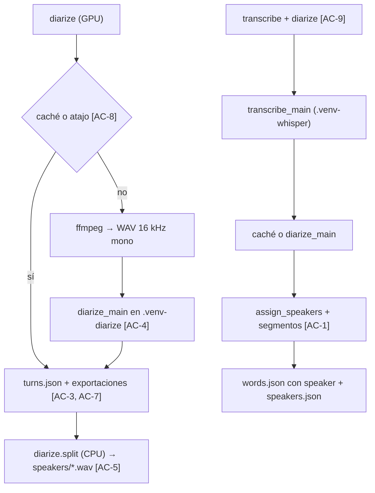

# Spec 035: diseño

> **Decisiones y pendientes al ejecutar**: quien implemente esta spec puede tomar **todas las decisiones técnicas** que necesite, sin detenerse a pedir confirmación.
> Cada una queda anotada en [`docs/process/WARNING/`](../../../process/WARNING/README.md) (ficha `035-<tema>.md` con contexto, elegida, descartadas, cómo revertir y cómo comprobarla, y su fila en el README de la carpeta).
> Toda revisión pendiente queda en [`docs/process/PENDING/`](../../../process/PENDING/README.md) (ficha y fila, con qué la cierra).
>
> **Datos del usuario: solo los que crea esta spec**. La spec no borra ni sobrescribe voces grabadas (`server/data/narration/voz/`), voces construidas, salidas de `out/` ni modelos descargados que ella no creó. Sus pruebas escriben en carpetas nuevas (`out/<herramienta>/spec-035/` o `tmp/spec-035/`). Si algo parece exigir tocar datos existentes, no se decide al ejecutar: es un `blocked — user-data` y se pregunta. Los cambios locales o sin rastrear del checkout principal no son de la spec: no se tocan y no bloquean.

## 1. Flujo



## 2. Trabajos, CLI y API

| Superficie | Entrada | Salida | Errores |
| :--- | :--- | :--- | :--- |
| `POST /jobs` con `kind: diarize` | `{input, num_speakers? , min_speakers?, max_speakers?}` | `out/diarize/<AAAA-MM-DD>-<id>-<slug>/`: `turns.json`, `turns.rttm`, `turns.csv`, `speakers.json`, `embeddings.json` | `file_not_found`, `invalid_speakers`, `engine_not_installed` |
| `POST /jobs` con `kind: diarize.split` | `{job: <id del diarize>}` | `speakers/<SPEAKER_NN>.wav` dentro de la carpeta de ese trabajo | `job_not_found`, `not_a_diarization` |
| `POST /jobs` con `kind: transcribe` | lo de hoy más `diarize?, num_speakers?, min_speakers?, max_speakers?` | `words.json` con `speaker` y `speakers.json` | los de hoy, más los de `diarize` |
| `uv run studio diarize <archivo> [--speakers N] [--min-speakers A --max-speakers B]` | — | la carpeta del trabajo en stdout | exit 2 con un mensaje en inglés |

## 3. Datos y migración

Migración nueva en `db/schema.py`, al final de `MIGRATIONS`:

```sql
CREATE TABLE diarizations (
  id INTEGER PRIMARY KEY,
  source_path TEXT NOT NULL,
  mtime REAL NOT NULL,
  size INTEGER NOT NULL,
  speakers TEXT NOT NULL,          -- 'auto', '2' o '2-5'
  json_path TEXT NOT NULL,
  created_at TEXT NOT NULL,
  UNIQUE (source_path, mtime, size, speakers)
);
```

Archivos de una carpeta de trabajo:

```text
turns.json        {"duration": 312.4, "speakers": ["SPEAKER_00", ...],
                   "diarization": [{"start", "end", "speaker"}],
                   "exclusive_diarization": [{"start", "end", "speaker"}]}
speakers.json     {"SPEAKER_00": {"name": "Hablante 1", "color": "#2563eb"}, ...}
embeddings.json   {"SPEAKER_00": [floats], ...}
turns.rttm, turns.csv
words.json        (transcribe) palabras y segmentos con "speaker"
```

* La paleta, en orden: `#2563eb`, `#dc2626`, `#16a34a`, `#d97706`, `#9333ea`, `#0891b2`, `#db2777` y `#65a30d`. Después del octavo se repite.
* La 036 valida el contraste en claro y oscuro; si no pasa, cambia la paleta en `WARNING`.
* El nombre inicial sale de `speakers.default_name(i)`: `Hablante {n}`. Va en el catálogo con la clave `speakers.default_name` y el idioma de la API.

## 4. Diseño por módulo

### 4.1 `diarization/assign.py` y `blocks.py` (stdlib)

* `assign_speakers(words, turns, max_gap=1.0) -> list[dict]`, con la forma de la [investigación 04 §4](../../../research/diarizacion-pyannote/04-integracion-con-faster-whisper.md).
* `segment_speaker(words) -> str | None`: el hablante con más duración del segmento.
* `blocks(words, absorb_gap=0.3) -> list[dict]`, de la forma `{speaker, start, end, words}`.

### 4.2 `diarization/exports.py` (stdlib)

`rttm(turns, uri)`, `csv_text(turns, speakers)` y `write_all(folder, result, speakers)`.

### 4.3 `diarization/diarize_main.py`

* Argumentos: `--input <wav 16k>`, `--out <carpeta>`, `--speakers`, `--min-speakers` y `--max-speakers`.
* `main()`, en este orden:
  1. `use_venv(...)` con la receta `pyannote`.
  2. Fija `os.environ` para la telemetría y el modo offline, antes de importar.
  3. Lee el WAV con `wave` y `numpy.frombuffer`, y arma el tensor `(1, n)` en float32.
  4. `Pipeline.from_pretrained(<engine_root>/models/community-1)`.
  5. `.cuda()` si `torch.cuda.is_available()`.
  6. `embedding_batch_size = 4`.
  7. El `hook` mapea las etapas a `progress.emit`: `segmentation` de 0 a 0,5 y `embeddings` de 0,5 a 0,95.
  8. Escribe `serialize()` más `duration`, `speakers` y `embeddings`.
* Un archivo sin voz devuelve listas vacías, sin error.

### 4.4 `diarization/speaker_audio.py` (stdlib)

* `split_command(source, turns, speaker, out) -> list[str]`: `ffmpeg -i <source> -af "volume=enable='not(between(t,a,b)+between(t,c,d)…)':volume=0" -c:a pcm_s16le <out>`.
* Si el filtro supera unos 30 000 caracteres, el filtro va en un archivo con `-filter_script:a`.
* Para evitar clics, el borde lleva una rampa de 10 ms (`afade` por tramo, o `volume` con `eval` por cuadro). Se elige con la medición y va a `WARNING/035-audio-por-hablante`.

### 4.5 `diarization/cache.py` (stdlib)

`find(conn, path, speakers)` y `store(...)`, con el patrón de `transcription/cache.py`.

### 4.6 `diarization/run.py` (stdlib, Python del server)

`diarize_file(source, out_dir, speakers, emit) -> dict`:

1. caché;
2. atajo (D-7);
3. ffmpeg a 16 kHz mono;
4. subproceso `diarize_main` con el progreso reenviado y reescalado;
5. guarda en caché;
6. `speakers.json` y exportaciones.

La usan `services/diarize` (a través de `diarization/job_main.py`), `transcribe_speakers_main` y la 038.

### 4.7 Servicios, CLI y verificación

* `services/diarize.py`: `RESOURCE='gpu'`; el comando es `content_studio.diarization.job_main`.
* `services/diarize_split.py`: `KIND='diarize.split'` y `RESOURCE='cpu'`.
* `services/transcribe.py`: si `diarize`, el comando es `content_studio.diarization.transcribe_speakers_main`.
* `cli/diarize.py` y una línea en `cli/main.build_parser`.
* `engines/verification.py`: rama `diarization`.

## 5. Textos

| Clave | Texto en es |
| :--- | :--- |
| `speakers.default_name` | Hablante {n} |
| `error.invalid_speakers` | El número de hablantes debe estar entre 1 y 20, y el mínimo no puede ser mayor que el máximo. |
| `error.not_a_diarization` | Ese trabajo no tiene turnos de hablantes. |
| `jobs.stage.diarizing` | Identificando hablantes |
