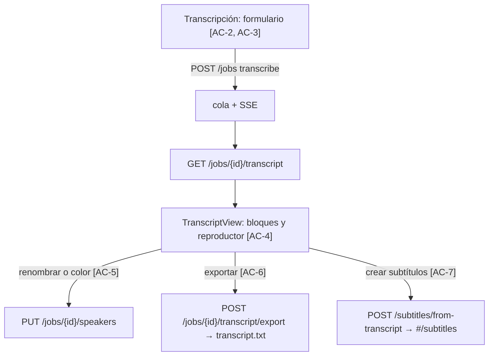

# Spec 036: diseño

> **Decisiones y pendientes al ejecutar**: quien implemente esta spec puede tomar **todas las decisiones técnicas** que necesite, sin detenerse a pedir confirmación.
> Cada una queda anotada en [`docs/process/WARNING/`](../../../process/WARNING/README.md) (ficha `036-<tema>.md` con contexto, elegida, descartadas, cómo revertir y cómo comprobarla, y su fila en el README de la carpeta).
> Toda revisión pendiente queda en [`docs/process/PENDING/`](../../../process/PENDING/README.md) (ficha y fila, con qué la cierra).
>
> **Datos del usuario: solo los que crea esta spec**. La spec no borra ni sobrescribe voces grabadas (`server/data/narration/voz/`), voces construidas, salidas de `out/` ni modelos descargados que ella no creó. Sus pruebas escriben en carpetas nuevas (`out/<herramienta>/spec-036/` o `tmp/spec-036/`). Si algo parece exigir tocar datos existentes, no se decide al ejecutar: es un `blocked — user-data` y se pregunta. Los cambios locales o sin rastrear del checkout principal no son de la spec: no se tocan y no bloquean.

## 1. Flujo

## 2. API

| Superficie | Entrada | Salida | Errores |
| :--- | :--- | :--- | :--- |
| `GET /jobs/{id}/transcript` | — | `{source, duration, segments, speakers}`: `words.json` más `speakers.json` (o `{}`) | 404 `job_not_found`, 409 `no_transcript` |
| `GET /jobs/{id}/speakers` | — | `{"SPEAKER_00": {"name", "color"}}` | 404, 409 `not_a_diarization` |
| `PUT /jobs/{id}/speakers` | el mismo mapa (solo ids existentes) | el mapa guardado | 422 `invalid_speaker_name|invalid_color` |
| `POST /jobs/{id}/transcript/export` | `{"timestamps": bool}` | `{"path": ".../transcript.txt"}` | 409 `no_transcript` |

* Las rutas van en `api/routes/speakers.py`.
* `PUT /speakers` también regenera `turns.csv` si existe, para que lleve los nombres nuevos (la 037 lo necesita).

## 3. Datos

No hay migración. Archivos de la 035: `words.json` y `speakers.json`.

## 4. Diseño por módulo

### 4.1 Server

* `diarization/transcript_text.py` (stdlib): `transcript_text(words_payload, speakers, timestamps) -> str`. Usa `blocks.blocks` de la 035, y `hh:mm:ss` va como doctest.
* `api/routes/speakers.py`: ubica la carpeta del trabajo con la tabla `jobs`, valida y escribe `speakers.json` de forma atómica (archivo temporal y `os.replace`).

### 4.2 Client

* `app/nav.ts`: `{id: 'transcription', group: 'nav.group.edit', icon: 'transcription'}`, y la entrada perezosa en `Shell.tsx`.
* `features/transcription/TranscriptionPage.tsx`: el formulario y, si hay un trabajo, `TranscriptView`.
* `features/transcription/TranscriptionForm.tsx`: archivo (selector como en Convertir), `UIWhisperModelSelect`, idioma (las mismas opciones que el Limpiador), `UISwitch` «Identificar hablantes» y `UISpeakerCountField`.
* `features/transcription/TranscriptView.tsx`:
  * reproductor con `useSyncedMedia`;
  * bloques con nombre y color (borde izquierdo de 4 px y nombre en negrita);
  * palabras como `UIButton` de tipo texto;
  * la barra con «Exportar texto» (y la casilla «Con marcas de tiempo»), «Abrir carpeta» y «Crear subtítulos».
* `shared/components/molecules/UISpeakerCountField/`: un selector de modo (automático, exacto o rango) y números del 1 al 20. Devuelve `{num_speakers}`, `{min_speakers, max_speakers}` o `{}`.
* `shared/components/molecules/UISpeakerLegend/`: una fila por hablante con una muestra de color (`UIColorPicker`, o un `input` de tipo color dentro de un átomo), un nombre editable y la duración total. Llama a `onChange(map)`.
* `shared/hooks/useSpeakers.ts`: `useQuery` y `useMutation` de `/jobs/{id}/speakers`.
* Estados: cargando (esqueleto), vacío (sin palabras: «No se detectó voz»), error (el mensaje de la API) y en cola (progreso).

## 5. Textos

| Clave | Texto en es |
| :--- | :--- |
| `nav.transcription` | Transcripción |
| `transcription.title` | Transcribir un archivo |
| `transcription.diarize` | Identificar hablantes |
| `transcription.diarize.missing` | Instala el motor de diarización para identificar hablantes |
| `transcription.start` | Transcribir |
| `transcription.export.txt` | Exportar texto |
| `transcription.export.timestamps` | Con marcas de tiempo |
| `transcription.to_subtitles` | Crear subtítulos |
| `transcription.empty` | No se detectó voz en el archivo |
| `speakers.count.auto` | Automático |
| `speakers.count.exact` | Exacto |
| `speakers.count.range` | Entre |
| `speakers.legend.title` | Hablantes |
| `speakers.legend.rename` | Nombre del hablante |
| `speakers.legend.color` | Color de {name} |
| `error.invalid_speaker_name` | El nombre debe tener entre 1 y 40 caracteres. |
| `error.invalid_color` | El color debe tener el formato #rrggbb. |
