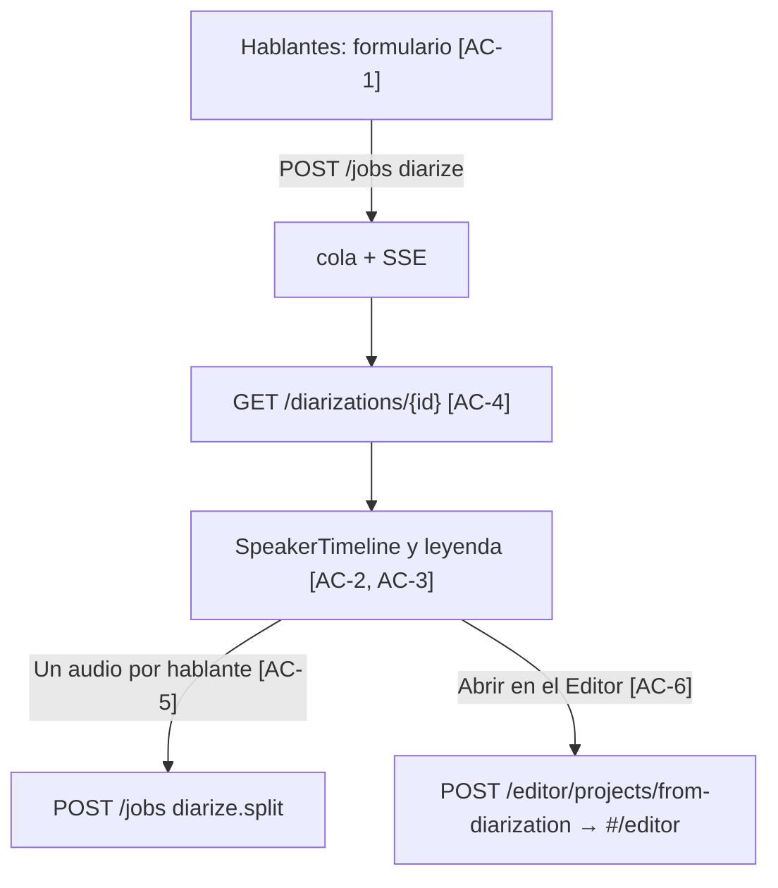

# Spec 037: diseño

> **Decisiones y pendientes al ejecutar**: quien implemente esta spec puede tomar **todas las decisiones técnicas** que necesite, sin detenerse a pedir confirmación.
> Cada una queda anotada en [`docs/process/WARNING/`](../../../process/WARNING/README.md) (ficha `037-<tema>.md` con contexto, elegida, descartadas, cómo revertir y cómo comprobarla, y su fila en el README de la carpeta).
> Toda revisión pendiente queda en [`docs/process/PENDING/`](../../../process/PENDING/README.md) (ficha y fila, con qué la cierra).
>
> **Datos del usuario: solo los que crea esta spec**. La spec no borra ni sobrescribe voces grabadas (`server/data/narration/voz/`), voces construidas, salidas de `out/` ni modelos descargados que ella no creó. Sus pruebas escriben en carpetas nuevas (`out/<herramienta>/spec-037/` o `tmp/spec-037/`). Si algo parece exigir tocar datos existentes, no se decide al ejecutar: es un `blocked — user-data` y se pregunta. Los cambios locales o sin rastrear del checkout principal no son de la spec: no se tocan y no bloquean.

## 1. Flujo

## 2. API

| Superficie | Entrada | Salida | Errores |
| :--- | :--- | :--- | :--- |
| `GET /diarizations/{job_id}` | — | `{source, duration, turns, exclusive_turns, speakers, files: {json, rttm, csv}, split: {SPEAKER_00: path, …} | null}` | 404 `job_not_found`, 409 `not_a_diarization` |
| `POST /editor/projects/from-diarization` | `{"job": id}` | `{"project": "<ruta de project.json>"}` | 404, 409 `not_a_diarization` |

## 3. Datos

No hay migración. El proyecto del Editor sigue el esquema v3 (`editor/schema.py`): `markers: [{id, time, label}]`, o los campos que defina el esquema vigente al implementar, que manda.

## 4. Diseño por módulo

### 4.1 Server

* `api/routes/diarizations.py`: lee la carpeta del trabajo y lista `speakers/*.wav`.
* `editor/from_diarization.py`: `project_from_diarization(source, duration, exclusive_turns, speakers, min_turn=0.5) -> dict`, una función pura sobre la plantilla de `store.new_project` (o su equivalente). La ruta la guarda con `store` en `out/editor/<fecha>-<slug>/`.

### 4.2 Client

* `app/nav.ts` y `Shell.tsx`: la sección `speakers`.
* `features/speakers/SpeakersPage.tsx`: el formulario o el resultado, con `useFromJob`.
* `features/speakers/SpeakersForm.tsx`: archivo y `UISpeakerCountField`.
* `features/speakers/SpeakerTimeline.tsx`:
  * WaveSurfer con los picos de `/media/peaks`;
  * el plugin de regiones con `drag: false, resize: false`;
  * el color de cada región con alfa de 0,35 y su etiqueta con el nombre;
  * el estado `focusSpeaker` y los atajos ← y →.
* `features/speakers/SpeakerFiles.tsx`:
  * la lista de archivos con «Abrir carpeta»;
  * el botón «Un audio por hablante» (o el progreso del trabajo `diarize.split`);
  * un `UIAudioPlayer` por WAV;
  * «Abrir en el Editor».
* Estados: en cola, error, sin voz («No se detectó voz») y un solo hablante (la leyenda con uno y sin el botón de dividir).

## 5. Textos

| Clave | Texto en es |
| :--- | :--- |
| `nav.speakers` | Hablantes |
| `speakers.title` | Identificar quién habla y cuándo |
| `speakers.start` | Identificar |
| `speakers.focus` | Solo este hablante |
| `speakers.files.title` | Archivos de turnos |
| `speakers.files.open_folder` | Abrir carpeta |
| `speakers.split` | Un audio por hablante |
| `speakers.split.running` | Separando audios… |
| `speakers.to_editor` | Abrir en el Editor |
| `speakers.empty` | No se detectó voz en el archivo |
| `speakers.total_time` | {time} en total |
