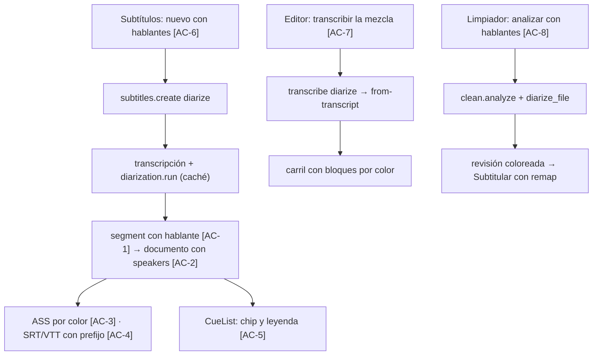

# Spec 038: diseño

> **Decisiones y pendientes al ejecutar**: quien implemente esta spec puede tomar **todas las decisiones técnicas** que necesite, sin detenerse a pedir confirmación.
> Cada una queda anotada en [`docs/process/WARNING/`](../../../process/WARNING/README.md) (ficha `038-<tema>.md` con contexto, elegida, descartadas, cómo revertir y cómo comprobarla, y su fila en el README de la carpeta).
> Toda revisión pendiente queda en [`docs/process/PENDING/`](../../../process/PENDING/README.md) (ficha y fila, con qué la cierra).
>
> **Datos del usuario: solo los que crea esta spec**. La spec no borra ni sobrescribe voces grabadas (`server/data/narration/voz/`), voces construidas, salidas de `out/` ni modelos descargados que ella no creó. Sus pruebas escriben en carpetas nuevas (`out/<herramienta>/spec-038/` o `tmp/spec-038/`). Si algo parece exigir tocar datos existentes, no se decide al ejecutar: es un `blocked — user-data` y se pregunta. Los cambios locales o sin rastrear del checkout principal no son de la spec: no se tocan y no bloquean.

## 1. Flujo



## 2. Parámetros y API

| Superficie | Cambio |
| :--- | :--- |
| `subtitles.create` | `diarize?`, `num_speakers?`, `min_speakers?`, `max_speakers?`, y ahora también `model` y `language` desde la app |
| `POST /subtitles/from-transcript` | Si el `words.json` trae `speaker` y existe `speakers.json`, los copia al documento |
| `POST /subtitles/{id}/export` | `speaker_labels?: bool` |
| `clean.analyze` | `diarize?` y los parámetros de hablantes. `cuts.json` suma `diarization: <ruta de turns.json>` |
| `GET /clean/...` (la revisión) | Las palabras con `speaker` y el mapa `speakers` |

## 3. Datos

No hay migración. El documento de subtítulos sigue en `version: 1` (D-1):

```json
{"speakers": {"SPEAKER_00": {"name": "Ana", "color": "#2563eb"}},
 "cues": [{"id": "c1", "start": 0.0, "end": 2.1, "text": "Hola", "speaker": "SPEAKER_00", "words": [...]}]}
```

## 4. Diseño por módulo

### 4.1 Server

* `subtitles/segment.py`: antes de cortar por puntuación, separa las palabras en grupos consecutivos por `speaker` y segmenta cada grupo como hoy.
* `subtitles/document.py`: `_cue_from_words` toma el hablante; `split` y `merge` lo conservan; `set_speaker(doc, cue_id, speaker)` es nuevo.
* `subtitles/sources.py` y `create_main.py`: `from_words` y `from_cleaner` propagan `speaker`. Con `diarize`, `create_main` llama a `diarization.run.diarize_file` después de transcribir y une con `assign_speakers`. Todo pasa en el mismo proceso del trabajo, que ya tiene el turno de la GPU.
* `subtitles/ass.py`: `_classic` y `_social` agregan `\1c` por evento. Los colores van de `#rrggbb` a `&HBBGGRR&` (doctest).
* `subtitles/formats.py`: el parámetro `speaker_labels`.
* `clean/analyze_main.py`: con `diarize`, `diarize_file` sobre el original y `assign_speakers` sobre las palabras. `cuts.json` guarda la ruta de los turnos.
* `api/routes/clean.py`: la revisión entrega `speaker` y `speakers`.
* El nombre del hablante en el prefijo sale de `document.speakers[speaker].name`.

### 4.2 Client

* `features/subtitles/cues.ts`: `CueEdit.speaker?`; `splitCue`, `mergeCues` y `setCueSpeaker`.
* `features/subtitles/CueList.tsx`: un chip (`UIBadge` con el color y el nombre) con un menú de los hablantes del documento.
* `features/subtitles/SubtitlesEditor.tsx`: `UISpeakerLegend` si hay hablantes, y la casilla «Incluir nombres» en exportar.
* `features/subtitles/ass.ts`: el mismo color por evento que el server.
* `features/subtitles/SubtitlesPage.tsx`: `UIWhisperModelSelect`, idioma, el interruptor y `UISpeakerCountField` con el origen `file`.
* `features/editor/SubtitleTracksPanel.tsx`: el interruptor y el número.
* `features/editor/timeline/SubtitleLane.tsx` (nuevo): bloques por cue, con la posición de `Timeline`.
* `features/cleaner/CleanerPage.tsx`: el interruptor.
* `features/cleaner/CleanReview.tsx`: el color por palabra (subrayado de 3 px con el color del hablante) y la leyenda de solo lectura con los nombres.

## 5. Textos

| Clave | Texto en es |
| :--- | :--- |
| `subtitles.home.diarize` | Identificar hablantes |
| `subtitles.cues.speaker` | Hablante del subtítulo |
| `subtitles.export.speaker_labels` | Incluir nombres |
| `editor.subtitles.diarize` | Identificar hablantes |
| `cleaner.diarize` | Identificar hablantes |
| `cleaner.review.speakers` | Hablantes |
