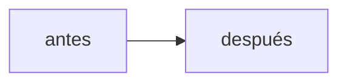

# <NN>: contexto y decisión

> **Decisiones y pendientes al ejecutar**: quien implemente esta spec puede tomar **todas las decisiones técnicas** que necesite, sin detenerse a pedir confirmación. Cada una queda en [`docs/process/WARNING/`](../../process/WARNING/README.md); toda revisión pendiente, en [`docs/process/PENDING/`](../../process/PENDING/README.md).
>
> **Datos del usuario: solo los que crea esta spec**. No borra ni sobrescribe voces grabadas, voces construidas, salidas de `out/` ni modelos que no creó; si algo parece exigirlo, es un `blocked — user-data`.

## 1. Precondición (si aplica)

<Spec de la que depende y cómo comprobarla contra `origin/dev`: `git show origin/dev:<ruta> | ...`.>

## 2. Contexto

<La necesidad o el defecto, y lo que encontró la exploración: archivos, funciones (`ruta:línea` del grafo), mediciones actuales (tiempos, VRAM, LUFS).>

## 3. Solución

Una sola. Cada decisión pasó la escalera de `plan-format.md` §0 (¿debe existir? ¿ya existe? ¿stdlib o una dependencia que ya está?):

* **D-1: <qué>** — <por qué; qué alternativa más simple se descartó y por qué no alcanza>.

## 4. Fuera de alcance

* <Lo que esta spec deliberadamente no hace; lo pendiente va a `docs/process/02-next/` o `PENDING/`.>

## 5. Criterios de aceptación

* **AC-1**: WHEN <acción> THEN <resultado observable>. Lo verifica: <test o medición>.
* **AC-2**: Given <estado> When <acción> Then <resultado>.

## 6. Diagrama antes y después (si cambia un flujo)

## 7. Debe sonar / no debe sonar (si toca la salida de audio)

| Salida | Debe | No debe |
| :--- | :--- | :--- |
| <comando y archivo> | <duración, LUFS, carácter> | <voz en la música, cortes, clipping, silencios> |
