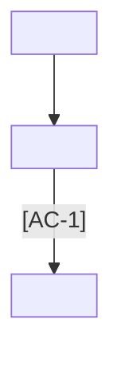

# Spec <NN>: diseño

> **Decisiones y pendientes al ejecutar**: quien implemente esta spec puede tomar **todas las decisiones técnicas** que necesite, sin detenerse a pedir confirmación.
> Cada una queda anotada en [`docs/process/WARNING/`](../../process/WARNING/README.md) (ficha `<NN>-<tema>.md` con contexto, elegida, descartadas, cómo revertir y cómo comprobarla, y su fila en el README de la carpeta).
> Toda revisión pendiente queda en [`docs/process/PENDING/`](../../process/PENDING/README.md) (ficha y fila, con qué la cierra).
>
> **Datos del usuario: solo los que crea esta spec**. La spec no borra ni sobrescribe voces grabadas (`server/data/narration/voz/`), voces construidas, salidas de `out/` ni modelos descargados que ella no creó. Sus pruebas escriben en carpetas nuevas (`out/<herramienta>/spec-<NN>/` o `tmp/spec-<NN>/`). Si algo parece exigir tocar datos existentes, no se decide al ejecutar: es un `blocked — user-data` y se pregunta. Los cambios locales o sin rastrear del checkout principal no son de la spec: no se tocan y no bloquean.

<Diseño transversal a todas las fases. Lo que es propio de una sola fase va en su plan-tdd.md. Borra las secciones que no apliquen.>

## 1. Flujo antes y después

<Mermaid o ASCII; marca con [AC-n] la rama que cubre cada criterio.>

## 2. CLI y API

| Superficie | Entrada | Salida | Errores |
| :--- | :--- | :--- | :--- |
| `uv run studio <comando> <flags>` | <flags en inglés> | `out/<tipo>/<AAAA-MM-DD>-<id>-<slug>/` | <exit code y mensaje> |
| `<POST /recurso>` | <cuerpo> | <respuesta> | `error.<código>` |

## 3. Datos y migración

<Tablas de `var/content-studio.db` (migración SQL que solo agrega), `params.json`, recetas de motores. Si no, «no aplica».>

## 4. Diseño por módulo

### 4.1 <server: `server/src/content_studio/<módulo>/`>

<Firma pública, comportamiento paso a paso, casos borde y lo que no cambia. Qué se importa dentro de funciones (dos capas).>

### 4.2 <client: `client/src/<feature>/`>

<Componentes, hooks y estados (cargando, vacío, error).>

## 5. Textos

| Clave en `messages/{es,en,pt}.json` | Texto en es |
| :--- | :--- |
| `<area>.<clave>` | <texto> |
